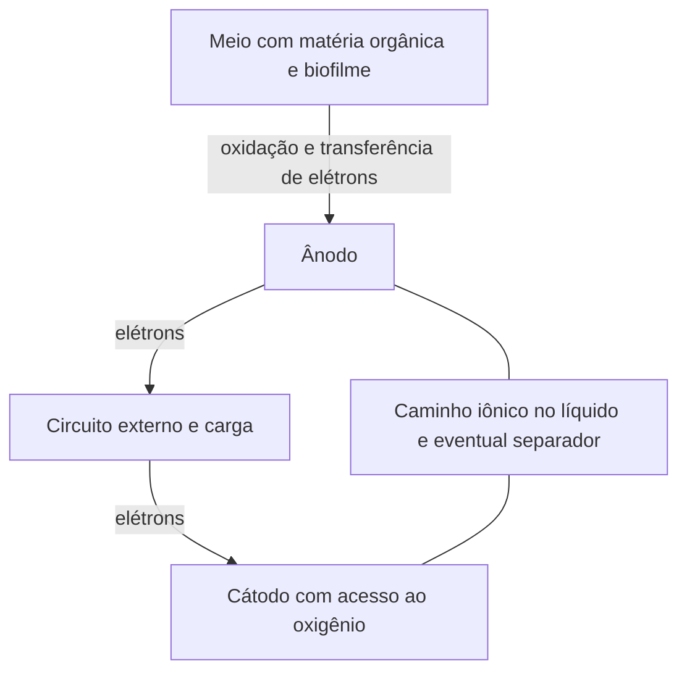

# MFC Studio — guia de engenharia, materiais e modelagem

**Uma leitura para entender a célula, acompanhar seus balanços e saber até onde confiar em uma previsão.**

Revisão editorial em **9 de novembro de 2026**. O projeto mantém o núcleo `mfc-kernel/0.2.0` e a base publicada `mfc-corpus/0.4.0`, conferida em 2 de novembro. A literatura usa o [catálogo único de publicações](#catalogo-unico). O histórico de busca fica recolhido na seção 12.

Este guia reúne o conteúdo dos onze arquivos que antes estavam separados em `docs`. O texto principal foi reescrito para uma leitura de engenharia. Inventários, números de verificação e registros originais ficam em anexos recolhíveis no final, dentro deste mesmo documento.

## Como usar esta leitura

Se você está retomando o assunto, leia primeiro as seções 1 a 6. Elas ligam a experiência em materiais ao funcionamento eletroquímico e biológico. Depois avance para as equações, na seção 8, acompanhando o exemplo da seção 9. Para trabalhar diretamente com artigos e fichas, comece pelas seções 11 e 12. O roteiro da seção 14 propõe exercícios sem exigir programação.

Não é necessário decorar todas as fórmulas. A primeira meta é conseguir responder: **o que está se movendo, por onde passa, o que limita esse movimento e qual medição sustentaria a relação que estou usando?**

### Sumário

1. [A pergunta que o Studio procura responder](#objetivo)
2. [O que existe hoje e o que continua em aberto](#estado)
3. [Como uma MFC funciona](#funcionamento)
4. [Arquiteturas: o desenho muda os balanços](#arquiteturas)
5. [As onze etapas e suas relações](#etapas)
6. [Materiais: da fabricação ao comportamento da célula](#materiais)
7. [Como transformar uma pergunta de engenharia em um modelo](#construir-modelo)
8. [As equações que o núcleo atual resolve](#equacoes)
9. [Um exemplo de cálculo explicado](#exemplo)
10. [Como ler curvas, perdas e diagnósticos](#resultados)
11. [Como transformar literatura e fichas em dados utilizáveis](#dados)
12. [O que os estudos já reunidos permitem aprender](#estudos)
13. [Calibração, validação e confiança na previsão](#validacao)
14. [Roteiro de aprendizado e exercícios](#aprendizado)
15. [Próximas decisões científicas](#continuidade)
16. [Referências e localização dos materiais de apoio](#referencias)
17. [História do projeto, preservação e limites de acesso](#historico)
18. [Glossário de consulta](#glossario)
19. [Anexos de parâmetros e rastreabilidade](#anexos)

<a id="objetivo"></a>
## 1. A pergunta que o Studio procura responder

O MFC Studio é um laboratório digital de **células a combustível microbianas**, chamadas de MFCs pela sigla em inglês. A intenção é investigar configurações, compreender por que uma escolha altera o resultado e selecionar hipóteses que mereçam um protótipo ou ensaio pequeno.

Uma pergunta útil seria: “Se eu usar este feltro comercial como ânodo, nesta geometria, com este meio e este cátodo, qual perda provavelmente será importante? Qual propriedade preciso conhecer antes de comprar ou montar a célula?”. A resposta depende do conjunto. O material mais condutor pode trazer pouca melhora se o transporte iônico no líquido ou a reação no cátodo dominar as perdas.

O recorte definido para esta fase é **selecionar materiais comerciais usando literatura e fichas técnicas, com atenção a custo e disponibilidade**. Isso aproveita a formação em engenharia de materiais e estabelece uma entrada concreta para estudar a eletroquímica e a microbiologia necessárias.

O objetivo de longo prazo inclui investigar combinações ainda não ensaiadas diretamente em artigos. Para isso, será preciso conectar composição, fabricação, microestrutura e propriedades medidas às relações físicas da célula. Não basta atribuir um coeficiente a cada nome de material ou copiar o pico de potência de um artigo.

Há três perguntas diferentes que devem acompanhar qualquer resultado:

| Pergunta | Exemplo |
|---|---|
| O que sabemos a partir de uma fonte ou medição? | A ficha informa resistência em determinada direção e pressão. |
| O que estamos propondo como representação? | Representar o percurso eletrônico por uma resistência equivalente. |
| O que ainda precisa ser demonstrado? | Que essa resistência e as demais relações reproduzem uma célula real, inclusive fora dos dados usados no ajuste. |

O baixo erro é uma meta de validação. A quantidade de artigos reunidos, o número de propriedades cadastradas e a aparência da interface não demonstram essa precisão.

<a id="estado"></a>
## 2. O que existe hoje e o que continua em aberto

### 2.1 Uma aplicação utilizável e um modelo ainda exploratório

O Studio é independente do METREV completo. A aplicação possui uma página inicial explicativa, um simulador com acesso pela conta ChatGPT, montagem guiada em onze etapas, desenho selecionável, painel científico e persistência dos cenários. As explicações, equações, hipóteses e diagnósticos devem permanecer reunidos no painel científico, que pode ser minimizado e expandido.

O produto foi definido sem chat ou agente dentro da aplicação e sem plugin MCP para conversar com ela. A interface deve permitir voltar ao início, avançar e retornar entre etapas, fechar painéis, retornar ao desenho e sair da sessão. O desenho precisa manter componentes identificáveis e selecionáveis sem esconder os vizinhos. São decisões de uso do laboratório, preservadas nesta consolidação.

O núcleo de cálculo representa uma família específica: **monocâmara, sem membrana separadora, acetato como substrato, consórcio microbiano misto, cátodo a ar ambiente, batelada, pH 7 tamponado e 25 °C**. Ele calcula perdas elétricas, limitações de corrente e evolução de DQO, carga e energia. Seus parâmetros iniciais são hipóteses de exploração. Ainda não houve ajuste experimental que transforme esse conjunto em um preditor validado.

Configurações fora dessa família podem ser registradas, mas a previsão é declarada indisponível quando faltam as relações correspondentes. Essa distinção evita que uma configuração de duas câmaras, por exemplo, receba números produzidos por balanços de outra arquitetura.

### 2.2 O significado dos números da base

| Conteúdo no corpus 0.4.0 | Quantidade | Como interpretar |
|---|---:|---|
| Etapas de configuração | 11 | Estrutura do sistema. |
| Propriedades propostas no catálogo | 110 | Perguntas e campos pertinentes; não são 110 leis físicas implementadas. |
| Campos numéricos do núcleo | 39 | Incluem entradas de cálculo, condições fixas, limites de uso e propriedades apenas registradas. |
| Fontes indexadas | 29 | Misturam estudos, modelos, dados, fornecedores e uma referência de plataforma. |
| Artigos completos recuperados | 7 | Seis publicados com licença CC BY; S02 preservado em cópia de pesquisa sem redistribuição pública. |
| Suplementos completos | 2 | Incluem métodos, figuras e dados adicionais. |
| Registros de evidência | 206 | Incluem contextos, especificações, ofertas e resultados; não são 206 experimentos independentes. |
| Células de observação | 427 | 423 numéricas e quatro ausentes. Incluem valores comerciais e quatro derivados S02. |
| Variantes comerciais | 16 | Suportes, tratamentos e componentes completos separados. |
| Propriedades comerciais extraídas | 46 | 44 normalizadas dimensionalmente; duas com conversão bloqueada. |
| Ofertas datadas | 31 | Capturas de 26/10/2026; não são preços atuais garantidos nem custos entregues. |
| Pontos digitalizados de uma curva S18 | 13 | Pontos relacionados, provenientes da mesma curva. |
| Pares experimentais de pico e tempo S29 | 115 | Medidos em três reatores reutilizados; dois pares adicionais estão ausentes. |
| Registros aprovados para treinamento | 0 | Nenhum preditor foi treinado com essa base. |

Na auditoria de produção de outubro, os oito PDFs estavam presentes e os textos estavam organizados em 49 trechos no banco. Os quinze grupos de proveniência daquela auditoria incluem grupos comerciais e experimentais. Não devem ser lidos como quinze famílias independentes de validação.

### 2.3 Três níveis de relação com a ciência

**Fenômeno explicado:** sabemos que pode afetar a célula e explicamos seu mecanismo. É o caso do desequilíbrio de pH ou do alagamento de um cátodo poroso.

**Propriedade registrada:** guardamos valor, unidade, condição e fonte. A espessura do biofilme e a carga de catalisador são exemplos de campos que ainda não determinam, sozinhos, uma resposta física no núcleo.

**Relação resolvida:** existe uma equação implementada que participa do cálculo. É o caso da resistência do líquido a partir de sua condutividade e da geometria do percurso iônico.

Esses níveis podem coexistir na mesma etapa. Uma etapa estar presente na montagem ou na base bibliográfica não significa que todas as suas interações já estejam calculadas.

<a id="funcionamento"></a>
## 3. Como uma MFC funciona

### 3.1 O material orgânico é a fonte de elétrons

Na região anódica, certos microrganismos oxidam compostos orgânicos e conseguem transferir parte dos elétrons dessa oxidação ao ânodo. O eletrodo funciona como um destino para esses elétrons. A comunidade microbiana usa o metabolismo para obter energia e manter sua atividade; nem todo elétron disponível no alimento acaba no circuito.

Um modo de escrever o balanço da oxidação completa do acetato é:

$$
\mathrm{CH_3COO^- + 2H_2O \rightarrow 2CO_2 + 7H^+ + 8e^-}
$$

Essa escrita mostra os oito elétrons por molécula de acetato e conserva átomos e carga. É uma representação estequiométrica. Próximo de pH neutro, o carbono inorgânico se distribui entre espécies como CO₂ e bicarbonato, e parte do carbono pode ser incorporada à biomassa. A equação não descreve todas as etapas metabólicas ou toda a composição do líquido.

### 3.2 Há um percurso eletrônico e um percurso iônico

Os elétrons seguem do ânodo pelo coletor e pelo circuito externo até o cátodo. A passagem pela carga externa permite entregar energia elétrica. No cátodo a ar, o oxigênio recebe elétrons. Para a rota de quatro elétrons, uma escrita em meio neutro/alcalino é:

$$
\mathrm{O_2 + 2H_2O + 4e^- \rightarrow 4OH^-}
$$

Ao mesmo tempo, o meio líquido e, quando presente, a membrana precisam transportar carga iônica. Sem essa redistribuição, as regiões acumulariam carga e a passagem sustentada de corrente seria impedida. O circuito da célula depende desses dois percursos.



O desenho é conceitual: não fixa o sentido de transporte de cada espécie iônica nem cria um segundo líquido. Na monocâmara com cátodo a ar, o líquido em contato com os eletrodos pode ser o mesmo. O sentido indicado pelas setas externas é o fluxo de elétrons; o sentido convencional da corrente elétrica é o oposto.

### 3.3 A tensão depende das duas extremidades e das perdas

A tensão da célula é a diferença entre os potenciais dos dois eletrodos, descontadas as perdas quando há corrente. Um potencial de eletrodo precisa ser referido a uma referência: por exemplo, Ag/AgCl com composição de eletrólito especificada. Já a tensão terminal é medida entre os dois terminais da célula.

A composição e o pH podem alterar potenciais de equilíbrio. A relação de Nernst expressa essa dependência em termos de temperatura e atividades das espécies. “Atividade” é a concentração efetiva do ponto de vista termodinâmico; não é sempre igual à concentração nominal. Uma DQO total de efluente não pode ser colocada diretamente no lugar da atividade de uma espécie nessa relação.

O Studio atual recebe uma tensão de circuito aberto **efetiva**, mantida como parâmetro. Ele não calcula a especiação química nem recalcula essa tensão por Nernst a cada mudança de meio. Essa diferença entre a explicação física e a implementação precisa acompanhar qualquer interpretação.

### 3.4 A corrente atravessa um conjunto de limitações

Para sustentar corrente, é necessário haver substrato acessível, microrganismos ativos, transferência de elétrons ao ânodo, condução pelo material e pelos contatos, transporte iônico e reação catódica com acesso ao oxidante. Melhorar um percurso pode deslocar a importância para outro.

Uma comparação familiar à engenharia de materiais ajuda: melhorar a condutividade de um componente de uma montagem não elimina uma interface mal conectada. Na MFC, ainda há interfaces com líquidos, gases e um biofilme que muda com a história de operação. Por isso, a avaliação precisa acompanhar o conjunto.

<a id="arquiteturas"></a>
## 4. Arquiteturas: o desenho muda os balanços

Antes de escolher equações, desenhe os volumes de controle: quais regiões contêm líquido, quais contêm gás, quais meios são compartilhados e o que pode atravessar cada fronteira. Esse desenho define o que precisa ser conservado.

| Arquitetura | O que deve ser acompanhado | Consequência para a modelagem |
|---|---|---|
| Uma câmara, cátodo a ar | Um inventário líquido; entrada de O₂ pelo lado do ar e possível ingresso no líquido. | Não somar um católito independente ao volume anódico. É a família atualmente calculada, nas condições restritas da seção 2. |
| Uma câmara, cátodo imerso | Um meio líquido compartilhado; transporte de oxidante até o cátodo. | A disponibilidade de O₂ dissolvido exige seu próprio balanço. Não duplicar o mesmo líquido. |
| Duas câmaras com meios separados | Inventário e composição de cada líquido; transporte entre regiões. | Exige balanços acoplados e descrição do separador, quando houver. |
| Cátodo exposto a gás em volume controlado | Quantidade inicial de gás, consumo, eventual alimentação e saída. | A concentração ou pressão pode variar. Um reservatório fechado não se comporta como ar ambiente aberto. |
| Presença de membrana ou separador | Transporte de espécies, resistência, mistura e passagem de reagentes. | Acrescentar apenas uma resistência elétrica não descreve todas essas funções. |

O ar ambiente é tratado no núcleo como uma **fronteira aberta**, com fração de O₂ e pressão informadas. Isso é uma hipótese de contorno declarada. Não significa que o programa tenha calculado ventilação, depleção em uma caixa fechada ou transporte em um volume finito de gás.

A alimentação também altera o problema. Na **batelada**, parte-se de um inventário e acompanha-se seu consumo. Em **bateladas alimentadas**, há adição ou substituição de meio; os eventos e a idade do sistema importam. Em **fluxo contínuo**, entram vazão, concentração de entrada e saída. O tempo de residência nominal é volume dividido pela vazão, mas não descreve sozinho mistura, zonas mortas ou distribuição dos tempos de permanência.

As onze etapas permanecem na montagem em todas essas configurações. Algumas identificam ausência, compartilhamento ou não aplicabilidade. Um espaço no guia não obriga a existência física de uma peça ou de um reservatório.

<a id="etapas"></a>
## 5. As onze etapas e suas relações

### 5.1 Câmara anódica

A câmara define o volume de líquido, a forma da região reacional, a posição do ânodo e os caminhos até o cátodo. Também participa da vedação e das trocas indesejadas com o ambiente. Sua geometria influencia o percurso iônico e o transporte de substrato.

Para um engenheiro de materiais, vale observar o material das paredes, a fabricação, a rugosidade, as juntas e a estabilidade em contato com o meio. Uma peça impressa pode apresentar poros, aditivos ou acabamentos diferentes de uma placa usinada. Compatibilidade, liberação de substâncias e permeação precisam de evidência para o produto e as condições utilizados; o nome do polímero não resolve todas essas perguntas.

No modelo atual, o volume determina o inventário de DQO e a geometria entra por um comprimento e uma seção iônicos efetivos. Não há cálculo do escoamento ou de gradientes dentro da câmara. A pergunta prática é: “Que volume está realmente disponível e qual percurso estou representando com estes números?”.

### 5.2 Meio anódico

O meio anódico, ou anólito, contém substrato, água, nutrientes, sais e os componentes que controlam o pH. Alimentar carbono e conduzir íons são funções diferentes. Aumentar a concentração de um sal pode alterar a condutividade sem acrescentar alimento biodegradável.

DQO é uma medida de equivalentes de oxigênio necessários à oxidação química. DBO é uma medida associada ao consumo biológico de oxigênio em um ensaio definido. Ambas costumam aparecer em mg O₂/L, mas não são intercambiáveis. Dois meios de mesma DQO podem ter frações biodegradáveis e velocidades de consumo diferentes.

O pH afeta a fisiologia e as reações; o tampão ajuda a resistir às alterações de pH. A condutividade do líquido afeta a perda ôhmica. Mais sais, porém, também mudam o ambiente químico e biológico. Uma melhora elétrica não autoriza presumir que a comunidade tolerará qualquer concentração.

O núcleo usa uma única concentração de DQO na base de acetato e uma condutividade informada. Mantém pH e temperatura no caso de referência. Não resolve mistura de substratos, especiação, consumo de tampão ou metabolismo específico de cada composto.

### 5.3 Ânodo

O ânodo reúne a superfície onde o biofilme se estabelece e o caminho pelo qual os elétrons chegam ao coletor. Feltro, tecido, papel e outros materiais porosos podem oferecer arranjos muito diferentes de área acessível, conectividade e transporte.

Há pelo menos três perguntas de área: qual é a área geométrica exposta, qual é a seção atravessada pelos elétrons e qual superfície interna é efetivamente acessível? Elas não são iguais. Uma grande área BET de pó não demonstra que microrganismos colonizem todos os poros ou que toda a área participe da transferência eletroquímica.

Tratamentos térmicos e químicos podem alterar condução, grupos superficiais, molhabilidade e estabilidade. A compressão pode melhorar contato e, simultaneamente, modificar porosidade e passagens para o líquido. O efeito depende do percurso de corrente e da montagem.

O núcleo distingue área geométrica anódica, condutividade eletrônica e geometria da condução. Ainda não converte automaticamente porosidade, BET, tratamento ou nome comercial em capacidade eletroativa. Para usar uma ficha, comece verificando direção de medição, estado, pressão e identidade da variante.

### 5.4 Catalisador anódico

Esta etapa identifica um eventual revestimento ou material adicional aplicado ao ânodo. Não deve ser confundida com o próprio biofilme, que é o biocatalisador tratado na etapa seguinte.

Uma camada adicionada pode mudar a superfície, o contato com as células, a transferência eletrônica, o acesso aos poros e a estabilidade. Sua influência depende de composição, carga, aderência, preparação e compatibilidade com o meio. Depositar mais material não garante que ele permaneça eletricamente conectado e acessível.

Na família atual, não há catalisador anódico artificial adicionado. Selecionar uma camada ativa leva à previsão indisponível porque sua relação constitutiva não foi implementada. A etapa preserva essa possibilidade no contrato, sem inventar uma contribuição numérica para ela.

### 5.5 Biofilme

O biofilme é uma comunidade aderida, com células e uma matriz extracelular. Nela ocorrem consumo de substrato, crescimento, competição e transferência de elétrons. Algumas espécies podem produzir compostos que outras utilizam. A comunidade e sua atividade dependem do inóculo, do enriquecimento, do alimento e da história de operação.

Um biofilme mais espesso pode conter mais biomassa, mas também estabelecer percursos maiores para substrato, produtos e carga. Espessura não determina sozinha a capacidade de corrente. É preciso saber que parte está ativa, como os elétrons são transferidos e quais limitações internas aparecem.

Para estudar a bioquímica inicialmente, concentre-se em quatro relações: **quem fornece elétrons, quem os recebe, quais rotas competem pelo substrato e como o meio afeta a atividade**. A identificação de um organismo ou de um gene não fornece diretamente uma constante cinética.

O núcleo atual representa uma capacidade eletroativa fixa, limitada pelo substrato, e duas rotas efetivas de consumo concorrente. Não calcula crescimento, distribuição de espécies ou difusão dentro do biofilme. A espessura pode ser registrada, mas ainda não é a origem matemática dessa capacidade.

### 5.6 Membrana

Uma membrana pode separar meios e controlar o transporte de espécies. Precisa conciliar condução de carga com limitação de misturas ou passagens indesejadas. Hidratação, grupo funcional, contraíon, espessura, eletrólito e temperatura importam para suas propriedades.

“Membrana de troca catiônica” não significa “só passam prótons”. Em condições de MFC, íons como Na⁺, K⁺ e NH₄⁺ podem contribuir para o transporte. Isso pode acompanhar diferenças de composição e pH entre os lados. O estudo de Rozendal, Hamelers e Buisman, [S06](https://doi.org/10.1021/es060387r), mostra por que essa distinção é necessária.

Uma resistência por área medida em ácido ou solução salina especificada não é uma constante universal para qualquer meio. A forma em que a membrana é fornecida e o procedimento de pré-hidratação também devem ser registrados.

O núcleo atual calcula somente a configuração sem membrana separadora. A expressão resistência = ASR/área é explicada, mas não constitui um modelo de transporte membranar implementado. O Nafion presente como ionômero ou revestimento de um eletrodo também não cria, por si só, uma membrana separadora na arquitetura.

### 5.7 Circuito e alimentação/coleta

A resistência externa define a carga elétrica conectada à célula. Ela participa da determinação do ponto de operação. Uma carga muito alta aproxima a condição de circuito aberto; uma carga muito baixa aproxima o curto-circuito. Em ambos os extremos, a potência útil pode ser pequena, por motivos diferentes.

Contatos, fios e coletores acrescentam perdas. Uma boa condutividade do eletrodo pode ser pouco aproveitada se a ligação com o coletor for ruim. Pressão, corrosão, área de contato e posição da coleta precisam ser considerados na montagem.

Alimentação e coleta são reunidas nesta etapa para registrar como o inventário entra, é renovado e sai. Na leitura de um artigo, identifique intervalos de alimentação, volumes substituídos, momentos de amostragem e critério para considerar o substrato esgotado. Esses eventos podem alterar a resposta temporal.

O núcleo resolve uma carga resistiva e uma resistência de contato informada. A dinâmica implementada é de batelada; não inclui balanço de alimentação contínua, trocas periódicas de meio ou consumo energético de bombas e instrumentação. A energia elétrica calculada é bruta da célula.

### 5.8 Câmara catódica

Quando existe uma câmara catódica separada, sua geometria e seu meio influenciam composição, transporte e acúmulo de produtos. Ela exige um inventário próprio, conforme a arquitetura.

Na monocâmara com cátodo a ar, esta etapa descreve principalmente a exposição ao gás, a abertura útil, a vedação e o suporte mecânico. Não representa obrigatoriamente outro reservatório líquido. Uma área de folha comprada também não é igual à área circular deixada exposta por uma abertura.

A pergunta de modelagem é: “De onde vem o oxidante e que fronteira estou assumindo?”. No caso suportado, a fronteira é o ar ambiente. Uma caixa fechada com quantidade finita de O₂ precisaria acompanhar o consumo do gás ao longo do tempo.

### 5.9 Meio catódico

O católito é o líquido da região catódica quando há um meio próprio. Seu pH, composição, condutividade e disponibilidade de oxidante podem mudar durante a operação. Na monocâmara com cátodo imerso, esse líquido pode ser o mesmo anólito.

No cátodo a ar, não se deve adicionar um católito independente apenas para preencher um campo. Há uma região de reação associada ao eletrodo e ao líquido/filme hidratado que o alcança, além do gás no lado exposto. Descrever essas interfaces é diferente de inventar outro volume de solução.

O núcleo mantém a distinção entre meio compartilhado, meio independente e etapa não aplicável. Ainda não resolve um inventário separado de católito ou um campo de oxigênio dissolvido.

### 5.10 Cátodo

O cátodo precisa receber elétrons, manter contato iônico com o meio e permitir que o oxidante alcance regiões reativas. Em um cátodo poroso a ar, a organização das fases sólida, líquida e gasosa é central.

Uma camada muito molhada pode dificultar o acesso de gás; uma região excessivamente seca pode perder contato iônico. O tratamento hidrofóbico e a camada microporosa, ou MPL, ajudam a controlar essa distribuição, mas seu efeito depende da estrutura e das condições de uso. É uma questão de transporte e de interfaces, além de composição química.

É necessário distinguir **suporte poroso**, **suporte com MPL/tratamento** e **eletrodo completo com catalisador e ligante**. O tecido W1S1011 nu e um eletrodo pronto que usa esse tecido são produtos diferentes. O preço e o comportamento de um não substituem automaticamente os do outro.

O núcleo usa área catódica, condução eletrônica e um coeficiente efetivo de acesso de O₂. Não calcula alagamento, secagem ou distribuição da reação entre poros. Essas explicações físicas continuam importantes para interpretar e selecionar dados, mesmo quando a relação ainda não está resolvida.

### 5.11 Catalisador catódico

O catalisador influencia a velocidade e a rota da redução do oxigênio. A camada real contém, além do material ativo, suporte e frequentemente ligantes ou ionômeros. Carga, dispersão, acessibilidade, contato e estabilidade atuam em conjunto.

“0,5 mg de Pt por cm²” é diferente de “0,5 mg de Pt/C por cm²”. Se o pó tem uma fração de platina, é necessário especificar a base de massa antes de comparar cargas e custos. A massa de tinta, que também contém solvente e ligante, é outra grandeza.

Uma camada mais carregada pode ter mais material ativo e, ao mesmo tempo, maior espessura ou resistência ao transporte. Uma atividade medida em eletrodo rotatório também não equivale ao desempenho de uma MFC completa. O eletrólito, o potencial e a organização das fases mudam.

O modelo atual usa parâmetros cinéticos efetivos e adota redução de O₂ por quatro elétrons. Essa rota não deve ser generalizada automaticamente a todos os carbonos: S17 relata resultados compatíveis com participação de rota de dois elétrons/peróxido nas condições ensaiadas. Carga e nome do catalisador ainda não geram os parâmetros cinéticos do núcleo.

<a id="materiais"></a>
## 6. Materiais: da fabricação ao comportamento da célula

### 6.1 A pergunta intermediária que liga material e previsão

Entre “escolhi um feltro” e “a potência aumentou” existem várias relações. A fabricação estabelece fibras, poros, contatos e superfície. O tratamento muda algumas dessas características. A montagem impõe compressão, exposição e conexão ao coletor. O meio altera molhabilidade e estado químico. A operação ainda pode causar envelhecimento, incrustação ou mudança do biofilme.

Para construir uma previsão, cada ligação precisa de uma medição, de uma relação física adequada ou de uma hipótese claramente identificada.

| Escolha ou tratamento | O que pode mudar fisicamente | O que procurar para sustentar a relação |
|---|---|---|
| Carbonização, grafitização ou tratamento térmico | Conectividade eletrônica, química superficial e estrutura. | Condutividade direcional e caracterização da variante efetivamente usada. |
| Oxidação ou ativação superficial | Molhabilidade, grupos superficiais e superfície acessível. | Método de tratamento, medidas superficiais e ensaio eletroquímico compatível. |
| Compressão de feltro ou papel | Contatos entre fibras, espessura e caminhos de líquido/gás. | Propriedades medidas sob a mesma compressão da montagem. |
| PTFE, MPL ou outro tratamento hidrofóbico | Distribuição de fases e transporte até a reação. | Carga, fabricação, permeabilidade, molhabilidade e ensaio do componente. |
| Deposição de catalisador/ionômero | Sítios ativos conectados, acesso iônico e espessura da camada. | Bases de massa, formulação, método de deposição e caracterização do eletrodo final. |
| Alteração do coletor e de sua posição | Distância eletrônica e perdas de contato. | Geometria, pressão de contato e resistência da montagem. |

As relações dessa tabela são caminhos de investigação. O Studio não calcula automaticamente todos eles. Hoje, selecionar uma designação comercial não preenche uma cadeia já calibrada de composição até desempenho.

### 6.2 Quatro distinções que evitam erros grandes

**Condutividade eletrônica e iônica.** A primeira descreve a condução de elétrons no sólido e em seus contatos; a segunda, a condução de íons no líquido ou em materiais apropriados. O mesmo símbolo de unidade, S/m, não torna os mecanismos ou valores intercambiáveis.

**Resistividade e resistência por área.** Resistividade tem unidade Ω·m e entra na relação entre comprimento e seção. Resistência específica por área, ASR, tem unidade Ω·m² e deve ser dividida pela área correspondente para produzir Ω. O valor informado pode incluir contato e condição de compressão. Não se deve transformá-lo em propriedade volumétrica sem esclarecer isso.

**Área geométrica, BET e área eletroquimicamente ativa.** A primeira descreve uma referência de geometria. BET é uma área específica obtida por adsorção, usualmente na base de massa e com preparação definida. ECSA é uma medida de área eletroquimicamente ativa segundo um método. Igualar essas áreas pode introduzir erros de muitas ordens de grandeza.

**Seco, hidratado e comprimido.** Espessura observada após preparação para microscopia não é necessariamente a espessura em operação. Uma ficha de material seco e uma resistência medida comprimida não descrevem automaticamente o mesmo estado. O estado faz parte do dado.

### 6.3 Como ler uma ficha com uma pergunta de engenharia

Comece pela identidade: fabricante, família, grau, SKU, tratamento e lote, quando disponíveis. SKU é o código comercial de uma variante; não comprova sozinho igualdade entre o produto atual e o lote de um estudo antigo.

Depois procure a direção de medição. *In-plane* significa ao longo do plano; *through-plane*, atravessando a espessura. Um tecido ou feltro é anisotrópico: não se pode escolher a maior condutividade da tabela sem relacioná-la ao percurso da corrente na montagem.

Por fim, leia condições e notas: pressão, temperatura, hidratação, eletrólito, método e se os números são típicos, limites ou valores garantidos. Um valor típico não traz automaticamente uma distribuição de incerteza. Um sinal “menor que” deve continuar sendo um limite, mesmo depois da conversão de unidade.

Na base atual, a unidade de uma resistência do H23C6 está ambígua e a base de massa de uma carga nominal comercial precisa de confirmação. Essas observações continuam registradas, com a conversão bloqueada. Isso permite retomar a fonte sem preencher uma lacuna com uma suposição silenciosa.

### 6.4 Custo e disponibilidade fazem parte da comparação

Para escolher comercialmente, compare produtos que entreguem funções e níveis de acabamento equivalentes. Um suporte barato ainda pode exigir catalisador, ligante, solventes, tratamento, montagem e perdas. Um eletrodo pronto pode incluir parte disso, mas precisa ter dimensões e condições adequadas ao ensaio.

Há três custos diferentes: preço anunciado, custo do material efetivamente aproveitado e custo entregue/montado. A base atual registra ofertas e permite algumas comparações por área bruta comprada. Não presume aproveitamento de corte, frete, IVA ou importação iguais a zero.

**Exemplo apenas didático:** uma folha de 10 × 10 cm tem 100 cm². Se custa 30 unidades monetárias, o preço bruto é 0,30 por cm². Caso só 60 cm² possam ser aproveitados na montagem, o custo de material por área aproveitada passa a 0,50. Os valores deste exemplo não são uma cotação.

Um anúncio “a partir de” só permite um limite de preço por área quando se sabe a que dimensão e quantidade ele se refere. Botão de compra, indicação de estoque e prazo anunciado são informações do vendedor; a entrega e o custo final precisam de confirmação. As 31 ofertas do corpus são capturas históricas de 26/10/2026.

<a id="construir-modelo"></a>
## 7. Como transformar uma pergunta de engenharia em um modelo

### 7.1 Defina primeiro a decisão e a grandeza de interesse

“Qual é o melhor material?” é uma pergunta incompleta. Melhor para qual montagem, qual meio e qual critério? Potência máxima, energia acumulada, estabilidade e sensibilidade de um biossensor são resultados diferentes. Um produto pode ser adequado a um deles e pouco interessante a outro.

Nesta fase, uma pergunta mais bem delimitada seria: “Entre componentes comerciais que consigo adquirir, quais têm dados suficientes para comparar o custo e as perdas esperadas nesta família de MFC?”. A primeira saída pode ser uma lista de comparações admissíveis e de medições faltantes, antes de existir uma classificação confiável de desempenho.

### 7.2 Separe entradas, estados, parâmetros e resultados

| Tipo de informação | O que significa | Exemplo |
|---|---|---|
| Entrada de operação ou montagem | Algo definido para o caso estudado. | Volume de líquido, carga externa e área exposta. |
| Estado do sistema | Grandeza que muda com a evolução representada. | DQO restante na batelada. |
| Parâmetro de uma relação | Número que caracteriza a resposta dentro de condições e de uma formulação. | Condutividade, capacidade anódica ou parâmetro cinético efetivo. |
| Resultado | Grandeza obtida depois de resolver as relações em conjunto. | Corrente, tensão, energia e DQO final. |
| Descritor registrado | Informação pertinente sem relação quantitativa implementada para aquela saída. | Nome comercial ou espessura do biofilme no núcleo atual. |

Um parâmetro pode ser medido, calculado a partir de uma medição, ajustado a dados ou assumido. A origem deve acompanhar o valor. A mesma condutividade pode servir como entrada do cálculo elétrico e, ao mesmo tempo, ter sido obtida de um ensaio de material.

### 7.3 Escolha volumes de controle e balanços

Depois da decisão, desenhe o sistema como na seção 4. Conte matéria que entra, sai, reage e se acumula. Identifique as espécies necessárias à pergunta: uma descrição simplificada pode acompanhar apenas DQO; uma previsão de pH exige composição, equilíbrio e transporte adicionais.

O modelo atual é de **parâmetros concentrados**, frequentemente chamado de 0D. Usa valores representativos para cada região e perdas equivalentes. Não fornece um mapa de concentração ou potencial dentro dos poros. “0D” não significa ausência de geometria: comprimentos, áreas e volume continuam participando do cálculo.

Uma descrição espacial 1D, 2D ou 3D passaria a resolver variações ao longo de uma ou mais direções. Exigiria propriedades e condições de contorno que sustentem essas variações. O projeto não estabelece visualização espacial como requisito inicial; o avanço depende de modelo, dados e verificação correspondentes.

### 7.4 Escreva relações e só então procure seus parâmetros

Para uma perda condutiva, a pergunta é como comprimento, seção e condutividade produzem resistência. Para uma limitação de substrato, a pergunta é como a disponibilidade do alimento restringe a capacidade de corrente. Para um cátodo a ar, é como representar acesso ao oxidante e velocidade de reação.

O material fornece parte das propriedades, mas nem todos os parâmetros são propriedades intrínsecas. Um coeficiente **efetivo** pode reunir fenômenos não separados pela representação. Nesse caso, um valor obtido para uma montagem pode não ser transportável para outra espessura, hidratação ou estrutura.

Antes de inserir um número, confira se a unidade fecha, se a condição corresponde ao sistema e se esse número é realmente o parâmetro da equação. Uma potência máxima publicada não fornece, por renomeação, a corrente de troca do catalisador ou a resistência puramente ôhmica da solução.

### 7.5 Resolva o conjunto e confronte suas consequências

Nas relações elétricas atuais, a corrente participa de todas as perdas. A soma precisa ser compatível com a tensão disponível e com a carga externa. Ao mudar a corrente, também muda a taxa de consumo eletrogênico de DQO. Com o consumo, a concentração diminui e altera a capacidade de corrente nos instantes seguintes.

Esse é o acoplamento essencial: as saídas emergem da solução simultânea e da evolução dos balanços. Somar “bônus” independentes a cada peça não representa esse comportamento.

Uma boa revisão pergunta se a solução respeita os limites: corrente nula sem substrato ou sem O₂ na família representada, inventário não negativo, fechamento de tensão e compatibilidade entre carga elétrica e consumo equivalente de matéria. Depois é necessário comparar com experimentos. As duas verificações têm funções distintas.

<a id="equacoes"></a>
## 8. As equações que o núcleo atual resolve

As expressões abaixo são as relações efetivamente presentes no núcleo 0.2.0. As leis de ativação e limitação constituem uma **hipótese de engenharia ainda não calibrada**. Não são apresentadas como reprodução completa de um artigo específico.

Use unidades coerentes durante o cálculo. O programa trabalha principalmente com metros, metros quadrados, metros cúbicos, segundos, ampères e volts. A concentração de substrato é expressa em **g de equivalentes de O₂ por m³**, numericamente igual a mg O₂/L.

### 8.1 Condução iônica no líquido

$$
R_{\mathrm{sol}}=\frac{L_i}{\kappa A_i}
$$

| Símbolo | Nome e unidade | Papel |
|---|---|---|
| $R_{\mathrm{sol}}$ | Resistência do caminho líquido, Ω. | Perda condutiva representada. |
| $L_i$ | Comprimento iônico efetivo, m. | Percurso médio equivalente. |
| $\kappa$ | Condutividade iônica, S/m. | Capacidade de condução do meio nas condições informadas. |
| $A_i$ | Seção iônica efetiva, m². | Seção disponível para a condução equivalente. |

Mantidas as outras condições, dobrar o comprimento dobra essa resistência; dobrar a condutividade ou a seção a reduz à metade. Isso descreve uma representação uniforme. Uma geometria com distribuição não uniforme pode exigir outro comprimento/seção efetivos ou um modelo espacial.

**Exemplo com os valores iniciais assumidos do núcleo:**

$$
R_{\mathrm{sol}}=\frac{0{,}03\ \mathrm{m}}{0{,}5\ \mathrm{S/m}\times0{,}0007\ \mathrm{m^2}}
\approx85{,}71\ \Omega
$$

Esse número não é uma resistência medida de um reator publicado. Ele mostra o significado das entradas do caso de exploração.

### 8.2 Condução eletrônica e contatos

Para cada eletrodo, a representação é:

$$
R_e=\frac{L_e}{\sigma A_e}
$$

$R_e$ é a resistência eletrônica, em Ω; $L_e$, o percurso eletrônico em m; $\sigma$, a condutividade eletrônica direcional em S/m; e $A_e$, a seção normal a esse percurso em m². Há um conjunto desses valores para o ânodo e outro para o cátodo.

Se os elétrons atravessam a espessura, a geometria do caminho difere de uma coleta ao longo do plano. Na segunda situação, a seção pode envolver largura e espessura, e o comprimento acompanha a distância até o coletor. A área reacional exposta não deve substituir automaticamente essa seção.

A resistência ôhmica total representada é:

$$
R_\Omega=R_{\mathrm{sol}}+R_{e,a}+R_{e,c}+R_{\mathrm{cont}}
$$

$R_{e,a}$ e $R_{e,c}$ são as resistências eletrônicas anódica e catódica. $R_{\mathrm{cont}}$ é a resistência de contatos, informada em Ω. Cada parcela participa da queda de tensão $I R$, em volts. Não se deve somar novamente uma resistência de célula inteira que já englobe essas perdas.

### 8.3 Capacidade anódica limitada pelo substrato

$$
I_{\mathrm{cap},a}=j_{\max,a}A_a\frac{S}{K_S+S}
$$

| Símbolo | Nome e unidade | Papel |
|---|---|---|
| $I_{\mathrm{cap},a}$ | Capacidade de corrente anódica, A. | Limite efetivo dependente do substrato. |
| $j_{\max,a}$ | Capacidade por área sob substrato saturante, A/m² geométrico. | Inclui a atividade fixa representada do bioânodo. |
| $A_a$ | Área geométrica anódica, m². | Base de área usada nessa relação. |
| $S$ | DQO disponível na base de acetato, g O₂/m³. | Estado de concentração da batelada. |
| $K_S$ | Constante de meia saturação, g O₂/m³. | Concentração na qual o fator de disponibilidade vale 0,5. |

Quando $S=K_S$, a capacidade vale metade de $j_{\max,a}A_a$. Quando $S$ é muito maior que $K_S$, acrescentar mais substrato tem um efeito cada vez menor sobre esse fator. Se $S=0$, a capacidade é zero.

É uma lei de saturação de tipo Monod, usada aqui como representação efetiva de capacidade. Não calcula crescimento da comunidade. Também não torna uma DQO de efluente complexo equivalente à de acetato.

A aproximação ao limite acrescenta uma perda:

$$
\eta_S=-b_S\ln\left(1-\frac{I}{I_{\mathrm{cap},a}}\right)
$$

$\eta_S$ é a perda em V; $b_S$ é sua escala em V; e $I$ é a corrente em A. A razão dentro do logaritmo é adimensional. A perda cresce quando a corrente solicitada se aproxima da capacidade. Esse termo e a lei de capacidade devem ser identificados por dados adequados, sem contar duas vezes a mesma limitação.

### 8.4 Ativação efetiva nos eletrodos

$$
\eta_a=b_a\operatorname{asinh}\left(\frac{I}{2j_{0,a}A_a}\right)
\qquad
\eta_c=b_c\operatorname{asinh}\left(\frac{I}{2j_{0,c}A_c}\right)
$$

Os sobrepotenciais $\eta_a$ e $\eta_c$ são expressas em volts. Elas representam a parcela de tensão associada à cinética efetiva nos eletrodos. Os parâmetros $b_a$ e $b_c$ têm unidade V. As densidades de troca efetivas $j_{0,a}$ e $j_{0,c}$ têm unidade A/m² na base geométrica adotada. $A_a$ e $A_c$ são as áreas dos respectivos eletrodos em m².

A função $\operatorname{asinh}$ é a inversa do seno hiperbólico, uma função matemática não linear; não é uma nova propriedade do material. Seu argumento é uma razão de correntes. Para a mesma corrente e geometria, aumentar a densidade de troca reduz a perda calculada por essa expressão.

Esses parâmetros reúnem uma resposta efetiva da montagem nas condições consideradas. Ainda não são calculados a partir do tipo de carbono, da carga de Pt ou da espessura da camada. Também não devem ser igualados diretamente a um parâmetro obtido por qualquer ajuste de impedância.

### 8.5 Disponibilidade de oxigênio no cátodo a ar

$$
c_{\mathrm{O_2},g}=\frac{y_{\mathrm{O_2}}p}{R_gT}
$$

$c_{\mathrm{O_2},g}$ é a concentração molar de O₂ no gás, em mol/m³. O símbolo refere-se a oxigênio, não a CO₂. $y_{\mathrm{O_2}}$ é sua fração molar, adimensional; $p$ é a pressão em Pa; $T$, a temperatura em K; e $R_g=8{,}314462618$ J/(mol·K), a constante dos gases. A relação usa a aproximação de gás ideal.

O limite de corrente correspondente é:

$$
I_{\mathrm{lim,O_2}}=4F A_c k_{\mathrm{O_2},g}c_{\mathrm{O_2},g}
$$

$F=96485{,}33212$ C/mol de elétrons é a constante de Faraday. O fator 4 corresponde aos quatro elétrons por molécula de O₂ na rota adotada. $A_c$ é a área catódica em m². O coeficiente $k_{\mathrm{O_2},g}$ tem unidade m/s e reúne a transferência efetiva **referida à concentração no gás**.

Concentração vezes coeficiente vezes área resulta em mol/s de O₂; multiplicar por $4F$ produz A. Essa conferência de unidades ajuda a perceber por que um tempo de Gurley, uma permeabilidade em m² ou um $k_La$ aquoso em s⁻¹ não podem ser colocados no lugar de $k_{\mathrm{O_2},g}$.

A perda próxima a esse limite é:

$$
\eta_{\mathrm{O_2}}=-\frac{R_gT}{4F}\ln\left(1-\frac{I}{I_{\mathrm{lim,O_2}}}\right)
$$

O resultado é em V e cresce quando a corrente se aproxima do limite de transporte. A formulação não resolve concentração local nos poros, dissolução detalhada, alagamento ou uma reserva fechada de gás. A temperatura aparece nas expressões, mas o domínio atualmente permitido continua fixo em 25 °C.

### 8.6 O fechamento elétrico que determina a corrente

$$
E_{\mathrm{oc}}=I R_{\mathrm{ext}}+I R_\Omega+\eta_a+\eta_c+\eta_S+\eta_{\mathrm{O_2}}
$$

$E_{\mathrm{oc}}$ é a tensão de circuito aberto efetiva em V. $R_{\mathrm{ext}}$ é a resistência externa em Ω. Todos os termos da soma são tensões. A corrente $I$ é a incógnita comum que deve satisfazer a igualdade e respeitar os limites de capacidade.

O cálculo procura a corrente em que a tensão restante depois das perdas coincide com a tensão na carga. Como as perdas dependem da própria corrente, não basta usar uma resistência interna fixa para todos os pontos.

Depois de encontrar $I$:

$$
V_t=I R_{\mathrm{ext}}
\qquad
P=I V_t
$$

$V_t$ é a tensão terminal em V e $P$, a potência elétrica bruta em W. A maior corrente possível não é necessariamente o ponto de maior potência. Em um curto ideal, a tensão terminal é zero; em circuito aberto, a corrente é zero. A potência entregue à carga é zero nos dois extremos.

### 8.7 Evolução da DQO na batelada

Com volume líquido constante, a massa equivalente é $m_{\mathrm{DQO}}=V_aS$, em g de equivalentes de O₂. Sua evolução é:

$$
\frac{d(V_aS)}{dt}=-\frac{8I}{F}-k_{\mathrm{comp}}V_aS-k_{\mathrm{cross}}\frac{c_{\mathrm{O_2},g}}{c_{\mathrm{O_2},g,\mathrm{ref}}}V_aS
$$

O tempo $t$ está em s; $V_a$ é o volume em m³. Todos os termos do lado direito têm unidade g/s. A expressão distingue três saídas do inventário representado:

1. **Rota eletrogênica:** $8I/F$, ligada à corrente coletada. O fator 8 é 8 g de equivalentes de O₂ por mol de elétrons.
2. **Consumo concorrente:** $k_{\mathrm{comp}}V_aS$, uma perda efetiva de substrato sem coleta correspondente de elétrons. A taxa $k_{\mathrm{comp}}$ tem unidade s⁻¹.
3. **Perda efetiva associada ao ingresso de O₂:** o último termo, com $k_{\mathrm{cross}}$ em s⁻¹. A razão de concentrações é adimensional.

A concentração de referência do gás corresponde a O₂ de 20,95%, 101325 Pa e 298,15 K. O termo de ingresso é uma aproximação de consumo de DQO, não uma solução do transporte espacial de oxigênio dissolvido. Os mecanismos concorrentes não foram separados experimentalmente nesse conjunto de parâmetros.

A cada avanço de tempo, o modelo atualiza $S$, recalcula a capacidade e resolve o ponto elétrico. Em circuito aberto, a parcela eletrogênica é zero, mas as rotas concorrentes representadas ainda podem consumir substrato.

Este é um balanço de equivalentes de oxigênio. Ele não fecha automaticamente balanços separados de carbono, nitrogênio ou de cada espécie iônica, nem calcula a evolução do pH. Essas descrições exigiriam estados e relações adicionais.

### 8.8 Carga, energia e eficiência coulômbica

$$
Q=\int I\,dt
\qquad
E_{\mathrm{el}}=\int I V_t\,dt
$$

$Q$ é a carga acumulada em C e $E_{\mathrm{el}}$, a energia elétrica em J. A corrente e a tensão podem variar; usar apenas o valor do instante inicial multiplicado pela duração é uma aproximação que precisa ser verificada.

$$
\mathrm{CE}=\frac{Q}{\Delta m_{\mathrm{DQO}}F/8}
\qquad
n_{\mathrm{O_2}}=\frac{Q}{4F}
$$

CE é a eficiência coulômbica, adimensional, calculada sobre a DQO total removida no período. $\Delta m_{\mathrm{DQO}}$ é essa massa removida em g de equivalentes de O₂. $n_{\mathrm{O_2}}$ é a quantidade em mol de oxigênio correspondente à reação catódica de quatro elétrons. Ela não representa todo consumo de O₂ que possa existir na célula real.

CE responde que fração dos equivalentes de elétrons removidos apareceu no circuito. Não é a eficiência energética global. Para avaliar energia líquida de uma montagem, ainda seria necessário considerar alimentação, bombeamento, controle, aquisição e outros consumos auxiliares, que o núcleo não calcula.

### 8.9 A relação de membrana que é apenas explicada

$$
R_m=\frac{\mathrm{ASR}_m}{A_m}
$$

$R_m$ é resistência em Ω; $\mathrm{ASR}_m$ é a resistência específica por área em Ω·m²; e $A_m$, a área correspondente em m². Essa relação ajuda a ler uma especificação nas condições em que ela foi obtida. **Ela não está acoplada como um solver completo de MFC com membrana.** Transporte iônico, seletividade, composição e passagem de reagentes continuam necessários para essa configuração.

<a id="exemplo"></a>
## 9. Um exemplo de cálculo explicado

### 9.1 Um caso numérico, com origem declarada

Os resultados abaixo foram reproduzidos diretamente com o núcleo existente durante a revisão. **São consequências de entradas assumidas; não são resultados experimentais ou uma recomendação de compra.**

O caso inicial tem 28 mL de líquido, 1000 mg O₂/L de DQO na base de acetato, áreas geométricas de 7 cm² e carga externa de 1000 Ω. Usa pH 7 e 25 °C, além das demais hipóteses do núcleo.

A massa inicial de DQO é:

$$
1000\ \mathrm{mg/L}\times0{,}028\ \mathrm{L}=28\ \mathrm{mg}=0{,}028\ \mathrm{g}
$$

A resistência equivalente do líquido é aproximadamente 85,71 Ω. As resistências eletrônicas assumidas são cerca de 0,0143 Ω no ânodo e 0,0286 Ω no cátodo; os contatos acrescentam 5 Ω. A soma ôhmica é aproximadamente **90,76 Ω**.

Ao fechar o circuito com as perdas não lineares, o ponto calculado é:

| Grandeza | Resultado aproximado | Leitura física |
|---|---:|---|
| Corrente | 0,46184 mA | Corrente que concilia carga, perdas e capacidades. |
| Tensão terminal | 0,46184 V | Queda na resistência externa de 1000 Ω. |
| Potência bruta | 0,21330 mW | Produto da corrente pela tensão. |

Confira as unidades: 0,00046184 A × 1000 Ω = 0,46184 V. Multiplicando corrente e tensão, obtém-se cerca de 0,00021330 W. O fato de a conta fechar é uma verificação necessária; não demonstra que uma célula montada forneceria esses valores.

### 9.2 Por que melhorar um material pode mudar pouco o resultado

Mantendo todas as demais entradas, foram feitos três exercícios separados:

| Alteração hipotética | Corrente, mA | Potência bruta, mW | O que o exercício ilustra |
|---|---:|---:|---|
| Caso de referência | 0,46184 | 0,21330 | Ponto inicial assumido. |
| Dobrar a condutividade iônica | 0,47749 | 0,22800 | A resistência do líquido cai à metade, mas outras perdas continuam presentes. |
| Dobrar a condutividade eletrônica anódica | 0,461842 | 0,213298 | A resistência eletrônica anódica já é muito pequena neste caso. |
| Dobrar a densidade de troca catódica efetiva | 0,48631 | 0,23650 | Reduzir uma perda cinética altera o ponto, mesmo sem mudar a soma ôhmica. |

A pequena influência da condutividade anódica neste exemplo não significa que ela seja irrelevante em toda montagem. Um eletrodo comprido, uma seção estreita ou um coletor mal posicionado poderiam mudar a participação dessa perda. O diagnóstico precisa acompanhar os valores e a geometria.

Também não se deve traduzir a última linha como “comprar o dobro de catalisador”. Dobrar $j_{0,c}$ foi uma mudança de parâmetro efetivo; ainda falta a relação experimental que ligaria uma escolha concreta de material ou fabricação a esse parâmetro.

### 9.3 O balanço de um dia

Para a batelada de 24 horas com as entradas de referência, o núcleo obtém aproximadamente:

| Parcela | Valor |
|---|---:|
| DQO inicial | 28,000 mg |
| DQO final | 17,016 mg |
| DQO removida total | 10,984 mg |
| Remoção atribuída à rota eletrogênica | 3,308 mg |
| Remoção concorrente efetiva | 5,757 mg |
| Remoção efetiva associada ao ingresso de O₂ | 1,919 mg |
| Carga acumulada | 39,896 C |
| Energia elétrica bruta | 18,422 J, aproximadamente 5,12 mWh |
| Eficiência coulômbica | 30,12% |

A soma das três rotas de remoção corresponde à diferença entre inventário inicial e final, dentro do arredondamento. O baixo resíduo do cálculo mostra consistência da contabilidade implementada. As proporções entre as rotas continuam dependentes das taxas assumidas.

Esse exercício mostra por que corrente, remoção de matéria orgânica e eficiência coulômbica precisam ser acompanhadas juntas. Remover DQO por uma rota concorrente pode melhorar a remoção total e reduzir a fração recuperada como carga elétrica.

<a id="resultados"></a>
## 10. Como ler curvas, perdas e diagnósticos

### 10.1 Curva de polarização e curva de potência

Na polarização, observe tensão no eixo vertical e corrente ou densidade de corrente no horizontal, sempre com unidades. A curva de potência usa $P=IV$. O ponto de operação é aquele associado à carga externa escolhida.

Para comparar curvas de densidade, a base de área precisa ser a mesma ou ser convertida de forma justificável. Potência por área do cátodo e corrente por área do ânodo não podem ser combinadas sem informar essa diferença. A área comprada de uma folha também não é a área exposta na célula.

O pico da curva calculada é obtido de pontos amostrados e tem a resolução dessa amostragem. A curva atual é quase estática, na DQO inicial. Não é uma medição de batelada nem uma previsão validada de envelhecimento.

Em curvas experimentais, confira velocidade de varredura, tempo de estabilização, pré-condicionamento, idade e sentido da varredura. Uma resposta que depende da história ou apresenta histerese pode não ser bem representada por uma curva estacionária única.

### 10.2 Perdas e “resistência interna”

Pergunte o que a resistência publicada ou exibida representa. Pode ser uma parcela ôhmica, uma resposta de impedância, uma inclinação em determinada região ou a resistência externa no ponto de potência máxima, conforme a convenção dos autores.

Essas grandezas não são automaticamente equivalentes. Em particular, a soma ôhmica do núcleo não inclui toda a cinética como resistores fixos. A regra de máxima transferência de potência com resistência externa igual à resistência interna vale para uma fonte equivalente linear nas condições apropriadas; não deve substituir a análise das perdas não lineares de toda MFC.

### 10.3 Sensibilidade e incerteza

A sensibilidade atual muda uma entrada por vez e recalcula a resposta. Ela responde: “Perto deste caso, o resultado muda quanto se esta entrada mudar?”. É útil para priorizar medições e verificar o mecanismo representado.

Um intervalo de confiança ou de previsão exige outra análise: incerteza de medição, variação entre reatores, parâmetros correlacionados e erros da própria formulação. A faixa obtida variando uma entrada em ±10% não é automaticamente um intervalo preditivo de 90% ou 95%.

### 10.4 Quando a resposta é indisponível

A previsão é bloqueada para duas câmaras, membrana presente, cátodo imerso ou gás controlado, alimentação contínua ou em bateladas alimentadas, outro substrato/cultura, revestimento anódico ativo ou condições de pH e temperatura fora da família implementada. Há também verificações contra números inválidos e geometrias incompatíveis.

Isso indica uma relação ou condição ainda não atendida. Não é uma demonstração de que a arquitetura real seja impossível. Uma membrana com baixa resistência, por exemplo, continua exigindo balanços de espécies que o modelo atual não resolve.

Quando um número é apresentado, observe conjuntamente sua origem, as condições permitidas e a situação da calibração. Um resultado com muitas casas decimais pode ser apenas uma solução numérica precisa de hipóteses ainda incertas.

<a id="dados"></a>
## 11. Como transformar literatura e fichas em dados utilizáveis

### Auditoria reproduzível do corpus — 2 de novembro de 2026

A rotina `node scripts/audit-corpus.mjs` confere referências, identificadores únicos, valores numéricos, localizadores e hashes dos textos completos. A execução sobre o corpus 0.3.0 confirmou 198 registros, 393 células numéricas e quatro ausentes. O relatório em [research/audits/corpus-0.3.0-audit.json](../research/audits/corpus-0.3.0-audit.json) apresenta a cobertura por etapa e os grupos conectados de proveniência.

Na auditoria histórica, oito registros não possuíam atribuição explícita às etapas. A revisão foi documentada individualmente e integrada ao corpus 0.4.0. A auditoria atual encontra zero registros sem atribuição. Uma contagem por etapa pode incluir o mesmo registro em várias partes da célula. Grupos comerciais também aparecem na proveniência: seu número não representa famílias experimentais independentes.

Essa verificação confirma a integridade estrutural do material processado. Não constitui nova leitura científica de todas as páginas, aquisição de novos ensaios ou calibração. A revisão de escopo está concluída; as lacunas de normalização, independência e calibração continuam exigindo fontes e medições adequadas.

### 11.1 Classifique o que foi realmente observado

Uma base útil mantém separados os diferentes níveis de ensaio:

| Tipo de evidência | Pergunta que ajuda a responder | O que não demonstra sozinha |
|---|---|---|
| Caracterização do material | Como são estrutura, superfície, composição e condução? | Desempenho da célula montada. |
| Ensaio eletroquímico de componente | Como um eletrodo reage naquele eletrólito e protocolo? | A resposta de uma MFC com biofilme e transporte diferentes. |
| Ensaio de célula completa | Como a montagem operou nas condições descritas? | Efeito isolado de cada componente. |
| Simulação publicada | Quais relações foram assumidas e que consequências produziram? | Uma nova medição experimental. |
| Previsão temporal baseada em histórico | Como extrapolar uma série de um sistema observado? | Como funcionará uma combinação inédita de materiais. |
| Ficha ou oferta comercial | Qual variante é anunciada, com quais propriedades e condições de compra? | Validação experimental da formulação do Studio. |

É possível usar esses níveis de forma complementar. A dificuldade aparece quando são misturados como se todos fossem observações equivalentes do mesmo problema.

### 11.2 Preserve o contexto junto com o número

Para cada observação, devem acompanhar o valor: unidade original, transformação aplicada, fonte e localizador, método, variante, estado, condição e tipo de incerteza. Para resultados de célula, acrescente geometria, meio, temperatura, pH, alimentação, idade, preparação, carga externa e identificação das réplicas.

Em um ensaio de potencial, registre também o eletrodo de referência e seu eletrólito. “Ag/AgCl” incompleto não basta para converter sem ressalvas a outra escala, especialmente quando as soluções internas e temperaturas diferem. Tensão entre terminais e potencial de um único eletrodo permanecem distintos.

Um valor ausente fica ausente. Não é zero. Um resultado “±” sem definição não deve virar automaticamente desvio-padrão. Um limite de leitura de uma imagem não representa variação biológica nem intervalo de previsão.

### 11.3 Normalize unidades sem mudar o significado

| Dado ou conversão | Resultado | Cuidado que permanece |
|---|---|---|
| 1 mg O₂/L | 1 g O₂/m³. | A composição e a biodegradabilidade do substrato continuam necessárias. |
| 1 cm² | $10^{-4}$ m². | Informar que área está sendo usada: uma face, duas faces, abertura ou outra base. |
| 1 mS/cm | 0,1 S/m. | Condutividade depende do estado, meio e temperatura. |
| 80 mΩ·cm | $8\times10^{-4}$ Ω·m. | Preservar direção e método. O valor é um exemplo dimensional. |
| Inverso de $8\times10^{-4}$ Ω·m | 1250 S/m. | A conversão não prova adequação à montagem ou calibração. |
| 10 mΩ·cm² | $10^{-6}$ Ω·m². | Trata-se de ASR, não de resistividade volumétrica. |
| 0,5 mgPt/cm² | 0,005 kgPt/m². | A base é Pt metálico explicitamente; Pt/C é outra massa. |
| 78% de porosidade | 0,78 como fração. | Não inserir 78 em uma relação que espera fração. |

Se a resistividade é menor que um valor positivo, seu inverso é uma condutividade **maior que** o inverso desse valor. A inversão troca o sentido da desigualdade. Não transforma um limite em medida exata.

As 44 normalizações comerciais admitidas significam que a transformação dimensional foi estabelecida. Ainda é necessário verificar correspondência de condições antes de usar uma delas como parâmetro de uma equação.

### 11.4 Vá além do resumo do artigo

Os métodos permitem reconstruir a montagem e o protocolo. Os suplementos podem revelar réplicas, dados tabulados, curvas e contradições que não aparecem no resumo. As legendas ajudam a identificar bases de área e tipos de erro, mas também podem conter erros de unidade; precisam ser cruzadas com os métodos e com a coerência dimensional.

Na coleta atual, os documentos licenciados são preservados com autores, DOI, licença e hashes. O hash é uma impressão digital dos bytes: permite verificar qual arquivo foi usado. Não atesta a veracidade de um resultado científico.

Documentos comerciais foram usados para extrair fatos, condições e proveniência. Quando a redistribuição integral não foi liberada, o arquivo completo não foi publicado no repositório. A existência de um link também não significa que o documento foi integralmente recuperado ou inspecionado.

### 11.5 Evite multiplicar a mesma evidência

Uma curva com cem pontos continua sendo uma curva de um ensaio ou conjunto de ensaios. Três alimentações no mesmo reator não equivalem a três reatores independentes. Dois artigos podem reutilizar a mesma montagem, as mesmas séries ou fases sucessivas de operação.

A base registra essa proveniência para agrupar os dados relacionados. O agrupamento precisa acontecer antes de separar ajuste e avaliação, antes de normalizar variáveis com estatísticas aprendidas e antes de escolher parâmetros com base no desempenho.

O termo “big data” só será útil aqui se vier acompanhado de diversidade experimental, qualidade e relações identificáveis. Aumentar a quantidade de linhas copiadas da mesma família não resolve a falta de comparações independentes entre materiais.

### S02: o que a nova leitura permite calcular

A cópia integral de Liu e Logan (2004) foi recuperada do site dos autores. Os métodos e resultados foram lidos, e as primeiras quatro páginas foram conferidas visualmente. A extração estruturada foi manual. Os scripts repetem as conversões e os cálculos, preservando a transcrição e os localizadores. A licença para redistribuição pública do PDF não foi identificada; por isso, o repositório contém os fatos revisados, hashes e endereço da fonte, sem copiar o artigo completo.

Os seis novos registros de fatos acrescentam 26 valores publicados. Dois registros derivados acrescentam quatro valores calculados. Continuam no mesmo grupo dos registros S02 anteriores; não acrescentam outra família independente. Todos permanecem fora de treinamento.

A comparação de montagens merece atenção: o braço com Nafion 117 usou tecido de carbono com 0,5 mgPt/cm² e prensagem a quente; o braço sem membrana usou papel de carbono com 0,35 mgPt/cm². Não é possível usar essa diferença de potência para aprender um efeito isolado da membrana. O ânodo é descrito como papel Toray sem tratamento hidrofóbico, mas sem grau comercial suficiente para identificá-lo como TGP-H-060 do catálogo atual.

**Entrada de oxigênio no líquido.** O artigo mediu quanto tempo uma solução sem glicose e agitada leva para atingir metade da saturação de O₂. Em uma representação perfeitamente misturada, inicialmente sem O₂, com concentração de saturação fixa na fronteira:

$$
k_{L,\mathrm{entrada}}=\frac{\ln(2)V}{A t_{1/2}}
$$

Aqui, $V$ é o volume do ensaio em m³; $A$, a área de passagem em m²; $t_{1/2}$, o tempo até meia saturação em s; e $k_{L,\mathrm{entrada}}$, o coeficiente referido à concentração no líquido em m/s. O balanço tem a forma $V\,dC/dt=k_LA(C^*-C)$. Ele descreve o ensaio de entrada no líquido, sem resolver o consumo em uma célula operando.

Com 28 mL, 7,1 cm² e os tempos de 200 e 53 minutos, obtêm-se aproximadamente **2,28 × 10⁻⁶ e 8,60 × 10⁻⁶ m/s**. Usando a saturação assumida no artigo, 2,65 × 10⁻⁴ mol/L, a taxa máxima reconstruída é $k_LAC^*M_{O_2}$, em kg/s, com $M_{O_2}=0,032$ kg/mol. Isso fornece **0,049 e 0,186 mg/h**. Os valores publicados são 0,05 e 0,187 mg/h. A proximidade verifica a conta sob essas hipóteses; não demonstra previsão em outro reator.

O artigo imprime uma unidade incompatível para seu coeficiente. Mantivemos esse valor bloqueado e criamos uma reconstrução independente dos tempos e da geometria. Também preservamos o conflito entre o fator de aumento publicado, 2,7, e a razão entre os fluxos, cerca de 3,74. A conversão de um potencial catódico e a constante de Faraday impressa apresentam inconsistências e não foram admitidas como parâmetros do núcleo.

A formação de biofilme, a geometria e a presença de glicose durante operação podem mudar o transporte e o consumo. Portanto, o coeficiente acima não preenche o parâmetro $k_{O_2,g}$ da seção 8: esse parâmetro usa concentração no gás e representa outra fronteira e outro fenômeno. Faltam ensaios comparáveis para relacioná-los quantitativamente.

Os arquivos [de transcrição e tratamento S02](../research/corpus-v0.4/) preservam as condições, conflitos e fórmulas. Os demais seis artigos e dois suplementos completos já publicados continuam preservados. As ofertas comerciais continuam sendo capturas históricas de outubro; esta rodada não atualizou preços ou estoque.

### Conferência da publicação 0.4.0

A base publicada contém 206 registros e 427 células de observação, das quais 423 são numéricas e quatro permanecem ausentes. As oito atribuições de etapa revisadas foram aplicadas. O preenchimento repetido retornou “já aplicado”. A conferência do aplicativo comparou integralmente os registros e as observações, os metadados das 29 fontes e os textos dos oito documentos reconstruídos de 49 trechos; não encontrou divergências. Também conferiu os hashes dos oito PDFs e dos seis HTMLs comprimidos. O acesso de serviço aos cenários particulares continuou retornando 401; a página de QA permaneceu indisponível em produção.

Uma leitura independente do banco percorreu 32 páginas e confirmou os 206 identificadores únicos e zero registros aprovados para treinamento. Essa ferramenta truncou 176 campos longos. Portanto, essa leitura independente confirma a presença e os metadados projetados, mas não reconstrói sozinha todo o conteúdo. A comparação integral acima é executada pelo código publicado, que foi testado contra truncamento e alteração de valores em SQLite. Essas verificações têm alcances distintos e estão documentadas nos [relatórios de produção](../research/audits/production-0.4.0.json) e [da leitura independente](../research/audits/production-0.4.0-independent.json).

Passaram 42 testes JavaScript e 50 testes Python, incluindo contratos legados, curadoria, compressão e higienização. A conferência TypeScript e o build passaram. A tentativa de inspeção visual pelo preview recebeu conexão recusada no navegador; o fluxo visual de login e cenários não foi certificado novamente nesta rodada. Os testes numéricos e de dados não demonstram erro preditivo experimental.

Continuam abertos os dados necessários à calibração: área de normalização S18/S29, séries individuais comparáveis, identificação independente das perdas e uma família externa de materiais/montagens compatível. S01 e S03 não tiveram seus documentos completos recuperados nesta rodada; os arquivos do conjunto S10 continuam pendentes. O novo lote S02 melhora as condições e a rastreabilidade, sem preencher essas lacunas por suposição.

<a id="estudos"></a>
## 12. O que os estudos já reunidos permitem aprender

### 12.1 O papel de cada família

| Fonte | Conteúdo relevante | Uso e limite para o Studio |
|---|---|---|
| S02 | Experimento de arquitetura monocâmara com cátodo a ar. | Precedente de arquitetura; dados de glicose não calibram automaticamente cinética de acetato. |
| S08 | Modelo integrado de processos bioeletroquímicos e populações. | Ajuda a estudar competição e balanços. Suas hipóteses e parâmetros não foram copiados como se descrevessem a família atual. |
| S09 | Previsão temporal de energia de MFC com aprendizado a partir de séries. | Ilustra outra tarefa de previsão; não demonstra relação entre uma nova configuração de materiais e sua resposta. |
| S17 | Cátodos carbonáceos, caracterização, ensaios de componente e MFCs com urina e membrana. | Mostra a importância de camada, ligante, método e rota ORR. Difere do domínio acetato/sem membrana. |
| S18 | Comparação de cátodos a ar em MFCs de 30 mL, com acetato. | Família candidata relativamente bem documentada, mas com conflitos de área e outros dados pendentes. |
| S19 | Remoção de nitrato e alteração de arquitetura em reatores relacionados. | Ajuda a compreender competição por matéria e elétrons. O domínio com nitrato não é o caso acetato/O₂ sem esses competidores. |
| S20–S28 | Fichas e ofertas de fabricantes/fornecedores. | Caracterização e comparação comercial; não são novos ensaios independentes de MFC. |
| S29 | Resposta de três reatores a meios sintético e real, com tabelas de picos e tempos. | Acrescenta dados por reator, preservando relação conservadora com S18; não é holdout independente de materiais. |

Os demais itens do índice ajudam a localizar caracterização de superfícies, modelos de biofilme, estudos de membranas e conjuntos de dados. O estado de acesso de cada um precisa ser considerado. O índice completo está na seção 16.

### 12.2 O que uma comparação de cátodos realmente compara em S18

S18 descreve uma montagem de 30 mL, ânodo de feltro, cátodo a ar e resistência de 1 kΩ durante os ciclos. O ensaio é reportado a 21 ± 2 °C e pH de 7,2 ± 0,2 nos métodos. Esses valores já diferem do caso inicial do núcleo, de 28 mL, 25 °C e pH 7.

No braço CC, o cátodo combina tecido W1S1011 com uma camada de Pt/Vulcan-C de fração nominal de Pt de 60%. No braço CP, o suporte é H23C6 e os autores preparam uma camada com Pt de 10% em carbono ativado e Nafion. Portanto, mudam suporte, suporte do catalisador, formulação e preparação da camada. Não se pode atribuir toda a diferença de desempenho apenas a “tecido versus papel”.

A mesma carga de metal também não implica a mesma massa total de camada. Como conta didática, se a carga fosse 0,5 mgPt/cm² e as frações de 60% e 10% estivessem na mesma base seca, seriam necessários aproximadamente 0,833 e 5 mgPt/C por cm², respectivamente, antes de acrescentar o ligante. Essa conta explica o cuidado com a base de massa; não mede espessura ou porosidade nem resolve o estado de fornecimento do pó.

As espessuras de camada catalítica de cerca de 3 e 96 µm aparecem em caracterização por microscopia após preparação e desidratação. Não devem ser usadas como espessuras hidratadas em operação. A igualdade entre um produto comercial atual e o lote dos artigos continua apenas uma correspondência nominal quando o SKU/lote final não foi declarado.

### 12.3 O problema de área que impede uma conversão simples

O ânodo de 2 × 3 cm tem 6 cm² de uma face. Alguns pares corrente/densidade publicados em S18 implicam aproximadamente 12 cm². Duas faces molhadas são uma hipótese possível, mas a expressão usada para a área no texto não resolve inequivocamente a questão. S29 também não fornece a declaração numérica que encerre essa ambiguidade.

Como $I=jA$, uma mudança por fator dois na base de área muda a corrente absoluta reconstruída pelo mesmo fator. O problema não deve ser “resolvido” escolhendo o denominador que faz uma curva ajustar melhor.

Os treze pontos digitalizados de S18 permanecem em densidade, com área numérica pendente e limites de leitura de aproximadamente ±15,7 mV e ±1,75 mA/m². Esses limites dizem respeito à digitalização da imagem. A variabilidade entre reatores é outra informação.

### 12.4 Os dados adicionais de S29

O artigo e seu suplemento descrevem três reatores biológicos e um controle estéril. As tabelas apresentam 21 linhas de alimentação com meio sintético, SWW, e 18 com meio real, RWW. As 39 linhas, combinadas com os três reatores, formam 117 registros reator–alimentação. Há 115 pares medidos de corrente máxima e tempo até esse máximo; dois pares estão ausentes por falha de equipamento.

| Meio | Pares medidos | DQO tabulada, mg/L | Corrente máxima tabulada, mA/m² | Tempo até o pico, h |
|---|---:|---:|---:|---:|
| Sintético, SWW | 62 | 108–1071 | 44–261 | 1,1–26,8 |
| Real, RWW | 53 | 238–732 | 1–115 | 1,9–7,2 |

São faixas descritivas do conjunto, sem ajuste de modelo. As condições e faixas de concentração diferem; a tabela não demonstra que um meio tenha determinado efeito isolado sobre o outro. A coluna de DBO foi calculada pelos autores a partir da relação com DQO e não é uma medição independente repetida em cada linha.

Os mesmos reatores foram usados sucessivamente. O histórico mostra formação do biofilme, fase com acetato e posterior mudança para SWW e RWW, com substituição de cátodos nas transições. Meio, idade e manutenção estão associados. A ordem das linhas publicadas não permite inventar datas de cada alimentação.

S18 e S29 foram agrupados conservadoramente porque compartilham laboratório, construção, origem do enriquecimento e histórico compatível. A identidade dos reatores individuais entre os artigos permanece sem comprovação. A temperatura operacional não foi explicitada em S29 e não foi herdada silenciosamente de S18.

Esses dados ajudam a estudar resposta e repetibilidade de uma família. Não contêm variação controlada de materiais comerciais e não fornecem séries individuais completas de corrente/DQO no tempo. Por isso, ainda não calibram diretamente o núcleo atual.

### 12.5 Outras pendências que devem acompanhar a interpretação

- **S18:** há conflito entre texto e figuras de eficiência coulômbica e entre unidades de concentração em legendas e métodos. A CE conflitante não foi admitida como alvo de ajuste. A replicação das curvas de polarização não deve ser inferida da replicação de outros ensaios do artigo.
- **S17:** os mesmos reatores receberam tratamentos em sequência. O efeito de tratamento pode estar associado à ordem e à idade. O tempo de residência reportado também difere do quociente simples volume/vazão. Uma equação publicada de resistividade tem problema dimensional a revisar e não foi copiada para o núcleo.
- **S19:** a divisão do reator não cria dois volumes iguais ao volume total original; o total permanece 30 mL. A descrição da carga de Pt/C não encerra a distinção entre massa de Pt e de Pt/C. Nitrato compete por recursos e modifica a interpretação da eficiência.

Preservar uma contradição não inutiliza automaticamente o estudo. Indica que certas relações podem ser usadas como contexto e que determinados números ainda não devem sustentar uma conversão ou calibração.

<details>
<summary>Histórico das consultas e rodadas anteriores de referências convencionais</summary>

### 12.6 Referências convencionais

Em 6 de novembro de 2026, os 17 candidatos e as seis configurações do levantamento anterior foram retirados da seleção ativa. Os arquivos daquela curadoria podem ser consultados pelo histórico. A seleção ativa está vazia. [Registro da seleção](../research/conventional-arms/selection.json) · [Curadoria anterior](https://github.com/igorbolognani/MFCStudio---Intelligent-UI/tree/d1529499b515433d5849267361ad5703ae59d885/research/reference-families-v0.1)

**Como a frequência foi medida.** A consulta geral no Europe PMC encontrou 832 registros de acesso aberto. A busca em título e resumo usou apenas “microbial fuel cell” ou “microbial fuel cells” entre 1990 e 6 de novembro de 2026. A consulta paginada foi congelada. A seleção determinística pelo hash da identidade bibliográfica começou com 24 artigos por período e ganhou mais 12 por período na ampliação. Os quatro intervalos foram 1990–2013, 2014–2018, 2019–2022 e 2023–2026. Dos 144 textos integrais recuperados em JATS, 46 estudos sustentaram 50 braços. Houve 94 exclusões e quatro pendências. A triagem leu métodos, resultados e legendas pertinentes ao braço. A inspeção de imagens de figuras, suplementos e dados originais foi seletiva. [Consulta congelada](../research/conventional-arms/frame.json) · [Fontes](../research/conventional-arms/sources.json) · [Triagem](../research/conventional-arms/screening.psv)

Um braço entra quando a MFC completa tem resposta elétrica medida sob carga e a montagem pode ser ligada ao controle convencional, ao período de referência anterior à intervenção ou a uma referência usual que os autores usaram para comparação. Células inteiramente abióticas, controles apenas em circuito aberto, eletrodos isolados, reatores de sedimento/planta, MECs e artigos de simulação ficaram fora. Um cátodo abiótico pode integrar um braço elegível se houver ânodo biológico e geração medida. Para cada combinação, cada DOI ou PMCID contribui uma vez. O agrupamento de linhagens reduz a influência de autores, laboratórios e campanhas relacionados. Ele é uma aproximação conservadora da dependência experimental. O desenho amostral equilibra períodos e privilegia o acervo aberto indexado. Os resultados descrevem esse recorte, com denominadores visíveis por período. [Fichas dos braços](../research/conventional-arms/arms.psv) · [Contagens reproduzíveis](../research/conventional-arms/audit.json)

**A topologia mais frequente** foi uma câmara líquida com cátodo a ar ambiente, em **24 de 46 estudos**, de 14 linhagens. Em 15 desses 24 estudos o acetato foi o doador principal, sem agrupar urina, esgoto sintético complexo, acetato com nitrato ou efluente suplementado. **Duas câmaras líquidas com ferricianeto** apareceram em nove estudos, de nove linhagens. A ordem persiste ao contar apenas controles explícitos, com 17 e quatro estudos, respectivamente. Os dois arranjos empataram no primeiro período em dois estudos cada. A vantagem da câmara líquida única a ar aparece nos três períodos seguintes.

| Arranjo observado no mesmo braço | Estudos | Linhagens | Evidência e diferenças |
|---|---:|---:|---|
| Uma câmara líquida a ar, acetato, tecido de carbono no ânodo, Pt no cátodo, fed-batch | 3 | 3 | L029, L036 e L037. Volumes de 13, 40 e 125 mL, resistências diferentes e tecido ou papel como suporte catódico. |
| Uma câmara líquida a ar, acetato, papel de carbono no ânodo, Pt no cátodo, fed-batch | 3 | 2 | L050, L107 e L122. Dois artigos da linhagem de Turim usam 12,5 mL. A referência de Penn State usa 28 mL. |
| Uma câmara líquida a ar, urina, véu de carbono no ânodo, carvão ativado no cátodo, alimentação contínua | 3 | 1 | L066, L068 e L124. Ligação comum com a linha de Bristol. Separadores e suportes catódicos variam. |
| Uma câmara líquida a ar, acetato, escova de carbono no ânodo, carvão ativado no cátodo, fed-batch | 2 | 2 | L031 e L062. Cilindros da ordem de 28 mL, 1 g/L de acetato e 1 kΩ. Suporte do cátodo e separador incompletos em pelo menos uma fonte. |
| Uma câmara líquida a ar, acetato, escova de carbono no ânodo, Pt no cátodo, fed-batch | 2 | 2 | L044 e L103. Compartilham 1 kΩ e 30 °C. Volumes, concentração de acetato, preparo e dimensões diferem. |
| Uma câmara líquida a ar, glicose, escova de carbono no ânodo, Pt no cátodo, fed-batch | 2 | 2 | L054 e L082. Ambos 28 mL, glicose 1 g/L, PBS 50 mmol/L, 30 °C e 1 kΩ. Cargas de Pt, preparo, inóculo e gatilho de troca diferem. |
| Duas câmaras líquidas, acetato, feltro no ânodo, ferricianeto e cátodo de carbono, fed-batch | 2 | 2 | L038 e L070-A. Feltro ou tecido no cátodo. Grau de membrana explicitado só em L070-A. |

A tabela mostra combinações realmente montadas. O grupo mais frequente por combinação de seis atributos tem três estudos. Ao exigir também suporte catódico e separador conhecido, as combinações completas do recorte aparecem em um estudo cada. Assim, a câmara líquida única com cátodo a ar e acetato tem recorrência no nível de família. A geometria, os graus comerciais, o preparo, a microbiologia e a operação ainda precisam ser conciliados para transferir parâmetros entre estudos. Por exemplo, a camada de difusão que mantém contato com o ar regula entrada de O₂ e inundação. Um cátodo imerso com ferricianeto tem um inventário químico finito de aceptor. Mesmo ânodo e mesma carga externa podem produzir respostas diferentes nessas duas condições.

**Ampliação dirigida.** Além dos 48 artigos acrescentados à amostra geral, 17 fontes foram buscadas a partir das montagens, componentes e termos encontrados nos métodos. Houve 12 XMLs completos, um PDF completo preservado, um PDF completo consultado pela editora e uma leitura parcial em HTML após falha de obtenção do XML. Foram tratados dez braços em nove estudos. Quatro fontes ficaram pendentes. O lote direcionado fica separado da frequência. Ele documenta, entre outros, tecido WENTE e carvão ativado em câmara com acetato e sem membrana (T011), controles Pt e carvão ativado com a mesma escova e meio de lodo e acetato (T012), e uma campanha com 28 réplicas sob 300 Ω, feltro SGL e cátodo a ar com Pt (T008). Neste último estudo, 27 reatores iniciaram corrente, com picos de 0,05 a 0,28 A/m² na primeira inoculação. A área é a projetada do ânodo. A repetição de hardware e procedimento deixa variabilidade biológica mensurável. [Fontes dirigidas](../research/conventional-arms/targeted-sources.json) · [Triagem dirigida](../research/conventional-arms/targeted-screening.psv) · [Fichas dirigidas](../research/conventional-arms/targeted-arms.psv) · [Leicester et al.](https://doi.org/10.1128/aem.02181-22)

**Onze etapas na mesma ficha.** As colunas seguem câmara anódica, meio anódico, ânodo, catalisador anódico, biofilme, membrana, circuito e alimentação/coleta, câmara catódica, meio catódico, cátodo e catalisador catódico. NR indica informação não recuperada para o braço. NA indica etapa inaplicável com motivo registrado. Zero adicionado e ausência explícita têm significado próprio. Entre os 50 braços da amostra, 20 não permitem uma classificação inequívoca do separador até o grau ou a ausência e 40 não informam catalisador anódico. A combinação de uma câmara e cátodo a ar pode ter membrana. O Nafion empregado na tinta do cátodo fica na etapa catódica. Um canal de gás ou cavidade de coleta não cria um segundo volume líquido de alimentação.

**Vínculo comercial.** O papel Toray TGP-H-090 citado no ânodo de L120 tem ficha de fabricante com espessura típica de 0,28 mm, porosidade de 78% e valores distintos por direção para a propriedade elétrica. A ficha ajuda a especificar a peça original e a geometria. As propriedades típicas do papel comercial não incluem o efeito de biofilme, compressão da montagem ou eletrólito. O grau Nafion N117 dos artigos também tem documentação do fabricante. A ficha para bateria de fluxo traz valores sob condições próprias daquele ensaio, portanto a resistência iônica na MFC permanece ligada à hidratação, às espécies do meio, à temperatura e à área efetiva. As fichas do levantamento preservam marcas e graus encontrados no artigo, com estoque e preço da rodada em aberto. A base de ofertas e propriedades comerciais usa os registros existentes. [Toray](https://www.cf-composites.toray/products/electrode/pdf/carbon_paper.pdf) · [Chemours](https://www.chemours.com/en/-/media/files/nafion/nafion-flow-battery-brochure.pdf?la=en&rev=0419d4c952254224bb97c2c80097922c) · [Curadoria comercial](../research/materials-v0.1/EXPERIMENTAL_LINK_REVIEW.md)

**Qualidade e uso dos números.** O suplemento L082 descreve 3 mm na preparação da escova e 3 cm na montagem. Os dois valores ficaram registrados. Na Fig. S2 de L096, o cache numérico do gráfico permitiu recuperar 47 pares de tensão e corrente, entre os dias 1 e 60, sem interpolação. O artigo informa 55 dias e associa o dia 42 a 10 Ω. Para 811 mV e 1,1 mA, a relação $R=U/I$ dá cerca de 737 Ω se ambas as medidas forem simultâneas na mesma carga. Nessa relação, $R$ é a resistência em Ω, $U$ a tensão em V e $I$ a corrente em A. O arquivo guarda os eixos e valores publicados com status de quarentena para modelagem. O registro e a série podem ser usados para auditoria bibliográfica, com resolução elétrica pendente. [Registro de qualidade](../research/conventional-arms/quality.psv) · [Série da Fig. S2](../research/conventional-arms/series-L096.json) · [Artigo](https://doi.org/10.1186/s12934-024-02374-5)

**Preservação e retomada.** O arquivo de fontes preserva 120 XMLs JATS com permissão de reutilização identificada, um PDF e três suplementos. Os bytes foram conferidos pelo SHA-256. O inventário distingue 36 XMLs não redistribuídos e leituras parciais ou bloqueadas. O acervo histórico do projeto foi reconciliado por identidade de arquivo. As sessões vinculadas adicionais só estavam acessíveis como resumos. O levantamento está na área de pesquisa, com escopo bibliográfico. O corpus publicado segue com a versão 0.4.0 registrada nesta revisão. [Manifesto do arquivo](../research/conventional-arms/archive.json) · [Inventário do projeto](../research/conventional-arms/project-context.json) · [Suplementos](../research/conventional-arms/attachments.json)

Para repetir a aquisição preservando a amostra, use um cache privado, o quadro congelado e os manifestos de artigos e suplementos. Uma mudança de versão de fonte deve ser tratada como nova aquisição e conferida com o hash registrado. O PDF de T013 é reobtido separadamente pelo endereço e hash do manifesto de fontes dirigidas.

```sh
dados=research/conventional-arms
cache=/caminho/privado/mfc-literatura
python3 scripts/survey-conventional-arms.py "$cache" \
  --frozen-frame "$dados/frame.json" \
  --targeted-manifest "$dados/targeted-sources.json" \
  --attachment-manifest "$dados/attachments.json"
python3 scripts/audit-conventional-arms.py --check --cache "$cache"
python3 scripts/extract-reference-series.py \
  "$cache/L096-12934_2024_2374_MOESM1_ESM.docx" --check
```

O próximo incremento parte dos localizadores L029/L036/L037, L031/L062 e L054/L082. Ele fecha o separador, a área exposta, o preparo de eletrodos e os dados de tensão por reator. A família mais frequente fornece o eixo para ampliar busca em outros índices. O par mais semelhante de 28 mL e a campanha T008 permitem testar comparabilidade e dispersão em conjuntos separados. As curvas, pontos de uma mesma série e réplicas relacionadas permanecem agrupados na avaliação.

### 12.7 Busca dentro dos métodos e conferência dos controles

Dos 14 braços da tabela anterior que pertencem às seis famílias desta rodada, 13 têm a montagem e a operação localizadas nos métodos do artigo. L082 remete ao suplemento, onde estão a escova, a glicose, o circuito e a montagem comum ao controle de Pt/C. Nenhum dos 14 resumos resolve sozinho a combinação e o regime. A introdução ajuda a entender por que um componente serviu de referência. Para confirmar que a referência foi efetivamente ensaiada, é preciso ligar o método ao nome do grupo, à fase sob carga e à curva ou tabela de resultados. Essa ligação está registrada artigo por artigo. [Localizadores dos 14 braços](../research/conventional-arms/methods-expansion/baseline-locators.psv)

O quadro geral de 832 registros foi reaproveitado. A busca adicional usou 12 consultas paginadas no Europe PMC, uma restrita a `METHODS` e uma no corpo indexado para cada família. Foram 328 artigos distintos nessas consultas, 127 além do quadro geral. Nos dois conjuntos foram recuperados e indexados 923 JATS completos. Trinta e cinco tentativas de recuperar o JATS ficaram indisponíveis e um registro do quadro geral não tinha PMCID. Houve ainda 28 buscas por referências dos estudos e buscas dirigidas em editoras e repositórios. O índice gera uma fila de leitura, porque um termo pode nomear o contraeletrodo de voltametria, um reagente de síntese ou outro braço do artigo. A revisão dirigida teve 55 fichas, 44 com leitura integral dos métodos. Cada inclusão tem método completo e resultado ligado ao mesmo braço. A frequência da amostra geral continua calculada separadamente. [Consultas](../research/conventional-arms/methods-expansion/search.json) · [Aquisição](../research/conventional-arms/methods-expansion/acquisition.psv) · [Leitura e decisões](../research/conventional-arms/methods-expansion/reading-log.psv)

| Família em bateladas com reposição | Artigos anteriores | Novos | Total | Linhagens | Artigos com valores tratados para consulta |
|---|---:|---:|---:|---:|---:|
| F1 · Uma câmara líquida a ar, acetato, tecido no ânodo, Pt | 3 | 2 | 5 | 5 | 5 |
| F2 · Uma câmara líquida a ar, acetato, papel no ânodo, Pt | 3 | 2 | 5 | 3 | 4 |
| F3 · Uma câmara líquida a ar, acetato, escova no ânodo, carvão ativado | 2 | 1 | 3 | 3 | 2 |
| F4 · Uma câmara líquida a ar, acetato, escova no ânodo, Pt | 2 | 3 | 5 | 3 | 4 |
| F5 · Uma câmara líquida a ar, glicose, escova no ânodo, Pt | 2 | 2 | 4 | 4 | 3 |
| F6 · Duas câmaras líquidas, acetato, feltro no ânodo, ferricianeto e cátodo de carbono | 2 | 2 | 4 | 4 | 3 |

O total bibliográfico é de 26 artigos. M6296648 documenta um protocolo adicional sem comparador próprio e fica fora da contagem estrita. O estudo M6353719 usa montagem e números semelhantes. Os dois foram agrupados na linhagem de Benha. O braço de PTFE comercial M10609324 usa ânodos reaproveitados da linha de Turim e também não aumenta o número de linhagens. L038 continua listado no total bibliográfico. Sua curva publicada tem uma diferença de volume de troca e de fase em relação ao método. A contagem de valores tratados exclui dados em quarentena. [Fichas das onze etapas](../research/conventional-arms/methods-expansion/arms.psv) · [Contagens](../research/conventional-arms/methods-expansion/audit.json)

Foram registradas 29 observações numéricas extraídas de texto ou tabela. Cinco ficaram em quarentena por base de área ou inconsistência de relato. Na Fig. S3a de M9141142, sete pares de densidade de corrente e de potência foram digitalizados da curva sem sulfadiazina. O arquivo guarda a imagem de origem por hash, as marcas dos eixos e a incerteza de leitura de aproximadamente 0,017 A/m² e 0,005 W/m². Pontos sobrepostos ao ensaio com sulfadiazina foram omitidos. A incerteza gráfica não mede a variabilidade entre reatores. [Observações](../research/conventional-arms/methods-expansion/observations.psv) · [Curva digitalizada](../research/conventional-arms/methods-expansion/series-M9141142.json) · [Ocorrências de qualidade](../research/conventional-arms/methods-expansion/quality.psv)

**O que já pode ser comparado.** Em F4, L103, D12, D16 e M9141142 têm câmara de 28 mL, acetato a 1 g/L, escova, tecido com Pt e operação de referência a 1 kΩ. A lavagem, o tratamento térmico, a carga de Pt, a temperatura e o inóculo ainda separam os protocolos. Em F5, L054 e L082 compartilham volume, glicose, tampão, temperatura e carga. D01 acrescenta seis partidas com 0,75 g/L a 20 ± 3 °C e suporte catódico de papel. D26 usa 18 mL e 37 °C. Em F6, D36 recupera três reatores com feltro nos dois lados, 10 mL de líquido por domínio, ferricianeto de 50 mmol/L e 1 kΩ. D05 usa escova no cátodo, 28 mL por domínio e potência dividida pela área da membrana. Em D36 a potência é dividida pela área geométrica anódica. Essas bases medem potência por superfícies físicas distintas. Dividir ou multiplicar pelo volume exige o volume da fase e da montagem correspondentes. [Nam et al.](https://doi.org/10.1016/j.ijhydene.2017.07.180) · [Feng et al.](https://doi.org/10.1016/j.jpowsour.2009.10.030) · [Jia et al.](https://doi.org/10.3390/environments13070396) · [Fonseca et al.](https://doi.org/10.1016/j.biortech.2021.125932)

Para comparar a normalização, a potência elétrica num resistor fixo é $P=U^2/R$, em W. $U$ é a tensão terminal em V e $R$ a resistência em Ω. A densidade $p=P/A$ tem unidade W/m² quando a área $A$ está em m². O cálculo exige uma tensão e uma carga do mesmo ponto e uma área conhecida. Em D26, combinar 0,58 V, 1 kΩ e 2,25 cm² daria 1,50 W/m². A publicação também relata 642 mW/m² de pico em polarização, com duas dispersões distintas. Fase, método de medida e área precisam ser conciliados antes de usar esses valores juntos. [Lu et al.](https://doi.org/10.1007/s44344-026-00033-y)

**Ponto de retomada.** O levantamento oferece uma base de referência bibliográfica nas seis famílias. Para uma calibração com verificação externa, ainda faltam séries e curvas por reator em condições equivalentes de pelo menos duas linhagens, com resistência, área, meio e fase recuperados. Em F4, a prioridade de processamento é alinhar as curvas e a reposição da série de 28 mL. Em F3, a pendência concreta é conferir o regime de reposição do estágio I de M12654573 e recuperar o método do controle AC de D20. Em F6, D36 é a primeira fonte da ampliação com triplicata, série temporal e polarização da referência. O passo seguinte é recuperar os pontos e a variação por reator, distinguindo a curva publicada dos dados de aquisição. Os documentos não recuperados estão no registro de leitura. A seleção ativa continua vazia e as fichas estão na camada de pesquisa do repositório. [Estado da seleção](../research/conventional-arms/selection.json) · [Arquivo de fontes](../research/conventional-arms/methods-expansion/archive.json)

A reprodução parte do quadro e dos manifestos congelados. O primeiro comando reaproveita os XMLs no cache e registra as tentativas e divergências. O segundo reconstrói a fila por métodos. O terceiro confere os originais, as contagens e as coordenadas da curva.

```sh
dados=research/conventional-arms/methods-expansion
cache=/caminho/privado/mfc-metodos
python3 scripts/search-conventional-methods.py "$cache" --replay "$dados/acquisition.psv"
python3 scripts/index-conventional-methods.py "$cache"
python3 scripts/audit-conventional-methods.py --check --cache "$cache"
```

O parâmetro `--cache` também confere os PDFs, os suplementos e a imagem da curva nas posições indicadas em `sources.json` e `series-M9141142.json`. Para uma conferência sem rede ou sem os arquivos, rode a auditoria somente com `--check`.

### 12.8 Expansão fora dos 972 artigos acessados

A lista de exclusão congela os 954 artigos com acesso integral e os 18 com acesso parcial da rodada anterior. A comparação usou DOI, PMCID, PMID e títulos normalizados. A busca rodou em três ciclos de API. O primeiro cruzou materiais, doador e topologia em OpenAlex e Crossref. O segundo ampliou os campos de título e resumo, incluindo Europe PMC sem filtro de acesso aberto. O terceiro seguiu as citações de 12 artigos de referência. Os ciclos trouxeram, respectivamente, 368, 848 e 273 registros de descoberta fora da lista, com sobreposição. A união deduplicada por identificadores e aliases conhecidos tem 1.292 registros. As APIs têm limites de paginação e houve rotas bloqueadas ou limitadas. Esse total mede descoberta bibliográfica e pode conter variantes de metadados. [Lista de exclusão](../research/conventional-arms/external-expansion/excluded-972.psv) · [Registros de descoberta](../research/conventional-arms/external-expansion/candidate-register.psv) · [Log de consultas](../research/conventional-arms/external-expansion/search.json)

A segunda frente usou SciSpace para descoberta, repositórios dos autores, referências de artigos e revisões e buscas técnicas em inglês e chinês. A triagem aprofundada exigiu ler os métodos completos e localizar a resposta elétrica do mesmo controle. A construção, o meio e a troca normalmente estão nos métodos. O preparo e a receita podem estar no suplemento. O nome do controle e a fase sob carga precisam ser ligados à curva ou tabela na seção de resultados. Foram preservados localizadores, versões, URLs e hashes dos originais baixados. Nos casos de PDF indexado e transcrição web, a forma de acesso está registrada separadamente. Os braços modificados ficaram fora da extração. [Fontes](../research/conventional-arms/external-expansion/sources.json) · [Triagem dirigida](../research/conventional-arms/external-expansion/screening.psv)

| Família em bateladas com reposição | Antes | Novos | Total | Linhagens |
|---|---:|---:|---:|---:|
| F1 · Acetato, tecido no ânodo, Pt a ar | 5 | 1 | 6 | 6 |
| F2 · Acetato, papel no ânodo, Pt a ar | 5 | 1 | 6 | 3 |
| F3 · Acetato, escova no ânodo, carvão ativado a ar | 3 | 7 | 10 | 5 |
| F4 · Acetato, escova no ânodo, Pt a ar | 5 | 5 | 10 | 3 |
| F5 · Glicose, escova no ânodo, Pt a ar | 4 | 1 | 5 | 5 |
| F6 · Acetato, feltro no ânodo, ferricianeto e carbono imerso | 4 | 0 | 4 | 4 |

As 15 inclusões por família vieram de onze artigos inéditos. O conjunto das seis famílias passou de 26 para 37 artigos distintos. As fichas novas cobrem as onze etapas. O católito líquido separado é não aplicável nos braços a ar. Separador, tratamento, volumes úteis e contagem de reatores ficam como não reportados quando o método não os resolve. Dos 21 valores extraídos manualmente de texto ou tabela, 19 servem para consulta contextual. Os outros dois preservam as dispersões conflitantes de X001. Em X003, a fórmula impressa implicaria dividir pela área duas vezes. Conservou-se o pico publicado sem recalculá-lo. X001 e X009 relatam o mesmo pico e a mesma dispersão no texto do controle Pt. Ambos contam na bibliografia e ficam agrupados até esclarecer eventual reaproveitamento de reatores ou dados. [Braços e onze etapas](../research/conventional-arms/external-expansion/arms.psv) · [Observações](../research/conventional-arms/external-expansion/observations.psv) · [Controle de qualidade](../research/conventional-arms/external-expansion/quality.json) · [Auditoria por etapa](../research/conventional-arms/external-expansion/audit.json)

F3 atingiu o alvo bibliográfico de dez artigos e cinco linhagens adotado para esta rodada. F4 chegou a dez artigos de três linhagens. Há controles com carvão ativado de turfa, ligante PTFE ou PVDF e suportes de aço, níquel ou produto comercial. Variações de área, tampão, difusão de oxigênio e protocolo de polarização acompanham as diferenças de potência. A tabela permite procurar comparações compatíveis sem atribuir o pico a uma propriedade isolada. Em F4, a repetição do desenho de 28 mL orienta a recuperação das curvas, mas a concentração de tampão e a sequência de cargas ainda variam. Em F5, o método de X007 liga glicose a 1 g/L, escova, Pt/C e troca por queda de tensão, com pico de 876 mW/m² pela área catódica projetada. [Xie et al.](https://doi.org/10.15541/jim20170136)

O controle X011 dá um exemplo de como o meio altera a referência elétrica. Na montagem de 12 mL com escova, Pt e sem separador, os picos foram 336 ± 3, 1228 ± 55 e 1848 ± 18 mW/m² em PBS nominal de 5, 50 e 100 mmol/L, respectivamente. A base foi a área projetada do cátodo, 7 cm². O artigo também mediu o controle de carvão ativado em polarização multiciclo, com 702 ± 29 mW/m². Os protocolos de polarização são distintos. A unidade de KCl impressa para 50 mmol/L e a concentração de PBS vinculada à curva de carvão ativado permanecem pendentes. [Hoskins et al.](https://doi.org/10.1016/j.biortech.2014.09.004)

Em F6, um suplemento confirma os bastões de grafite, o ferricianeto e os volumes de trabalho, enquanto a receita deixa o acetato sem confirmação. Outro artigo confirma acetato e reposição semanal, mas identifica o sal catódico como ferrocianeto, a espécie reduzida. A diferença altera a condição de contorno eletroquímica. Um terceiro descreve feltro, acetato e ferricianeto, porém não esclarece a reposição em bateladas. Esses controles seguem como pendências. O protocolo de Yin et al. documenta a montagem e uma curva de partida sob carga, como fonte auxiliar sem comparador próprio. [Wang et al. 2023](https://doi.org/10.3390/coatings13040790) · [Wang et al. 2025](https://doi.org/10.3390/coatings15030356) · [Protocolo de Yin et al.](https://journal.ecust.edu.cn/article/id/6abb8c5a-0e74-4378-87a6-8e553f6047f1)

A meta bibliográfica mede cobertura de leitura. Para avaliar o modelo, o requisito inicial continua sendo recuperar curvas ou séries com identidade do reator em pelo menos duas campanhas independentes de uma montagem comparável e reservar uma campanha para avaliação. O ponto de retomada prioriza F6, F5 e F2 para aumentar a diversidade, a verificação de reposição em F3 e a aquisição de séries para F3 e F4. As fichas ficam na camada de pesquisa. [Ponto de retomada](../research/conventional-arms/external-expansion/checkpoint.json)

```sh
cache=/caminho/privado/mfc-externo
for ciclo in 1 2 3; do
  python3 scripts/search-external-arms.py "$cache" --cycle "$ciclo"
done
python3 scripts/search-external-arms.py "$cache" --export-register "$cache/candidate-register.psv"
cmp "$cache/candidate-register.psv" research/conventional-arms/external-expansion/candidate-register.psv
python3 scripts/audit-external-arms.py --check
```

As consultas reutilizam páginas em cache e registram quais resultados foram limitados. Para conferir também os arquivos originais baixados, use `--cache "$cache"` na auditoria. Os arquivos desta rodada complementam o registro anterior com identificadores estáveis. A triagem manual e os controles revisados ficam separados da fila de descoberta.

### 12.9 Escala da busca e confirmação por família

Uma contagem exata exige delimitar bases, data, tipo de publicação e critérios de elegibilidade. A combinação procurada pertence ao braço experimental. A presença de termos na mesma página ou seção pode juntar o controle e a intervenção, o contraeletrodo de uma medição auxiliar ou um material citado na discussão. A base de referências verificadas é um mínimo demonstrável. As contagens de índice medem o universo recuperável por cada consulta.

O ciclo 4 paginou 5.003 registros da busca de MFC em título ou resumo no Europe PMC. O OpenAlex informou 16.611 resultados de uma consulta geral de título, resumo e palavras-chave filtrada por artigo. As consultas por intervalo de anos usaram paginação por número de página para recuperar resultados além da primeira página, dentro do limite registrado. O ciclo 5 executou 18 consultas em métodos e corpo do Europe PMC, mais seis consultas ao Crossref. O Crossref retornou parte das filas priorizadas, incluindo respostas 429. Os dois ciclos acrescentaram 9.594 retornos brutos. Os cinco ciclos juntos registraram 12.770 retornos e 6.629 registros deduplicados pelos identificadores conhecidos fora dos 972 originais. Isso amplia a fila anterior em 5.337 registros. [Manifesto de busca](../research/conventional-arms/external-expansion/coverage/manifest.json) · [Fila acumulada](../research/conventional-arms/external-expansion/coverage/register.psv.gz)

| Família | Termos de ânodo, doador e cátodo nos métodos do Europe PMC | Desses, no lote original de 972 | Artigos confirmados em todas as rotas |
|---|---:|---:|---:|
| F1 | 59 | 53 | 6 |
| F2 | 24 | 24 | 7 |
| F3 | 8 | 8 | 10 |
| F4 | 12 | 11 | 10 |
| F5 | 5 | 5 | 5 |
| F6 | 16 | 14 | 4 |

As duas colunas de consulta medem coocorrências e permitem sobreposição entre famílias. A última coluna conta referências verificadas e reúne vias que a pesquisa em métodos do Europe PMC não cobre. A diferença em F3 mostra por que o retorno de uma única base não funciona como teto para a família.

O lote documental de 180 registros novos ou ainda sem texto recuperou 47 corpos legíveis segundo o filtro automático. Houve 133 registros sem corpo validado nessa passagem. Uma mesma referência pode ter várias tentativas, e 104 requisições retornaram HTTP 403. Os arquivos incluem revisões, preprints e textos que ainda precisam de validação de identidade. A verificação de locais abertos por DOI encontrou três rotas alternativas. Eram dois registros de correção e uma nota de retratação. A triagem individual acrescentou 15 decisões, incluindo exclusões por uso de Pt como fio, papel no cátodo e alimentação contínua. Em F5, o suplemento oficial de Li et al. trouxe a caracterização EDS. O protocolo de operação segue pendente no artigo principal. [Aquisição](../research/conventional-arms/external-expansion/coverage/acquisition.psv) · [Triagem](../research/conventional-arms/external-expansion/screening.psv)

X012 acrescenta um controle F2 de uma linhagem da USTC. O braço de papel sem implantação chegou a 67 mV sob 1 kΩ. O pico de potência de 30,7 mW/m³ fica registrado na ocorrência de qualidade. O método declara 200 cm³ de volume de trabalho e 70 mL de meio adicionado. O denominador da potência precisa ser confirmado antes de convertê-la ou compará-la. O acervo passou de 37 a 38 artigos distintos e o registro de observações contém 22 valores. Para F6, o texto e o esquema de Jin et al. confirmam acetato, reposição, feltro anódico, duas câmaras com membrana e ferricianeto. O suporte catódico segue sem identificação, por isso esse artigo permanece pendente. [He et al.](https://doi.org/10.1039/c2cp40873b) · [Jin et al.](https://doi.org/10.1088/1755-1315/435/1/012036) · [Auditoria](../research/conventional-arms/external-expansion/audit.json)

```sh
cache=/caminho/privado/mfc-externo
for ciclo in 4 5; do
  python3 scripts/search-external-arms.py "$cache" --cycle "$ciclo"
done
python3 scripts/search-external-arms.py "$cache" --export-register "$cache/coverage-register.psv.gz" --include-expanded
cmp "$cache/coverage-register.psv.gz" research/conventional-arms/external-expansion/coverage/register.psv.gz
python3 scripts/audit-external-arms.py --check --cache "$cache"
```

### 12.10 Processamento dos 6.629 registros da fila congelada

Esta passagem reutilizou o acervo da seção 12.9. O cruzamento conferiu o SHA-256 e a contagem de 108 páginas de busca. Dos 12.770 retornos, 10.529 foram associados à fila de 6.629 registros, 2.214 ao lote anterior de 972 e 27 ficaram sem vínculo automático. Dois registros da fila continuam sem retorno vinculado por ambiguidade de título genérico. A relação mantém ciclo, consulta, página e posição. A correspondência usa DOI, PMCID ou PMID, com título normalizado único como alternativa. [Cruzamento de retornos](../research/conventional-arms/external-expansion/coverage/frozen-pass/raw-crosswalk.psv.gz)

| Etapa | Resultado |
|---|---:|
| Registros com resumo associado e triagem automática de termos | 4.700 |
| Registros sem resumo recuperado por estas rotas | 1.929 |
| Registros em duas rodadas de aquisição documental | 260 |
| Corpos candidatos recuperados nessas rodadas | 85 |
| Registros com revisão individual nesta passagem | 32 |
| Exclusões com justificativa e localização | 25 |
| Pendências com justificativa e localização | 7 |
| Controles acrescentados às seis famílias | 0 |

O enriquecimento consultou Europe PMC e OpenAlex por identificadores exatos. Os 4.700 resumos correspondem a 70,9% da fila e alimentam somente a priorização. A aquisição recuperou 46 de 140 e 39 de 120 corpos candidatos. A taxa conjunta foi de 32,7% no lote priorizado. O filtro automático verificou legibilidade e presença de termos de método e resultado. Uma resposta pode ser revisão, manuscrito de outra versão ou texto sem o braço procurado. Os manifestos registram a rota, o SHA-256 dos originais recuperados e as classes de falha. Os documentos e resumos ficaram no cache de trabalho. O repositório contém metadados e fatos revisados. [Balanço](../research/conventional-arms/external-expansion/coverage/frozen-pass/reconciliation.json) · [Aquisição](../research/conventional-arms/external-expansion/coverage/frozen-pass/acquisition.psv)

As 32 decisões incluem uma leitura dos métodos completos, 25 inspeções de seções pertinentes, uma decisão pelo resumo com critério eliminatório explícito e cinco inspeções parciais que permaneceram pendentes. A fonte de Liu et al. teve sua pendência refinada. No estudo de Zhang et al., o controle de glicose e platina a ar usa grânulos de grafite no ânodo. O tecido de carbono é suporte do cátodo. No de Montes-Ochoa et al., o controle de platina usa feltro de grafite ESGRAF no ânodo e tecido platinado Fuel Cell Earth no cátodo. Esses produtos estão identificados no método, porém a célula tem arquitetura própria com copo de papel. No estudo de Klevinskas et al., feltro e acetato coexistem, mas o católito é aerado e recirculado. Nenhum desses casos entra nas seis famílias. [Zhang et al.](https://doi.org/10.1016/j.bios.2009.02.010) · [Montes-Ochoa et al.](https://doi.org/10.1016/j.nxener.2025.100311) · [Klevinskas et al.](https://doi.org/10.3390/pr9081330) · [Triagem individual](../research/conventional-arms/external-expansion/screening.psv)

Rossi et al. é um caso pendente próximo de F3. A referência de carvão ativado sem modificação usa escova, acetato/PBS e uma face do cátodo ao ar. O método explicita ciclos de reposição para a polarização com esgoto. A operação em bateladas e os resultados semanais do controle com acetato são documentados, mas falta identificar a reposição no controle. Seus picos seguem fora da base comparativa. [Rossi et al.](https://doi.org/10.1016/j.biortech.2017.02.105)

| Família | Exclusões nesta passagem | Pendências nesta passagem | Artigos confirmados acumulados | Linhagens |
|---|---:|---:|---:|---:|
| F1 | 8 | 0 | 6 | 6 |
| F2 | 5 | 2 | 7 | 4 |
| F3 | 6 | 4 | 10 | 5 |
| F4 | 3 | 2 | 10 | 3 |
| F5 | 9 | 0 | 5 | 5 |
| F6 | 12 | 1 | 4 | 4 |

A mesma decisão pode descartar ou deixar pendente a pertinência de um artigo para mais de uma família. O acervo continua com 38 artigos confirmados distintos e 22 observações nas adições externas. Um pico agregado, mesmo quando sua unidade e base de área são conhecidas, não informa a dispersão entre reatores nem resolve o efeito de trocar materiais. Permanecem pendentes séries ou curvas identificadas por reator e campanhas comparáveis para separar ajuste e verificação.

A próxima passagem começa pelos 172 corpos candidatos acumulados sem decisão individual, dos quais 70 vêm das duas rodadas acima. A segunda fila tem 334 registros ainda sem tentativa e com local indexado, ordenados em `acquisition_rank`. Há 383 registros com tentativa sem corpo candidato e 6.032 sem tentativa automatizada documentada. Esses estados coexistem com a leitura pela web. Para F2, F5 e F6, a prioridade é validar a posição do material na montagem, a alimentação no mesmo braço e o resultado sob carga. [Estado por registro](../research/conventional-arms/external-expansion/coverage/frozen-pass/status.psv.gz) · [Ponto de retomada](../research/conventional-arms/external-expansion/checkpoint.json)

O comando de reconciliação reutiliza os cinco ciclos de consultas e as aquisições guardadas no cache. `--fetch-metadata` preenche os lotes de metadados por identificador exato quando faltam. O comando de aquisição usa Python com `lxml` e `pdftotext`. O mesmo número de lote e a mesma seleção reutilizam as aquisições concluídas. Depois da aquisição, rode a reconciliação de novo para avançar a fila.

```sh
cache=/caminho/privado/mfc-externo
out=research/conventional-arms/external-expansion/coverage/frozen-pass
python3 scripts/reconcile-external-register.py "$cache" --output "$out" --queue "$cache/frozen-next.json" --fetch-metadata
cp "$cache/frozen-next.json" "$cache/frozen-batch-3.json"
python3 scripts/acquire-external-register.py "$cache" "$cache/frozen-batch-3.json" --batch 3 --limit 120
python3 scripts/reconcile-external-register.py "$cache" --output "$out" --queue "$cache/frozen-next.json"
python3 scripts/audit-external-arms.py --check --cache "$cache"
```

</details>

<a id="catalogo-unico"></a>
### 12.11 Catálogo único de publicações

Em 9 de novembro de 2026, o catálogo passou a usar **7.599 publicações** como denominador único. Uma linha representa uma identidade bibliográfica. DOI, PMID e PMCID são mantidos como identificadores alternativos. O título normalizado só vincula uma entrada quando o cruzamento é inequívoco e os identificadores e o ano disponíveis são compatíveis. O XML original confirmou um caso com DOI e PMCID antes separados. Outros 29 vínculos agruparam preprints e artigos publicados, com a relação e sua fonte registradas. Há 293 entradas sem DOI, PMID ou PMCID, para as quais a deduplicação depende dos metadados disponíveis. Os títulos estão preenchidos em todas as linhas. [Catálogo](../research/conventional-arms/catalog/publications.psv.gz) · [Vínculos de versões](../research/conventional-arms/catalog/versions.psv)

| Etapa | Publicações | Percentual do catálogo |
|---|---:|---:|
| Triagem automática de metadados e sinais para priorização | 7.599 | 100% |
| Resumo associado | 5.830 | 76,72% |
| Corpo de artigo recuperado, incluindo candidatos à confirmação | 1.432 | 18,84% |
| Texto com identidade documentada | 1.272 | 16,74% |
| Triagem ou revisão individual registrada | 345 | 4,54% |
| Leitura dos métodos completos documentada | 83 | 1,09% |
| Artigo com controle F1–F6 admitido | 38 | 0,50% |

A meta de mais de 50% equivale a 3.800 publicações por etapa. Foi atingida para resumos e triagem automática. A inclusão depende da presença real da montagem, do doador, da reposição em bateladas e da resposta sob carga no mesmo braço. A contagem de 38 é a cobertura confirmada, e a prevalência dos controles na literatura segue desconhecida. O total por família é F1 6, F2 7, F3 10, F4 10, F5 5 e F6 4. Um artigo pode aparecer em mais de uma família.

A aquisição testou rotas públicas para 1.228 publicações. Foram recuperados ou restaurados 352 corpos de artigo. A comparação de identidade verificou 299 e manteve 53 como candidatos. As falhas de acesso e as rotas sem tentativa HTTP estão registradas à parte. O processamento dos arquivos JATS preservados identificou seções de métodos em 756 publicações. A localização automática da seção e a leitura completa são etapas diferentes. Esta passagem acrescentou ou atualizou 40 decisões individuais, com 31 exclusões e nove pendências. [Cobertura e integridade](../research/conventional-arms/catalog/coverage.json) · [Aquisição](../research/conventional-arms/catalog/acquisition.psv) · [Triagem](../research/conventional-arms/catalog/reviews.psv)

Em Wu et al., a referência de acetato tem feltro nos dois eletrodos e 0,57 V a 1 kΩ. O artigo mostra um ciclo e descreve adição de combustível. Falta ligar a troca do anólito em ciclos ao controle de acetato para admitir em F6. No estudo de Cheng et al., o preprint identifica a montagem e a reposição abaixo de 20 mV. O resumo do artigo publicado informa 54,7 mW/m² para o controle, valor diferente do que se obtém ao converter os valores textuais do preprint. A conferência da versão publicada segue pendente. Os dois casos permanecem fora das comparações quantitativas. [Wu et al.](https://doi.org/10.1088/1755-1315/369/1/012011) · [Cheng et al.](https://doi.org/10.1016/j.biortech.2018.08.006)

O ponto de retomada está nas linhas do catálogo. Há 1.135 publicações com corpo recuperado e sem triagem individual. Entre as que ainda não têm corpo, 1.387 têm localização indexada, incluindo rotas já testadas. A aquisição registra falha ou recuperação por tentativa e conserva o hash quando houve acesso. A próxima leitura começa nos textos disponíveis com sinal de F2, F5 ou F6. O histórico das versões preserva o documento de origem de cada observação.

```sh
cache=/caminho/privado/mfc-literatura
python3 scripts/build-conventional-catalog.py --check
python3 scripts/enrich-conventional-catalog.py "$cache" epmc
python3 scripts/enrich-conventional-catalog.py "$cache" alex
python3 scripts/acquire-conventional-catalog.py "$cache" rodada-seguinte --limit 120 --topic
python3 scripts/index-conventional-catalog-documents.py "$cache"
python3 scripts/build-conventional-catalog.py --cache "$cache"
```

Para reproduzir a rodada publicada, o cache deve conter os metadados exatos, os manifestos das aquisições concluídas e os originais correspondentes. O índice JATS pode ser reconstruído com `scripts/index-conventional-methods.py` a partir dos originais preservados e verificados pelo manifesto de metodologia. O repositório publica o catálogo, os hashes e as decisões. As cópias obtidas com condições de redistribuição desconhecidas permanecem no acervo de trabalho.

<a id="cobertura-metodos"></a>
### 12.12 Leitura integral e inclusão de novos controles

Em 10 de novembro de 2026, a revisão manteve as mesmas **7.599 publicações**. Foram priorizados textos primários com corpo e identidade verificados e sinais de configuração compatível. A inclusão exigiu localizar configuração, alimentação e resposta elétrica do mesmo controle. Resumos, corpo recuperado, identidade, triagem, leitura integral dos métodos e admissão F1–F6 continuam como etapas separadas. [Cobertura auditada](../research/conventional-arms/catalog/coverage.json) · [Leituras de métodos](../research/conventional-arms/methods-expansion/reading-log.psv) · [Revisões do catálogo](../research/conventional-arms/catalog/reviews.psv)

| Etapa | Antes | Após a revisão | Percentual atual |
|---|---:|---:|---:|
| Corpo recuperado, incluindo candidatos à conferência de identidade | 1.432 | 1.599 | 21,04% |
| Texto com identidade confirmada | 1.272 | 1.465 | 19,28% |
| Triagem ou revisão individual registrada | 345 | 457 | 6,01% |
| Métodos completos lidos | 83 | 182 | 2,40% |
| Artigo com controle admitido em F1–F6 | 38 | 44 | 0,58% |

As rotas públicas trouxeram 157 arquivos com corpo, com ganho de 156 publicações no catálogo. O PDF restaurado para um DOI de 2018 mostrou outro artigo, de 2021. O arquivo errado foi separado. Uma versão histórica com outro hash segue como corpo candidato, pendente de conferência do original. A confirmação de identidade também avançou sobre documentos já recuperados. Quando o texto é um preprint vinculado, o registro mantém o DOI dessa versão. A leitura de uma versão preliminar não resolve divergências com a versão publicada. O catálogo reúne 145 corpos ainda sem confirmação de identidade. [Aquisição por rota e hash](../research/conventional-arms/catalog/acquisition.psv) · [Conflito de documento](../research/conventional-arms/catalog/document-conflicts.psv) · [Vínculos de versões](../research/conventional-arms/catalog/versions.psv)

As 32 leituras integrais adicionais incluem a reconferência de três controles já admitidos. Quatro publicações novas entraram no acervo de referências. O total por família ficou em **F1 6, F2 9, F3 10, F4 12, F5 5 e F6 4**. Um artigo pode contribuir para duas famílias. A admissão libera consulta e comparação dentro das condições documentadas. Os dados desta rodada ficaram com uso bibliográfico, condicionado à fase e à unidade de cada observação. A habilitação para calibração depende da recuperabilidade das séries e réplicas, da consistência física e da separação de linhagens. [Braços e onze etapas](../research/conventional-arms/methods-expansion/arms.psv) · [Auditoria das famílias](../research/conventional-arms/external-expansion/audit.json)

| Família | Referência | Vínculo entre método e resultado |
|---|---|---|
| F2 | Massaglia et al., 2020 | §§2.1–2.2 identificam papel Fuel Cell Earth sem recobrimento, acetato a 2 g/L, Pt/C a ar e reposição quando a potência cai. A Fig. 3b mostra a série do controle a 1 kΩ, por área geométrica anódica. |
| F2 | Spisni et al., 2023 | §§2.1–2.2.3 ligam papel AvCarb sem recobrimento, acetato a 1 g/L e Pt/C a ar. A Fig. 9 marca reposições a 1 kΩ e a Tabela 2 dá a energia por volume interno. A LSV e o ajuste de impedância são outros ensaios. |
| F4 | Lu et al., 2019 | A configuração e a operação especificam escova de grafite, Pt a ar, acetato e controle com lodo fresco em duplicata a 4 °C. As Figs. 1A e 2 separam a tensão a 1 kΩ e a polarização. |
| F4 | Feng et al., 2013 | O método define escova de fibra de carbono, Pt/C BASF e troca abaixo de 20 mV a 1 kΩ. A Fig. 5 apresenta a polarização e a evolução por ciclos do controle. A área exata usada na normalização ainda precisa ser confirmada. |

As duas publicações F2 são da mesma linhagem. A concentração de acetato, a receita do meio e a carga de partida diferem. Os dois controles F4 também diferem na preparação, no inóculo e na temperatura de operação. A comparação preserva essas condições e os rótulos comerciais disponíveis. Um fabricante identificado sem o código do produto continua com a especificação comercial em aberto. [Massaglia et al.](https://doi.org/10.3390/nano10030523) · [Spisni et al.](https://doi.org/10.3390/nano13222926) · [Lu et al.](https://doi.org/10.3389/fmicb.2019.00935) · [Feng et al.](https://doi.org/10.1038/srep03306)

Foram integrados oito valores escalares e 21 pontos digitizados da curva de corrente do controle de Massaglia et al. A digitalização preserva a página, o hash do PDF e da imagem, os pixels e a calibração dos eixos. A incerteza da leitura gráfica é de cerca de 0,18 dia e 0,41 mA/m². A dispersão entre reatores continua desconhecida. A energia da Fig. 3c ficou em quarentena. Sob carga resistiva, `I = j A` e `P = I² R`, em que `I` é a corrente em A, `j` a densidade em A/m², `A` a área geométrica anódica em m², `P` a potência em W e `R` a resistência em Ω. Por exemplo, 10 mA/m² mantidos por um dia em 5,76 cm², a 1 kΩ, dariam cerca de 229 J/m³ se integrados no volume interno de 12,5 mL. A barra correspondente da Fig. 3c está na ordem de 0,1 J/m³ após converter seu rótulo de mJ/m³. Falta confirmar a janela, a unidade ou a normalização adotada pelos autores. [Valores tratados](../research/conventional-arms/methods-expansion/observations.psv) · [Série digitizada](../research/conventional-arms/methods-expansion/series-M7153249.json) · [Ocorrências de qualidade](../research/conventional-arms/methods-expansion/quality.psv)

Para F6, a leitura do método e do suplemento de Mohanty et al. confirmou o material dos eletrodos e o comparador Nafion 117. A receita imprime duas concentrações de ferricianeto incompatíveis entre si, e falta identificar quais ciclos do comparador foram acompanhados por reposição. Em Cao et al., a aclimatação de duas câmaras e a operação de dessalinização com três câmaras permanecem separadas. A carga e o calendário de reposições descritos para a dessalinização ainda não podem ser atribuídos à fase MFC. Os dois registros seguem pendentes. [Mohanty et al.](https://doi.org/10.3390/membranes11060454) · [Cao et al.](https://doi.org/10.1021/es901950j)

O ponto de retomada está no catálogo com as decisões, localizadores e hashes desta revisão. Há 1.260 publicações com corpo recuperado que aguardam triagem individual. O próximo incremento começa pelos textos identificados com sinais de métodos em F1, F5 e F6. Entre os pendentes já lidos, devem ser verificadas a montagem da fase MFC de Hari et al. e a vinculação do MFC-B de Borole et al. ao católito e à polarização relatados. As checagens reproduzem a contagem de publicações, os hashes do acervo disponível e a transformação de pixels em coordenadas. [Catálogo](../research/conventional-arms/catalog/publications.psv.gz) · [Manifesto de fontes e suplementos](../research/conventional-arms/methods-expansion/sources.json)

<a id="meta-cobertura"></a>
### 12.13 Conferência dos cinco percentuais

A base permanece com **7.599 publicações**. Para superar 50%, cada etapa precisa alcançar 3.800. A checagem usa contagens inteiras e foi repetida após os lotes. [Cobertura e lacunas](../research/conventional-arms/catalog/coverage.json)

| Etapa | Antes | Atual | Percentual | Faltam para superar 50% |
|---|---:|---:|---:|---:|
| Corpo recuperado | 1.588 | 1.593 | 20,96% | 2.207 |
| Texto com identidade confirmada | 1.443 | 1.447 | 19,04% | 2.353 |
| Triagem ou revisão individual | 373 | 392 | 5,16% | 3.408 |
| Métodos completos lidos | 115 | 133 | 1,75% | 3.667 |
| Controle admitido em F1–F6 | 42 | 42 | 0,55% | 3.758 |

O acervo público do PMC forneceu nove manuscritos com identidade verificada. Outras rotas forneceram cinco corpos, quatro com identidade confirmada. A auditoria de 69 arquivos HTML identificou onze páginas que só continham o resumo, referências e instruções de acesso. Duas apareceram nas tentativas novas. Nove haviam sido contadas como corpo. Os registros preservam os hashes e a identificação bibliográfica da página, marcada como `preview_only`. A aquisição passou a rejeitar esse tipo de página como corpo. [Registro de aquisição](../research/conventional-arms/catalog/acquisition.psv) · [Acervo do PMC](https://pmc.ncbi.nlm.nih.gov/tools/pmcaws/)

Após a limpeza do espaço temporário, o catálogo publicado e os arquivos de fontes permitiram retomar a revisão. Os 14 corpos e duas páginas de acesso da rodada foram obtidos novamente. Os nove HTMLs históricos mantêm os hashes da inspeção anterior. A reconstrução incremental preservou as identidades, as fontes e as decisões anteriores. O cache de todas as tentativas frustradas do primeiro passe ficou incompleto.

Foram registradas 19 revisões individuais, incluindo 18 métodos completos. Por exemplo, em Harrington e colaboradores o ferri/ferrocianeto pertence ao ensaio de impedância do reator. Em Quek e colaboradores, a montagem de duas câmaras tem ferricianeto, acetato e resultados sob carga, mas o ânodo é um leito de grânulos de grafite. Nenhuma das duas configurações satisfaz F6. [Decisões com localizadores](../research/conventional-arms/catalog/reviews.psv)

O teste da rota OpenAlex encontrou 315 registros pendentes com indicação de PDF. O download exige chave de API. Esses documentos continuam sujeitos à verificação de identidade e escopo. O próximo lote começa pelos corpos recuperados com sinais de F1, F5 e F6 e por novas rotas públicas de textos pendentes. A quinta meta depende de o catálogo conter pelo menos 3.800 controles elegíveis verificáveis. [Acesso a texto completo no OpenAlex](https://help.openalex.org/access/fulltext/)

```sh
python3 scripts/build-conventional-catalog.py --check --require-over-half
```

A checagem verifica a integridade dos arquivos e retorna 2 enquanto alguma etapa estiver em 50% ou menos.

#### Revisão de textos primários com sinais de F1, F5 e F6

O lote de 9 de novembro acrescentou 15 leituras integrais e reconferiu a distinção entre as Figs. 3 e 4 em Borole et al. A cópia editorial de Heidrich et al. recuperada no repositório da Universidade de Glasgow confirma o braço de acetato em bateladas, com feltro e carga de 470 Ω. O cátodo é malha de titânio platinizado em tampão aerado. [Heidrich et al.](https://eprints.gla.ac.uk/148747/1/148747.pdf) · [Borole et al.](https://doi.org/10.1186/1754-6834-2-7)

No artigo de Feng et al., a Fig. 5 vincula o braço R2B1 com acetato a uma resposta sob 1 kΩ. O método informa feltro de 3 × 3 cm como material de eletrodo e ferricianeto como aceitador. A área catódica declarada no cálculo é 100 cm², também a área do tecido no reator de isolamento. A montagem catódica do braço de acetato precisa de confirmação antes da admissão em F6. [Feng et al.](https://doi.org/10.1371/journal.pone.0113379)

Os registros de aquisição preservam a versão de cada XML do PMC pelo caminho do objeto, além do tamanho e do SHA-256. A fila continua nos corpos confirmados com sinais de F1, F5 e F6. [Aquisição](../research/conventional-arms/catalog/acquisition.psv) · [Decisões](../research/conventional-arms/catalog/reviews.psv) · [Cobertura](../research/conventional-arms/catalog/coverage.json)

| Etapa | Antes | Atual | Percentual | Faltam para superar 50% |
|---|---:|---:|---:|---:|
| Corpo recuperado | 1.593 | 1.594 | 20,98% | 2.206 |
| Texto com identidade confirmada | 1.447 | 1.448 | 19,06% | 2.352 |
| Triagem ou revisão individual | 392 | 407 | 5,36% | 3.393 |
| Métodos completos lidos | 133 | 148 | 1,95% | 3.652 |
| Controle admitido em F1–F6 | 42 | 42 | 0,55% | 3.758 |


#### Lote B01 · Acervo com hash conferido e versões públicas do PMC

O lote B01 retomou o catálogo após a revisão `64262c3`. O acervo forneceu 593 originais JATS com SHA-256 igual ao manifesto de aquisição. Entre eles, 88 artigos primários ainda sem triagem em `ffd7f0e` tinham termos de uma ou mais famílias nos métodos ou no corpo. A fila usa esses termos para ordenar a leitura. As quatro revisões que também entraram em `64262c3` ficaram com as decisões já publicadas.

A rota pública do PMC verificou 30 corpos em 85 tentativas. Desses, 18 já tinham identidade confirmada e 12 estavam registrados como candidatos a corpo. Em 47 casos o índice público não retornou versão, e oito requisições retornaram HTTP 503. A rota registra a versão no URL, o tamanho e o SHA-256. O catálogo mantém as versões e os hashes anteriores. O total de resumos ficou em 5.830. [Aquisição](../research/conventional-arms/catalog/acquisition.psv)

| Etapa | Antes | Atual | Percentual | Faltam para superar 50% |
|---|---:|---:|---:|---:|
| Corpo recuperado | 1.594 | 1.594 | 20,98% | 2.206 |
| Texto com identidade confirmada | 1.448 | 1.460 | 19,21% | 2.340 |
| Triagem ou revisão individual | 407 | 412 | 5,42% | 3.388 |
| Métodos completos lidos | 148 | 153 | 2,01% | 3.647 |
| Controle admitido em F1–F6 | 42 | 42 | 0,55% | 3.758 |

Cinco publicações receberam a primeira triagem individual, todas com leitura integral dos métodos. A reconferência de Hari et al. registrou a fase MFC a ar separada da MEC. Em Paitier et al. e Chen et al., os métodos e resultados documentam uma montagem F1 e resposta sob carga em braços identificados. A atribuição do papel de controle ou referência convencional segue em revisão. [Decisões e localizadores](../research/conventional-arms/catalog/reviews.psv) · [Cobertura atual](../research/conventional-arms/catalog/coverage.json)

#### Admissão de um braço F4 e leitura de novos métodos

O lote acrescentou 12 decisões, das quais sete documentam leitura dos métodos completos. O manuscrito público de Mateo et al. confirma feltro anódico, cátodo a ar e recirculação do reservatório nos braços de acetato e glicose. Os dois braços têm resultados sob carga e ficam fora de F1, F5 e F6 pela montagem. O catálogo identifica a cópia como manuscrito e preserva o hash da página que contém o texto. [Mateo et al.](https://www.academia.edu/120174484/Driving_force_behind_electrochemical_performance_of_microbial_fuel_cells_fed_with_different_substrates)

Souza et al. acrescentam um controle F4 pré-intervenção. O compartimento ventilado contém o cátodo de tecido platinizado, ligado a uma escova de carbono no domínio anódico. A Fig. 2 separa a série biótica dos ciclos I–II de acetato a 1 g/L da série abiótica e dos ciclos com benzeno. Os picos publicados em I e II foram 470,5 ± 25,1 mV e 568,0 ± 10,3 mV a 1 kΩ. A figura e o suplemento têm hashes próprios. Os valores ficam para consulta bibliográfica, com dispersão e número de reatores do valor resumido por esclarecer. [Souza et al.](https://doi.org/10.1021/acsomega.5c05703) · [Braço e método](../research/conventional-arms/methods-expansion/arms.psv) · [Observações](../research/conventional-arms/methods-expansion/observations.psv)

A consulta ao acervo público do PMC não encontrou XML para 15 identificadores pendentes. Em outras rotas indexadas houve páginas sem corpo, respostas de acesso restrito e limitação temporária de consultas. O próximo lote mantém a prioridade em F1, F5 e F6 e segue pelos corpos confirmados sem revisão. [Aquisição](../research/conventional-arms/catalog/acquisition.psv) · [Decisões](../research/conventional-arms/catalog/reviews.psv)

| Etapa | Antes | Atual | Percentual | Faltam para superar 50% |
|---|---:|---:|---:|---:|
| Corpo recuperado | 1.594 | 1.595 | 20,99% | 2.205 |
| Texto com identidade confirmada | 1.460 | 1.461 | 19,23% | 2.339 |
| Triagem ou revisão individual | 412 | 424 | 5,58% | 3.376 |
| Métodos completos lidos | 153 | 160 | 2,11% | 3.640 |
| Controle admitido em F1–F6 | 42 | 43 | 0,57% | 3.757 |

#### Reconferência de referências F1, F4 e F5 e suplemento de Paitier et al.

Foram documentadas quatro leituras integrais novas, três de controles já admitidos, e quatro primeiras triagens individuais. Os artigos de tobramicina, convergência de comunidades e inóculo ruminal mantêm, respectivamente, os braços F1, F4 e F5. A revisão separa corrente sob carga de polarização e identifica a batelada ou o braço de referência. [Decisões e localizadores](../research/conventional-arms/catalog/reviews.psv)

Em Paitier et al., o texto menciona acetato. A receita do suplemento para 500 mg DQO/L lista triptona, extrato de levedura e ureia. A composição das doses de reposição e o papel de referência dos coletores A, B e C continuam em aberto. O PDF interno `molecules-1622666-supplementary.pdf`, p. S2, tem SHA-256 `da871960ecaaa40e12ce8e06376b747f599358dee12ce5ef69ad8968ebe9b999`. O ZIP tem SHA-256 `d22b4b1c9817134fcab155b681b30827f1286f2de97fea4d1b00402ecedfc9f9`. [Artigo](https://doi.org/10.3390/molecules27072245) · [Suplemento do PMC](https://pmc-oa-opendata.s3.amazonaws.com/PMC9000358.1/molecules-27-02245-s001.zip)

O controle de Liu et al. com tecido, Pt a ar e acetato adicionado a cada dois dias permanece pendente em F1. O reator começa com efluente primário, e a receita da fase medida precisa ser confirmada. A próxima passagem continua a partir dos corpos com identidade verificada e sem triagem, com prioridade a F1, F5 e F6. [Liu et al.](https://doi.org/10.3390/microorganisms11112695) · [Cobertura](../research/conventional-arms/catalog/coverage.json)

| Etapa | Antes | Atual | Percentual | Faltam para superar 50% |
|---|---:|---:|---:|---:|
| Corpo recuperado | 1.595 | 1.595 | 20,99% | 2.205 |
| Texto com identidade confirmada | 1.461 | 1.461 | 19,23% | 2.339 |
| Triagem ou revisão individual | 424 | 428 | 5,63% | 3.372 |
| Métodos completos lidos | 160 | 164 | 2,16% | 3.636 |
| Controle admitido em F1–F6 | 43 | 43 | 0,57% | 3.757 |


#### Lote B02 · Texto editorial, restauração do PMC e suplemento

O lote B02 retomou o catálogo em `ce44f7e`. Foram reconfirmadas 80 versões de corpos do PMC em 100 tentativas para restaurar a fila de leitura. De 76 publicações selecionadas para busca de rotas abertas por DOI, foi confirmado um PDF editorial, 74 tentativas ficaram sem corpo confirmado e uma publicação ficou sem rota nova. A fonte adicional é o artigo de Yang et al. A Fig. 1A liga o controle de carvão ativado com PTFE a acetato, escova e potência. A reposição em bateladas do controle ainda requer evidência. O comparador Pt/C usa efluente doméstico em uma configuração distinta. [Aquisição](../research/conventional-arms/catalog/acquisition.psv) · [Yang et al.](https://doi.org/10.1021/ez5002769)

A decisão publicada sobre Paitier et al. foi preservada. A Tabela S1 identifica triptona, extrato de levedura e ureia no efluente inicial. O manifesto registra os hashes do ZIP editorial e do PDF interno e a página consultada. [Decisões e localizadores](../research/conventional-arms/catalog/reviews.psv) · [Anexos de revisão](../research/conventional-arms/catalog/review-attachments.psv)

| Etapa | Antes | Atual | Percentual | Faltam para superar 50% |
|---|---:|---:|---:|---:|
| Corpo recuperado | 1.595 | 1.596 | 21,00% | 2.204 |
| Texto com identidade confirmada | 1.461 | 1.462 | 19,24% | 2.338 |
| Triagem ou revisão individual | 428 | 433 | 5,70% | 3.367 |
| Métodos completos lidos | 164 | 168 | 2,21% | 3.632 |
| Controle admitido em F1–F6 | 43 | 43 | 0,57% | 3.757 |

O próximo lote começa por métodos de fontes primárias com corpo confirmado e por repositórios institucionais para os registros ainda sem texto. [Cobertura atual](../research/conventional-arms/catalog/coverage.json)

#### Revisão dos originais do acervo de referências convencionais

O lote conferiu os tamanhos e SHA-256 dos 14 arquivos descritos em `IDENTIDADE_DOCUMENTOS.json` do acervo `MFC_Referencias_Convencionais_Fontes_Abertas_v0.1.zip`. Os registros `authorized-archive-20261109` documentam os PDFs RF05, RF06, RF08 e RF10–RF14 com a identidade do artigo. A cópia de Logan et al. (D15) foi obtida na página dos autores. O lote acrescentou oito primeiras triagens e duas leituras integrais de métodos. [Aquisição](../research/conventional-arms/catalog/acquisition.psv) · [Decisões](../research/conventional-arms/catalog/reviews.psv)

O braço FeC de Sun et al. permanece pendente em F6. A montagem tem feltro, ferricianeto e acetato, e a Tabela 2 atribui 444 mA/m² a 150 Ω ao Período 1. O calendário de reposição do anólito precisa ser vinculado a esse período. Em Logan et al., a polarização da B-MFC com glicose foi medida no início de um ciclo. O limiar de renovação de 20 mV aparece no protocolo da C-MFC. A B-MFC segue pendente em F5. [Sun et al.](https://doi.org/10.3390/en9050388) · [Logan et al.](https://doi.org/10.1021/es062644y)

| Etapa | Antes | Atual | Percentual | Faltam para superar 50% |
|---|---:|---:|---:|---:|
| Corpo recuperado | 1.596 | 1.596 | 21,00% | 2.204 |
| Texto com identidade confirmada | 1.462 | 1.462 | 19,24% | 2.338 |
| Triagem ou revisão individual | 433 | 441 | 5,80% | 3.359 |
| Métodos completos lidos | 168 | 170 | 2,24% | 3.630 |
| Controle admitido em F1–F6 | 43 | 43 | 0,57% | 3.757 |


#### Lote B03 · Controle F4 de uma MFC sem capacitores

O lote B03 retomou o catálogo em `88a31ad` e recuperou dois PDFs editoriais com DOI e corpo conferidos. O PDF de Kim et al. está na Penn State. O comparador individual sem capacitores usa escova, tecido com Pt a ar e alimentação de acetato em bateladas. O texto da p. 4664 liga 0,25 V no ponto de potência máxima à curva sem capacitor da Fig. 2. A observação conserva a fase de polarização e a unidade publicadas. O valor serve para consulta bibliográfica e a resistência desse ponto permanece em aberto. O PDF de Ren foi classificado como artigo de opinião e triado fora dos controles. [Kim et al.](https://doi.org/10.1039/c1ee02451e) · [Braços externos](../research/conventional-arms/external-expansion/arms.psv) · [Observações](../research/conventional-arms/external-expansion/observations.psv)

| Etapa | Antes | Atual | Percentual | Faltam para superar 50% |
|---|---:|---:|---:|---:|
| Corpo recuperado | 1.596 | 1.598 | 21,03% | 2.202 |
| Texto com identidade confirmada | 1.462 | 1.464 | 19,27% | 2.336 |
| Triagem ou revisão individual | 441 | 445 | 5,86% | 3.355 |
| Métodos completos lidos | 170 | 173 | 2,28% | 3.627 |
| Controle admitido em F1–F6 | 43 | 44 | 0,58% | 3.756 |

O artigo de Yang et al. com cátodo tubular de bambu é candidato à próxima revisão F4. A cópia editorial indexada localiza a montagem Pt/C nas §§2.1–2.4 e a polarização na Fig. 4a. A tentativa de baixar o PDF pela editora retornou HTTP 403. A aquisição dos bytes e a ficha do braço ainda estão pendentes. [Yang et al.](https://doi.org/10.1039/c7ra04571a) · [Cobertura atual](../research/conventional-arms/catalog/coverage.json)


#### Lote B04 · Alimentação e fase do ensaio F6

O lote B04 retomou o catálogo em `e21838a`. A cópia editorial de Sun et al. obtida pela rota da MDPI tem o mesmo SHA-256 do PDF já registrado. A Fig. 5 descreve o experimento como contínuo e a polarização da Fig. 2 pertence ao dia 4 do mesmo Período 1. A troca de católito está documentada. A reposição de anólito em bateladas segue sem confirmação para o braço FeC-MFC. [Sun et al.](https://doi.org/10.3390/en9050388) · [Aquisição](../research/conventional-arms/catalog/acquisition.psv)

Foram triadas publicações do acervo JATS já conferido. Nos dois textos com feltro e ferricianeto, a glicose é o doador da fase em questão ou o feltro está no cátodo da aclimatação. As decisões localizam separadamente montagem, alimentação e ensaio. [Decisões e localizadores](../research/conventional-arms/catalog/reviews.psv)

| Etapa | Antes | Atual | Percentual | Faltam para superar 50% |
|---|---:|---:|---:|---:|
| Corpo recuperado | 1.598 | 1.598 | 21,03% | 2.202 |
| Texto com identidade confirmada | 1.464 | 1.464 | 19,27% | 2.336 |
| Triagem ou revisão individual | 445 | 450 | 5,92% | 3.350 |
| Métodos completos lidos | 173 | 177 | 2,33% | 3.623 |
| Controle admitido em F1–F6 | 44 | 44 | 0,58% | 3.756 |

A fila seguinte começa nos corpos confirmados sem triagem e nas cópias primárias pendentes, incluindo o comparador tubular Pt/C de Yang et al. A meta de admissão continua condicionada à verificação individual dos controles elegíveis. [Cobertura atual](../research/conventional-arms/catalog/coverage.json)


#### Lote B05 · Separação entre a montagem convencional e o braço medido

O lote B05 retomou o catálogo em `a9c6360`. No comparador CC do estudo de ânodos derivados de uva, a reposição abaixo de 100 mV, o ferricianeto e o acetato pertencem ao mesmo braço. O ânodo é de tecido e a escova está no cátodo. No estudo de `P. stutzeri`, o ferricianeto pertence ao reator 1 com tiossulfato. O reator 2 usa acetato e ânodo de tecido. [Decisões e localizadores](../research/conventional-arms/catalog/reviews.psv)

Na busca por referências do braço FeC-MFC de Sun et al., o manuscrito aceito de 2016 hospedado pela DTU informa papel de carbono nos dois eletrodos, ferricianeto e renovação a cada cinco dias. A publicação de DOI `10.1016/j.cjche.2015.11.002` ficou fora do denominador congelado. O original consultado tem SHA-256 `25474c509e236df314bab0feff137ab17116f52f8ec2590fd14f333ace441f18`. [Versão e identidade no repositório da DTU](https://orbit.dtu.dk/en/publications/inocula-selection-in-microbial-fuel-cells-based-on-anodic-biofilm/)

| Etapa | Antes | Atual | Percentual | Faltam para superar 50% |
|---|---:|---:|---:|---:|
| Corpo recuperado | 1.598 | 1.598 | 21,03% | 2.202 |
| Texto com identidade confirmada | 1.464 | 1.464 | 19,27% | 2.336 |
| Triagem ou revisão individual | 450 | 455 | 5,99% | 3.345 |
| Métodos completos lidos | 177 | 180 | 2,37% | 3.620 |
| Controle admitido em F1–F6 | 44 | 44 | 0,58% | 3.756 |

A retomada segue nos corpos primários confirmados sem triagem. Continuam pendentes a recuperação verificável do PDF do comparador tubular Pt/C de Yang et al. e a leitura dos métodos de Sun et al. de 2015, cujo registro da DTU oferece metadados e resumo. [Cobertura atual](../research/conventional-arms/catalog/coverage.json) · [Sun et al. 2015](https://doi.org/10.1007/s00253-015-6513-5)

#### Lote B06 · Aquisição verificável e etapas independentes

Uma cópia editorial de acesso público de Pasternak et al. foi recuperada e identificada pelo DOI `10.1016/j.bioelechem.2018.12.004`. O manifesto guarda a rota, os 2.454.399 bytes e o SHA-256 `1b748f9e82ca04cc79c8ebb12a708d1c2024f4ff1958f3cb8a2fc182a01ee50a`; o arquivo permanece no cache de trabalho. A leitura integral das seções 2.1–2.14 confirma o comparador CEM, acetato a 0,1%, reposição em ciclos de dois dias e exposição catódica ao ar. Ainda assim, o controle não pertence às famílias F1–F6. A montagem tem duas câmaras líquidas e véu de carbono nos dois eletrodos; F6 requer feltro no ânodo e ferricianeto. Os resultados do CEM não foram promovidos a uma família incompatível. [Artigo e métodos](https://livingarchitecture-h2020.eu/wp-content/uploads/2018/12/2019-Pasternak-SFM.pdf) · [Aquisição e hash](../research/conventional-arms/catalog/acquisition.psv) · [Decisão](../research/conventional-arms/catalog/reviews.psv)

Também foi lido o método completo de Hari et al. (`10.1038/srep38690`). O estudo é uma célula de eletrólise microbiana com ânodo polarizado, propionato em fed-batch e controle em circuito aberto, sem um controle MFC sob carga que corresponda a F1–F6. Foi excluído da admissão, com os localizadores das seções de método, figuras e tabela. [Artigo no PMC](https://pmc.ncbi.nlm.nih.gov/articles/PMC5146674/) · [Decisão no catálogo](../research/conventional-arms/catalog/reviews.psv)

A versão editorial aberta de Yang et al. foi consultada na RSC. O método §2.4 liga o braço Pt/C à câmara tubular de uma câmara, escova de carbono, acetato a 2,04 g/L, alimentação fed-batch com troca abaixo de 30 mV e carga de 1.000 Ω. A Fig. 4a relata 37,7 ± 2,5 W/m³ para esse braço. A configuração é um candidato F4. O acesso direto aos bytes do PDF retornou HTTP 403; a tentativa está preservada em `acquisition.psv`, sem hash de corpo, e o estudo segue fora da contagem até a aquisição verificável. [PDF editorial aberto](https://pubs.rsc.org/en/content/articlepdf/2017/ra/c7ra04571a) · [Método e resultado](https://doi.org/10.1039/c7ra04571a)

| Etapa | Antes | B06 | Atual | Percentual | Faltam para 3.800 |
|---|---:|---:|---:|---:|---:|
| Corpo recuperado | 1.598 | +1 | 1.599 | 21,04% | 2.201 |
| Identidade documentada | 1.464 | +1 | 1.465 | 19,28% | 2.335 |
| Triagem individual | 455 | +2 | 457 | 6,01% | 3.343 |
| Métodos completos lidos | 180 | +2 | 182 | 2,40% | 3.618 |
| Controle admitido em F1–F6 | 44 | +0 | 44 | 0,58% | 3.756 |

As consultas PMC do B06 não produziram corpo recuperável para 28 registros. A rota S3 não encontrou versões públicas para parte das chaves e a Europe PMC devolveu respostas transitórias 500 ou timeout. A rota direta do PDF de Yang et al. retornou 403. Essas tentativas ficam separadas de aquisições bem-sucedidas. A fila atual registra **6.000** itens sem corpo, **134** corpos que ainda precisam de identidade, **1.093** textos identificados sem triagem, **1.305** sem leitura completa dos métodos e **1.132** candidatos pendentes de avaliação para admissão. As filas se sobrepõem quando uma publicação ainda precisa passar por mais de uma etapa.

O comando `scripts/advance-conventional-catalog.py queue` expõe cada etapa sem confundir os estados. A aquisição PMC começa pelos corpos pendentes de confirmação de identidade; só depois passa ao backlog sem corpo. Cada rota tentada fica registrada para não se repetir automaticamente. `--retry-failed` volta apenas a falhas transitórias; 404 e ausência de versão pública permanecem encerrados para aquela rota. O limite de quatro requisições simultâneas reduz a repetição de respostas temporárias. O comando `stage` requer um diretório novo, verifica bytes e hashes, preserva decisões conflitantes e gera uma cópia candidata com o denominador fixo de 7.599.

```sh
python3 scripts/advance-conventional-catalog.py queue --limit 10
python3 scripts/advance-conventional-catalog.py acquire-pmc /cache-privado/b07-pmc --limit 25
python3 scripts/advance-conventional-catalog.py acquire-pmc /cache-privado/b07-retry --limit 25 --retry-failed
python3 scripts/advance-conventional-catalog.py stage /cache-privado/b07-staged \
  --receipts /cache-privado/b07-pmc/receipts.json --reviews /cache-privado/b07-reviews.psv
python3 scripts/build-conventional-catalog.py --output /cache-privado/b07-staged --check
python3 scripts/build-conventional-catalog.py --output /cache-privado/b07-staged --check --require-over-half
```

Na checagem B06, hashes, identidades e contagens passaram. `--require-over-half` retornou código 2 conforme esperado porque as cinco etapas ainda estão abaixo de 3.800. A revisão publica somente depois da verificação de integridade; o status da meta fica explícito, sem transformar essa pendência científica em falha de instalação do workflow.

#### Lote B07 · Identidade confirmada e controle F4 vinculado

O B07 registrou 23 tentativas PMC: dois corpos já contabilizados como candidatos tiveram a identidade confirmada, e 21 rotas não recuperaram outro corpo. Os originais Europe PMC ficaram no cache de trabalho com tamanhos e SHA-256; os registros distinguem confirmação de identidade de recuperação inicial do corpo.

A leitura integral de Santoro et al. (`10.1038/srep16596`, PMCID `PMC4643260`) confirmou um controle F4 no mesmo braço: cátodo com Pt, escova de carbono, célula de uma câmara sem membrana, acetato de sódio a 1 g/L no início de cada ciclo e resultado de 375 ± 7 mV no primeiro ciclo sob 470 Ω. A mistura 1:1 de PBS e lodo ativado, a substituição da alimentação a cada quatro dias, a temperatura e as duas réplicas permanecem explícitas na ficha. A origem JATS, 96.824 bytes, SHA-256 `227b39d8f76219fc9a10e55ab8da3490dfd2460d9d13c3b9ce76994a07666db8`, já estava registrada na aquisição por métodos; os localizadores ligam método e Fig. 3. [Artigo](https://doi.org/10.1038/srep16596) · [Braço CAT001-Pt](../research/conventional-arms/catalog/arms.psv) · [Resultado CATOBS001](../research/conventional-arms/catalog/observations.psv) · [Decisão F4](../research/conventional-arms/catalog/reviews.psv)

O B08 seleciona versões do PMC pelo manifesto JSON de cada versão, confere PMCID e DOI e prefere versões não marcadas como manuscritos de autor. Se Cloud e Europe PMC não servirem o texto, tenta também o BioC oficial do subconjunto aberto; identidade só é confirmada após validar corpo e identificadores. O registro mantém URL da versão e SHA-256 dos bytes recebidos. Para artigos sem PMCID, `plan-openalex-pdfs` consulta o OpenAlex em lote por DOI, exige `is_oa` e PDF direto e ordena primeiro as versões publicadas. Agora mantém todas as rotas públicas distintas de cada estudo; `acquire-pdfs` tenta-as em sequência, para após confirmar corpo e identidade, e registra provedor, versão, licença, hospedagem e página de destino por rota. Assim um link fechado ou quebrado não encerra as alternativas do mesmo artigo. [Documentação do PMC Cloud e seus manifestos](https://pmc.ncbi.nlm.nih.gov/tools/pmcaws/) · [API BioC autorizada para o subconjunto aberto](https://www.ncbi.nlm.nih.gov/research/bionlp/APIs/BioC-PMC/) · [API OpenAlex](https://help.openalex.org/api/) · [Locais abertos e versões](https://help.openalex.org/data/locations/)

| Etapa | Antes do B07 | B07 | Atual | Percentual | Faltam para 3.800 |
|---|---:|---:|---:|---:|---:|
| Corpo recuperado | 1.599 | +0 | 1.599 | 21,04% | 2.201 |
| Identidade documentada | 1.465 | +2 | 1.467 | 19,31% | 2.333 |
| Triagem ou revisão individual | 457 | +0 | 457 | 6,01% | 3.343 |
| Métodos completos lidos | 182 | +1 | 183 | 2,41% | 3.617 |
| Controle admitido em F1–F6 | 44 | +1 | 45 | 0,59% | 3.755 |

`arms.psv` e `observations.psv` usam o esquema auditado de braços e medições; a checagem impede que configuração, alimentação, carga e resposta sejam atribuídas a braços diferentes. Os dois arquivos entram nos hashes da cobertura. `--require-over-half` permanece abaixo da meta e retorna 2 até que cada uma das cinco contagens alcance 3.800.

As falhas que apareceram no Actions tinham duas causas. O run #30 parou na suíte `unittest`: dois módulos importavam `lxml`, que não estava instalado; o workflow agora fixa Python 3.12 e `lxml==6.1.1`. O run #31 parou antes dos testes, em `setup-node`, por causa da detecção automática de cache pnpm antes de o pnpm estar configurado; `package-manager-cache: false` remove essa dependência implícita. O run #32 e os lotes B05 e B06 passaram integralmente depois dos ajustes. [Workflow B06](https://github.com/igorbolognani/MFCStudio---Intelligent-UI/actions/runs/42730189761) · [Workflow de verificação](../.github/workflows/verify.yml)

#### Lote B08 · Falhas de rota e triagem integral microfluídica

O B08 tentou 25 registros PMC sem obter um novo corpo. Na rota BioC, 24 respostas eram páginas de erro sem artigo no subconjunto aberto e uma retornou HTTP 429, classificada como transitória. O plano OpenAlex localizou cinco PDFs de acesso aberto; as tentativas produziram duas respostas de autorização (401/403) e três respostas que não eram PDFs verificáveis. Nenhuma dessas tentativas alterou as contagens de corpo ou identidade. O manifesto de aquisição preserva por rota URL, provedor, versão, licença, tipo de hospedagem e SHA-256 quando houve bytes de artigo. O plano executado ainda selecionava apenas a primeira URL por publicação; o planejador agora mantém alternativas distintas e a aquisição tenta-as em ordem até confirmar corpo e identidade.

A leitura integral de Jiang et al. (`10.1038/srep41208`, PMCID `PMC5264610`) confirmou um dispositivo microfluídico de duas câmaras, graphene foam no ânodo, tecido de carbono no cátodo, Nafion 117, lactato e ferricianeto. A configuração não corresponde às famílias F1–F6. A decisão de exclusão aponta para todos os métodos experimentais e Fig. 2; o JATS primário tem 122.178 bytes e SHA-256 `0c98de373679e4e9367eaa8032dcb9e5cf97c2ce774ac6b1221cade2f057615f`. [Artigo e métodos](https://pmc.ncbi.nlm.nih.gov/articles/PMC5264610/) · [Aquisição por método](../research/conventional-arms/methods-expansion/acquisition.psv) · [Triagem](../research/conventional-arms/catalog/reviews.psv)

| Etapa | Antes do B08 | B08 | Atual | Percentual | Faltam para 3.800 |
|---|---:|---:|---:|---:|---:|
| Corpo recuperado | 1.599 | +0 | 1.599 | 21,04% | 2.201 |
| Identidade documentada | 1.467 | +0 | 1.467 | 19,31% | 2.333 |
| Triagem individual | 457 | +1 | 458 | 6,03% | 3.342 |
| Métodos completos lidos | 183 | +1 | 184 | 2,42% | 3.616 |
| Controle admitido em F1–F6 | 45 | +0 | 45 | 0,59% | 3.755 |


<a id="validacao"></a>
## 13. Calibração, validação e confiança na previsão

### 13.1 O que significa calibrar

Calibrar é usar dados apropriados para estimar os parâmetros de uma formulação dentro de um domínio definido. A comparação precisa usar a mesma grandeza, unidade, geometria e condição representada. Antes de ajustar cinética, convém conhecer as perdas e dimensões que podem ser medidas separadamente.

Uma dificuldade central é a **identificabilidade**: parâmetros diferentes podem compensar uns aos outros e produzir curvas parecidas. Se aumentar uma perda e reduzir outra gera quase a mesma curva, a qualidade visual do ajuste não permite concluir que ambos os mecanismos foram identificados.

Por isso, uma única curva ou um único pico de potência raramente sustenta a determinação simultânea de todos os parâmetros de ânodo, cátodo, transporte e competição. Medidas de componente e de célula, geometrias conhecidas, réplicas e séries pareadas ajudam a restringir essas compensações.

### 13.2 O que significa verificar o cálculo

Verificação pergunta se as equações escolhidas estão sendo resolvidas de forma coerente: unidades, conservação, sinais, casos-limite e estabilidade numérica. É possível verificar perfeitamente um modelo que ainda representa mal uma célula real.

No núcleo, a corrente é buscada respeitando o limite mais restritivo e conferindo o fechamento de tensão. A batelada usa passos adaptativos para limitar a perda de inventário por passo. Reduzir o teto de tempo permite verificar convergência: o resultado deve se aproximar de um valor estável conforme a discretização é refinada.

Na evolução registrada em outubro, houve verificações de massa, carga, consumo catódico de O₂ e energia. Os resíduos muito pequenos são evidência de consistência das contas implementadas, não uma medida de erro preditivo diante de um experimento.

### 13.3 O que significa validar

Validar exige comparar previsões com dados que não foram usados para escolher ou ajustar a relação avaliada. Para investigar novos materiais ou configurações, é especialmente importante reservar estudos, reatores e famílias experimentais inteiros.

Se pontos vizinhos de uma curva forem divididos entre ajuste e teste, o teste continuará muito próximo da informação já vista. Se dois artigos usam o mesmo reator ou um histórico contínuo, dividir pelos títulos dos artigos pode produzir o mesmo problema. O agrupamento por proveniência busca impedir esse vazamento de informação.

Na base atual, a conexão entre S18 e S29 é um exemplo concreto. O programa de avaliação preserva grupos relacionados antes de particionar. Isso não prova, por si só, que todas as ligações entre estudos tenham sido recuperadas ou que os domínios sejam comparáveis; a revisão científica continua necessária.

### 13.4 Como expressar erro e incerteza

O **erro absoluto médio**, MAE, informa o tamanho médio do erro absoluto na unidade da variável. O **RMSE**, raiz do erro quadrático médio, dá peso maior a erros grandes. O **viés** informa uma tendência média de superestimar ou subestimar. Corrente, tensão, energia e remoção devem ter suas próprias avaliações.

Um intervalo preditivo também precisa de avaliação. Para um intervalo nominal de 90%, por exemplo, verifica-se que fração das observações externas caiu dentro dele e qual sua largura. Uma faixa enorme pode cobrir quase tudo e ser pouco útil para decidir.

A incerteza pode vir de medição, diferenças entre reatores, identificação incompleta de parâmetros e estrutura do modelo. Ela não deve ser reduzida automaticamente só porque há muitos pontos correlacionados. O domínio de aplicabilidade informa em quais materiais, geometrias e condições há sustentação para interpretar o erro medido.

Os erros experimentais do Studio continuam **não determinados**. O valor ausente, registrado como `null`, significa que a avaliação ainda não existe; não significa erro zero. O núcleo não possui intervalos calibrados.

### 13.5 O que os testes já demonstraram

O registro mais recente da rodada científica de outubro informa 74 testes aprovados: 32 relacionados ao código JavaScript e 42 em Python, incluindo os testes anteriores, integridade de dados e conversões. A conferência de tipos e a montagem da aplicação também passaram. Contagens menores presentes em registros antigos correspondem a etapas anteriores do trabalho.

Foram verificados casos como ausência de substrato/O₂, circuito aberto/curto, seções eletrônicas independentes, efeitos de condutividade, balanços e separação por proveniência. A curadoria comercial acrescentou verificações de ASR versus resistividade, bases de massa, preços por pack e manutenção de faltantes. Nada disso substitui a avaliação experimental descrita acima.

<a id="aprendizado"></a>
## 14. Roteiro de aprendizado e exercícios

A proposta é aprender por relações e contas pequenas, começando pelo que se conecta à engenharia de materiais. Cada etapa abaixo pode produzir uma página de anotações ou uma planilha simples. Não é necessário implementar o programa para acompanhar o raciocínio.

| Etapa de estudo | Atividade | O que você deve conseguir explicar ao final |
|---|---|---|
| 1. Desenhar o sistema | Desenhar uma monocâmara a ar e uma célula com dois meios. Marcar volumes e fronteiras. | Quantos inventários existem e por onde passam matéria e carga. |
| 2. Fechar unidades | Converter volume, área, condutividade e DQO; calcular massa inicial. | Por que uma conversão pode alterar um resultado por fator 10, 100 ou 1000. |
| 3. Estudar condução | Calcular separadamente resistência do líquido, do eletrodo e dos contatos. | Que caminho domina nas condições escolhidas. |
| 4. Relacionar material e montagem | Escolher uma ficha de feltro/papel e identificar direção, tratamento e compressão. | Por que uma propriedade da ficha pode não corresponder ao eletrodo instalado. |
| 5. Entender metabolismo mínimo | Identificar doador, receptor de elétrons, rotas concorrentes e papel do inóculo em um artigo. | Como DQO pode diminuir sem a carga elétrica equivalente ser coletada. |
| 6. Ler uma curva | Identificar eixos, base de área, protocolo, corrente, tensão e potência. | Por que pico, ponto de operação e energia acumulada são coisas diferentes. |
| 7. Examinar saturação | Calcular $S/(K_S+S)$ para três concentrações. | Por que mais alimento pode ter efeito progressivamente menor. |
| 8. Estudar um ensaio completo | Reconstruir S18 e comparar com o caso inicial do núcleo. | Quais condições coincidem e quais impedem chamar o cálculo de reprodução do artigo. |
| 9. Comparar dados relacionados | Acompanhar os mesmos reatores em S29, mantendo as fases agrupadas. | Por que quantidade de linhas não é quantidade de experimentos independentes. |
| 10. Formular uma hipótese verificável | Escolher uma alteração de material e escrever propriedades, relação física, dados e critério de avaliação. | O que seria necessário para aceitar ou rejeitar a hipótese. |

### Exercício A — inventário e capacidade

Para 28 mL e 1000 mg O₂/L, obtenha 28 mg de DQO inicial. Depois considere $K_S=100$ mg O₂/L e calcule o fator de saturação para $S=10$, 100 e 1000 mg O₂/L.

Os resultados são aproximadamente **0,091; 0,500; 0,909**. A constante não é uma concentração abaixo da qual a reação obrigatoriamente para. Ela define a forma da relação de saturação escolhida.

### Exercício B — qual área está sendo usada?

Um feltro tem uma face de 2 × 3 cm. Calcule a densidade de corrente de 120 µA usando 6 cm²; depois use 12 cm².

Você encontrará **200 e 100 mA/m²**, respectivamente. A corrente física do exemplo é a mesma; mudou a base de normalização. Isso explica por que a questão de área S18/S29 precisa ser resolvida antes de reconstruir corrente absoluta ou comparar parâmetros.

### Exercício C — qual melhoria merece ser medida?

No exemplo da seção 9, compare os 85,71 Ω do líquido com cerca de 0,0143 Ω do ânodo. Antes de procurar um material de condutividade ainda maior, pergunte qual parte do orçamento de perdas poderia ser reduzida e como comprovar essa redução.

O exercício não determina uma compra. Ele orienta a pergunta experimental: condutividade, geometria do percurso, contato ou cinética? Uma montagem diferente pode mudar essa prioridade.

### Exercício D — a mesma carga de metal

Partindo de uma carga de 0,5 mgPt/cm², calcule a massa de catalisador seco necessária se o pó tem 10% de Pt. O resultado ideal é **5 mgPt/C por cm²**, sem ligante. Agora liste o que falta para transformar essa massa em espessura de camada: densidade aparente, porosidade, formulação, deposição e estado de secagem/hidratação.

Esse passo é uma boa ligação entre conhecimento de processamento e interpretação eletroquímica. A formulação e a montagem passam a ser variáveis observáveis, em vez de serem escondidas no nome do material.

### Exercício E — elaborar uma ficha de hipótese

Escreva: “A mudança de ______ pode alterar ______ porque ______. Vou procurar/medir ______ mantendo ______ comparável. Aceitarei a explicação se ______, e registrarei como limitação ______”.

Por exemplo, a posição de um coletor pode alterar o percurso eletrônico. Para sustentar a explicação, seriam necessários geometria, direção da condução e resistência da montagem, além de uma comparação de célula com condições controladas. Uma curva melhor sem esses dados pode revelar uma diferença real, mas não identifica automaticamente sua causa.

<a id="continuidade"></a>
## 15. Próximas decisões científicas

A seleção parte dos braços convencionais observados nos estudos primários. A compra e a avaliação econômica ficam para a etapa de seleção de componentes.

1. **Fazer uma busca independente.** Fixar a consulta, registrar a cobertura dos resultados e conferir os métodos de uma amostra reproduzível.
2. **Contar montagens recorrentes.** Comparar arquitetura, substrato, material e forma dos eletrodos, preparo, separador e operação dentro do mesmo braço. Registrar os campos ausentes e as campanhas relacionadas.
3. **Relacionar caracterização às condições reais.** Procurar condução direcional, compressão, hidratação, contato, preparação e transporte do componente final. A coleta deve continuar conectada às onze etapas.
4. **Separar o que pode ser identificado.** Medir ou obter na literatura as parcelas independentes antes de ajustar parâmetros efetivos da célula inteira. Verificar compensações e sensibilidade.
5. **Reservar uma família externa comparável.** Somente então avaliar erro, conservação, incerteza e domínio para configurações que não participaram do ajuste.
6. **Retomar custo quando fizer parte da decisão.** As ofertas antigas continuam como fotografias datadas; esta rodada não atualiza preços nem usa preço para escolher a referência científica.

Esse é um roteiro de investigação. As relações ainda não sustentadas continuam hipóteses ou registros. Não é uma declaração de que novos módulos, modelos de membrana ou transportes espaciais tenham sido implementados.

<a id="referencias"></a>
## 16. Referências e localização dos materiais de apoio

### 16.1 Como usar as referências

As fontes S01–S29 mantêm os identificadores usados no projeto. A tabela abaixo indica o papel de cada uma, sem promover uma referência de plataforma ou uma oferta comercial à condição de evidência experimental. O estado detalhado de recuperação fica nos manifestos e no inventário preservado nos anexos.

Para começar a estudar as relações, use S08 como exemplo de estrutura de modelo; S18 e S29 para reconstrução de métodos; S17 para distinguir caracterização, componente e célula; e S06 para transporte de íons e pH. Leia sempre as condições antes de aproveitar um número.

### 16.2 Fontes do projeto

| ID | Referência ou fornecedor | Papel na base |
|---|---|---|
| S01 | [Impact of Surface Properties of Porous SiOC-Based Materials on the Performance of Geobacter Biofilm Anodes](https://chemistry-europe.onlinelibrary.wiley.com/doi/full/10.1002/celc.202001568) | Superfície de materiais e bioânodo; recuperação integral atual pendente. |
| S02 | [Electricity Generation Using an Air-Cathode Single Chamber Microbial Fuel Cell in the Presence and Absence of a Proton Exchange Membrane](https://pure.psu.edu/en/publications/electricity-generation-using-an-air-cathode-single-chamber-microb/) | Arquitetura monocâmara a ar; substrato diferente do núcleo. |
| S03 | [Evaluation of Electrode and Solution Area-Based Resistances Enables Quantitative Comparisons of Factors Impacting Microbial Fuel Cell Performance](https://pure.psu.edu/en/publications/evaluation-of-electrode-and-solution-area-based-resistances-enabl/) | Comparação de resistências; recuperação integral pendente. |
| S04 | [Conduction-based modeling of the biofilm anode of a microbial fuel cell](https://pubmed.ncbi.nlm.nih.gov/17570714/) | Modelo de condução em biofilme. |
| S05 | [A computational model for biofilm-based microbial fuel cells](https://pubmed.ncbi.nlm.nih.gov/17537478/) | Modelo computacional de biofilme. |
| S06 | [Effects of membrane cation transport on pH and microbial fuel cell performance](https://research.wur.nl/en/publications/effects-of-membrane-cation-transport-on-ph-and-microbial-fuel-cel/) | Transporte de cátions e pH; estudo experimental. |
| S07 | [Enhanced activated carbon cathode performance for microbial fuel cell by blending carbon black](https://pure.psu.edu/en/publications/enhanced-activated-carbon-cathode-performance-for-microbial-fuel-/) | Cátodo de carbono ativado e negro de carbono. |
| S08 | [An Integrated Mathematical Model of Microbial Fuel Cell Processes: Bioelectrochemical and Microbiologic Aspects](https://www.mdpi.com/2227-9717/5/4/73) | Modelo integrado; documento completo recuperado. |
| S09 | [Time-series forecasting of microbial fuel cell energy generation using deep learning](https://www.frontiersin.org/journals/computer-science/articles/10.3389/fcomp.2024.1447745/full) | Previsão temporal; documento completo recuperado. |
| S10 | [Microbial fuel cell data set](https://data.mendeley.com/datasets/gydpxvj8gp/1) | Conjunto de dados; arquivos brutos sem recuperação concluída. |
| S11 | [[DATASET 8] - MICROBIAL FUEL CELLS (MFCS), GrowBot](https://zenodo.org/records/8096219) | Conjunto de dados indexado; verificar conteúdo e licença para cada uso. |
| S12 | [Artificial neural network simulating microbial fuel cells with different membrane materials and electrode configurations](https://uwe-repository.worktribe.com/output/1491788/artificial-neural-network-simulating-microbial-fuel-cells-with-different-membrane-materials-and-electrode-configurations) | Rede neural em outras configurações; não é calibração do núcleo. |
| S13 | [Architectural design of hierarchically meso-macroporous carbon for microbial fuel cell anodes](https://pubs.rsc.org/en/content/articlehtml/2016/ra/c5ra26420k) | Arquitetura porosa de ânodo; verificar condições e acesso. |
| S14 | [Electrochemical modeling of microbial fuel cells performance at different operating and structural conditions](https://pubmed.ncbi.nlm.nih.gov/31677000/) | Modelo eletroquímico de outras condições. |
| S15 | [Sites: Data and connections](https://learn.chatgpt.com/docs/sites/data-and-connections) | Referência histórica de plataforma; não é evidência científica. |
| S16 | [A two-population bio-electrochemical model of a microbial fuel cell](https://publications.polymtl.ca/17762/) | Modelo bioeletroquímico de duas populações. |
| S17 | [Carbon-Based Air-Breathing Cathodes for Microbial Fuel Cells](https://www.mdpi.com/2073-4344/6/9/127) | Cátodos carbonáceos; completo recuperado. |
| S18 | [Impact of Air-Cathodes on Operational Stability of Single-Chamber Microbial Fuel Cell Biosensors for Wastewater Monitoring](https://www.mdpi.com/1996-1073/17/14/3574) | Cátodos a ar e estabilidade; artigo e suplemento completos. |
| S19 | [Insight into a single-chamber air-cathode microbial fuel cell for nitrate removal and ecological roles](https://www.frontiersin.org/journals/bioengineering-and-biotechnology/articles/10.3389/fbioe.2024.1397294/full) | Nitrato e alterações de arquitetura; artigo completo. |
| S20 | [CeTech W1S1011 manufacturer product data](https://www.ce-tech.com.tw/data/W1S1011) | Fabricante de suporte W1S1011; propriedades comerciais. |
| S21 | [Fuel Cells Etc — GDE W1S1011, Pt/Vulcan, carga nominal de 0,5 mg/cm²](https://fuelcellsetc.com/products/carbon-cloth-05-ptc-gas-diffusion-electrode-w1s1011) | Fabricante de GDE completo; base de massa comercial ainda a confirmar. |
| S22 | [Fuel Cell Store Freudenberg H23C6 GDL listing](https://www.fuelcellstore.com/freudenberg-h2315-i2-c6) | Oferta/ficha H23C6; unidade de resistência ambígua. |
| S23 | [Torayca TGP-H carbon paper manufacturer data](https://www.cf-composites.toray/products/electrode/pdf/carbon_paper.pdf) | Fabricante Toray; dados direcionais representativos. |
| S24 | [Fuel Cell Store Toray 060 PTFE value pack](https://www.fuelcellstore.com/toray-carbon-paper-060-pack) | Oferta de pack Toray tratado; preço e quantidade. |
| S25 | [SIGRACET gas diffusion layer white paper](https://www.sglcarbon.com/pdf/SIGRACET-Whitepaper.pdf) | Fabricante SGL; GDL e condições de compressão. |
| S26 | [SIGRACELL battery felts TDS BF.01 04/2019](https://www.sglcarbon.com/pdf/SGL-Datasheet-SIGRACELL-Battery-Felts-EN.pdf) | Fabricante SGL; feltros virgens da ficha de 2019. |
| S27 | [Redox Flow SGL felt offer variants](https://redox-flow.com/product/sgl-carbon-felt-electrodes/) | Fornecedor; variantes de feltro e ofertas datadas. |
| S28 | [CXM-200S / CMI-7000S manufacturer technical specifications](https://ionexchangemembranes.com/cmi-7000-cation-exchange-membranes-technical-specifications/) | Fabricante CMI/CXM; condição de medição e pré-hidratação. |
| S29 | [Resilience of anodic biofilm in microbial fuel cell biosensor for BOD monitoring of urban wastewater](https://www.nature.com/articles/s41545-024-00350-5) | Resposta SWW/RWW; artigo e suplemento completos; relacionado a S18. |

### 16.3 Apoio conceitual desta revisão

- [Logan et al. — Microbial Fuel Cells: Methodology and Technology (2006)](https://doi.org/10.1021/es0605016): referência metodológica para organizar a leitura de ensaios de MFC. Nesta revisão foram conferidos identificação e resumo; não se afirma uma nova leitura integral desse artigo.
- [IUPAC — potencial de eletrodo de equilíbrio](https://goldbook.iupac.org/terms/view/09064), [equação de Nernst](https://goldbook.iupac.org/terms/view/09068) e [sobrepotencial](https://goldbook.iupac.org/terms/view/O04358): apoio terminológico. A consulta recuperou enunciados indexados; as tentativas de abertura direta de Nernst/sobrepotencial retornaram acesso negado. Não foi recuperado o compêndio completo.

Essas referências de apoio foram usadas para a explicação. Não foram incorporadas como novos dados de calibração ao corpus 0.3.0.

### 16.4 Onde ficam os dados que sustentam o guia

| Local no repositório | O que procurar |
|---|---|
| [Base científica original](../science/legacy-v0.1/) | Catálogo de 110 propriedades, fontes e contratos iniciais. |
| [Interfaces e arquivos originais](../research/legacy-ui/) | HTMLs, SVGs, previews e ZIP inicial preservados. |
| [Corpus v0.2](../research/corpus-v0.2/) | Cinco artigos, suplemento S18, manifestos, observações e curva digitalizada. |
| [Corpus v0.3](../research/corpus-v0.3/) | Artigo e suplemento S29, dados por reator e relatório de admissão. |
| [Materiais comerciais](../research/materials-v0.1/) | Variantes, propriedades, ofertas, vínculos experimentais e limites de recuperação. |
| [Núcleo de cálculo](../science/mfc-engine.mjs) | Relações e hipóteses do modelo 0.2.0. A leitura de código é opcional para acompanhar este guia. |
| [Avaliação por proveniência](../science/validation.mjs) | Regras de agrupamento e cálculo de métricas quando houver pares experimentais admissíveis. |
| [Curadoria dimensional](../science/material_data.py) | Conversões e restrições que impedem transferência automática de propriedades inadequadas. |

A [aplicação publicada](https://mfc-studio.igorbolognani768385.chatgpt.site) mantém acesso privado. Os registros anexos documentam a publicação e as verificações realizadas em outubro, sem afirmar uma nova conferência de disponibilidade nesta revisão editorial.

<a id="historico"></a>
## 17. História do projeto, preservação e limites de acesso

### 17.1 De onde veio o trabalho

A recuperação inicial encontrou nove arquivos na pasta “Intelligent UI - GPT”: dois HTMLs de interface v0.5, dois SVGs, quatro previews e o ZIP `MFC_Studio_Base_Cientifica_v0.1.zip`. Os HTMLs eram cópias idênticas entre si, assim como os SVGs. O ZIP, identificado originalmente como `libfile_d95e340b73a08191b725993f7c5acf99`, tinha 32.115 bytes e oito membros, todos extraídos.

O pacote inicial continha 110 propriedades propostas, dezesseis fontes de tipos diferentes, sete registros candidatos e dezenove testes de contratos. Esses números descrevem o ponto de partida. Não eram uma base aprovada de treinamento nem evidência de validação preditiva.

A interface antiga contemplava MFC/MEC e cenários em memória. As decisões posteriores estabeleceram MFC independente, montagem guiada, persistência e acesso ChatGPT. Elas prevalecem sobre propostas antigas de integração com METREV completo ou MCP. O preview antigo de METREV não foi alterado.

Também foram encontrados dois documentos de proposta de junho e uma captura textual de um preview antigo. Seus textos foram analisados na recuperação anterior. O documento longo tinha muitas repetições de parágrafos; não foi tratado como um relatório experimental completo de quarenta páginas. Esses materiais históricos permanecem preservados e não substituem resultados experimentais.

### 17.2 Por que havia contagens diferentes nos documentos

| Momento registrado | O que havia sido verificado |
|---|---|
| Base v0.1 | 110 propriedades propostas, 16 fontes, 7 candidatos e 19 testes de contratos. |
| Primeira implementação v0.2 | Núcleo exploratório e corpus com 19 fontes, 5 artigos e 1 suplemento. Relatórios iniciais mencionam 28 ou 29 testes conforme a etapa de desenvolvimento. |
| Conferência de documentos completos | 30 testes JavaScript, 19 legados e 8 de integridade científica, totalizando 57. |
| Limpeza da configuração de origem | Quatro testes adicionais de higienização, totalizando 61. |
| Curadoria do corpus 0.3.0 | 29 fontes, 6 artigos, 2 suplementos e 74 testes na rodada científica de outubro. |

O banco local da primeira auditoria tinha seis documentos e 35 trechos. A auditoria posterior de produção tinha oito documentos e 49 trechos. Esses registros não são retratos simultâneos. O histórico e os hashes permitem identificar a que versão cada resultado se refere.

### 17.3 O episódio da chave de API copiada de uma editora

Uma configuração de Google Maps do site da Frontiers foi copiada junto com os HTMLs de S09 e S19. Ela não era usada pela aplicação MFC Studio. Foram removidos scripts e configurações executáveis das cópias armazenadas, preservando PDFs, texto científico e observações. A versão 0.2.1 do corpus registrou essa higienização sem mudar suas contagens científicas.

Também foi reescrito o histórico alcançável da `main` para retirar aquelas cópias. A auditoria de então examinou 225 objetos de conteúdo em um clone novo e não encontrou o padrão de chave procurado. Nenhuma chave foi chamada, revogada ou rotacionada, conforme a decisão do usuário. A checagem foi incorporada à aquisição e às verificações automáticas.

Esse resultado não certificou ausência em caches, clones externos ou versões históricas guardadas pela hospedagem. As ferramentas disponíveis não permitiram eliminar versões históricas do Sites ou confirmar/encerrar o estado administrativo do alerta de segurança do GitHub. Não foi afirmado que ninguém tivesse copiado a sequência.

O aprendizado para a base científica é preservar o conteúdo e a proveniência necessários à pesquisa sem carregar configurações executáveis de terceiros. Não se deve reproduzir uma credencial no guia para documentar sua remoção.

### 17.4 O que foi acessível e o que não foi

**Conversas:** a recuperação retornou trechos herdados e resumos, não todos os textos integrais das sessões de origem. Este guia não afirma uma leitura integral de conversas que não foram fornecidas. As decisões explícitas posteriores foram preservadas.

**Artigos:** seis arquivos completos e dois suplementos foram recuperados. A inspeção científica anterior se concentrou em corpo principal, métodos, resultados, tabelas ou figuras específicas conforme a fonte. Recuperar o arquivo completo não significa ter revisado manualmente toda imagem ou referência. Nesta revisão editorial foram lidos integralmente os onze arquivos de `docs`, além dos arquivos de apoio identificados no inventário de consolidação.

**Falhas de recuperação:** S01 teve bloqueio de download; S03 devolveu um arquivo de desafio inválido como PDF e não foi contado como documento completo; os dados brutos de S10 continuavam sem recuperação. Licenças específicas de conjuntos externos ligados a S09 não estavam esclarecidas e os ZIPs correspondentes não foram redistribuídos. Isso não demonstra inexistência dos dados.

**Fichas e complementos:** os downloads brutos dos PDFs SGL falharam, mas texto e páginas renderizadas estavam acessíveis. Um link curto de Nafion redirecionou a uma categoria e foi rejeitado como ficha específica. Suplemento S19, preços atuais de Pt/AC e catálogo atual Phychemi não foram recuperados na rodada de curadoria. Não foram inventadas disponibilidade ou caracterização para preencher essas ausências.

**Auditoria do banco publicado:** hashes e metadados dos oito documentos conferiam com a base, e os ativos informados estavam presentes. O leitor do banco truncou um trecho de 10.000 caracteres para 2035 caracteres; por essa ferramenta não foi possível reconstruir independentemente o texto integral armazenado. Essa limitação não deve ser confundida com ausência dos PDFs completos recuperados. Os registros originais detalham a extensão da verificação.

**Interface e acesso:** houve inspeção de desenvolvimento da página inicial, do Studio, da seleção de componentes e do bloqueio de topologias não suportadas. Não foi declarada nova verificação visual mobile ou do fluxo completo de login e cenário por visitante na última rodada científica. O acesso de serviço a cenários privados retornou 401 e a página de teste de desenvolvimento retornou 404 em produção.

### 17.5 Como esta consolidação preserva a memória

Os cinco textos anteriores foram reconciliados nesta explicação, com distinção entre etapas históricas. Os seis arquivos JSON foram incorporados integralmente aos anexos recolhíveis. O inventário adicional registra nome, tamanho e hash dos onze originais e a revisão de origem. O histórico do Git permite recuperar os arquivos anteriores à reorganização.

Os documentos científicos, dados e cenários não foram alterados por esta revisão. Os pequenos utilitários que produzem relatórios foram adaptados para atualizar seu anexo no guia, preservando o texto de leitura. Assim, uma execução posterior não precisa recriar arquivos avulsos em `docs`.

<a id="glossario"></a>
## 18. Glossário de consulta

| Termo | Significado neste guia |
|---|---|
| Ânodo | Eletrodo onde ocorre a oxidação; recebe elétrons da atividade anódica e os conduz ao circuito. |
| Cátodo | Eletrodo onde ocorre a redução; na família estudada, recebe elétrons para reduzir O₂. |
| Anólito / católito | Meios líquidos anódico e catódico, que podem ser compartilhados conforme a arquitetura. |
| Biofilme | Comunidade aderida e sua matriz, com atividade e transporte dependentes das condições e da história. |
| Consórcio misto | Conjunto de microrganismos, sem a hipótese de uma única espécie responsável por toda a resposta. |
| Transferência extracelular de elétrons | Transferência entre a atividade celular e um receptor fora da célula, como o eletrodo. |
| DQO / COD | Demanda química de oxigênio; base de equivalentes de O₂ para a oxidação da amostra. COD é a sigla em inglês. |
| DBO / BOD | Demanda bioquímica de oxigênio em protocolo definido. BOD é a sigla em inglês. |
| Eletrólito | Meio que conduz carga por movimento de íons. |
| Tampão | Sistema químico que resiste à variação de pH dentro de uma capacidade e faixa. |
| Atividade química | Grandeza efetiva usada em relações termodinâmicas; pode diferir da concentração nominal. |
| Potencial de eletrodo | Potencial referido a uma referência definida. Não é a tensão terminal da célula inteira. |
| Circuito aberto / OCV | Condição sem corrente externa; OCV é a tensão de circuito aberto. |
| Sobrepotencial | Desvio de potencial associado à reação sob corrente em relação ao equilíbrio; no núcleo, as perdas efetivas têm convenções próprias. |
| Perda ôhmica | Queda de tensão associada à condução elétrica e representada por corrente vezes resistência. |
| Corrente de troca efetiva | Parâmetro de uma relação de ativação; sua identificação depende da formulação e das condições. |
| ORR | Reação de redução de oxigênio. A rota adotada pelo núcleo é de quatro elétrons. |
| MPL | Camada microporosa de um suporte de eletrodo; composição e fabricação afetam interfaces e transporte. |
| GDL / GDE | GDL é uma camada de difusão de gás; GDE é um eletrodo de difusão de gás, que inclui organização reativa adicional. A ficha deve esclarecer o acabamento. |
| PTFE | Polímero usado, entre outras funções, em tratamentos hidrofóbicos e ligantes. |
| Ionômero | Polímero com grupos iônicos, usado em algumas camadas para contato iônico e ligação; não equivale automaticamente a uma membrana separadora. |
| ASR | Resistência específica por área, em Ω·m² ou unidade equivalente. |
| BET / ECSA | Área específica por adsorção / área eletroquimicamente ativa segundo método. Não são automaticamente a área geométrica. |
| In-plane / through-plane | Medição ao longo do plano / através da espessura. |
| Gurley | Ensaio de passagem de gás sob protocolo definido, frequentemente informado como tempo. |
| Crossover | Passagem de uma espécie para uma região indesejada; no núcleo, há uma perda efetiva de DQO associada ao ingresso de O₂. |
| Eficiência coulômbica / CE | Fração dos equivalentes de elétrons removidos que foi coletada no circuito, segundo a base adotada. |
| Parâmetro efetivo | Número que reúne a resposta de fenômenos na escala de representação escolhida. |
| Relação constitutiva | Regra quantitativa que liga propriedades e condições a um comportamento. |
| Proveniência | Origem e história de um dado, incluindo relações entre estudo, reator, amostra e tratamento. |
| Réplica biológica | Unidade experimental biológica distinta; repetição de leitura da mesma unidade não cria outra réplica. |
| Identificabilidade | Possibilidade de distinguir os valores e efeitos dos parâmetros a partir dos dados disponíveis. |
| Calibração | Estimativa de parâmetros usando dados apropriados e um domínio definido. |
| Verificação / validação | Conferência da resolução e consistência das equações / avaliação de previsões diante de dados externos adequados. |
| Holdout | Conjunto reservado para avaliação; aqui, precisa preservar grupos experimentais relacionados. |
| Domínio de aplicabilidade | Materiais, montagens e condições para os quais há sustentação da interpretação preditiva. |
| Corpus | Conjunto organizado de documentos, fontes e dados. |
| Hash | Impressão digital de bytes para conferir identidade de um arquivo ou conteúdo. |
| D1 / R2 | Serviços usados para guardar registros/textos e arquivos da aplicação, respectivamente. |
| Idempotência | Repetir a aplicação da mesma versão de dados não cria duplicatas nem outra versão disfarçada. |

<a id="anexos"></a>
## 19. Anexos de parâmetros e rastreabilidade

Os anexos abaixo permitem conferir números, arquivos e execução sem interromper a leitura científica. Valores iniciais são assumidos; registros históricos mantêm as datas e versões originais. Os blocos JSON são dados de auditoria, não instruções para o leitor.

### 19.1 Entradas numéricas do núcleo

<details>
<summary>Mostrar os 39 campos, unidades e valores iniciais assumidos</summary>

Todos os números desta tabela são hipóteses do caso inicial, com origem experimental não atribuída. A função da entrada não demonstra sua calibração.

| Grandeza / símbolo | Unidade | Valor inicial | Papel no caso atual |
|---|---|---:|---|
| Volume líquido anódico — Vₐ | m³ | 2,8 × 10^-5 | Entrada de cálculo da relação correspondente; valor assumido. |
| Volume de católito independente — V𝚌 | m³ | 0 | Registrado; volume independente não aplicável ao caso a ar. |
| Volume de gás controlado — Vg | m³ | 0 | Registrado; volume fechado não aplicável à fronteira de ar ambiente. |
| DQO inicial biodegradável na base de acetato — S₀ | g O₂/m³ | 1000 | Entrada de cálculo da relação correspondente; valor assumido. |
| Condutividade iônica hidratada — κ | S/m | 0,5 | Entrada de cálculo da relação correspondente; valor assumido. |
| Percurso iônico efetivo — Lᵢ | m | 0,03 | Entrada de cálculo da relação correspondente; valor assumido. |
| Seção de condução iônica — Aᵢ | m² | 0,0007 | Entrada de cálculo da relação correspondente; valor assumido. |
| Área geométrica anódica — Aₐ | m² | 0,0007 | Entrada de cálculo da relação correspondente; valor assumido. |
| Área geométrica catódica — A𝚌 | m² | 0,0007 | Entrada de cálculo da relação correspondente; valor assumido. |
| Condutividade eletrônica anódica direcional — σₐ | S/m | 3000 | Entrada de cálculo da relação correspondente; valor assumido. |
| Percurso eletrônico anódico — Lₑ,ₐ | m | 0,003 | Entrada de cálculo da relação correspondente; valor assumido. |
| Seção eletrônica anódica — Aₑ,ₐ | m² | 7 × 10^-5 | Entrada de cálculo da relação correspondente; valor assumido. |
| Condutividade eletrônica catódica direcional — σ𝚌 | S/m | 1500 | Entrada de cálculo da relação correspondente; valor assumido. |
| Percurso eletrônico catódico — Lₑ,𝚌 | m | 0,003 | Entrada de cálculo da relação correspondente; valor assumido. |
| Seção eletrônica catódica — Aₑ,𝚌 | m² | 7 × 10^-5 | Entrada de cálculo da relação correspondente; valor assumido. |
| Resistência de contatos — Rcont | Ω | 5 | Entrada de cálculo da relação correspondente; valor assumido. |
| Resistência de carga — Rext | Ω | 1000 | Entrada de cálculo da relação correspondente; valor assumido. |
| Tensão de circuito aberto efetiva — Eoc | V de célula | 0,7 | Entrada de cálculo da relação correspondente; valor assumido. |
| Capacidade de corrente anódica em substrato saturante — jmax,ₐ | A/m² geométrico | 5 | Entrada de cálculo da relação correspondente; valor assumido. |
| Constante de meia saturação de DQO — Kₛ | g O₂/m³ | 100 | Entrada de cálculo da relação correspondente; valor assumido. |
| Densidade de troca anódica efetiva — j₀,ₐ | A/m² geométrico | 0,1 | Entrada de cálculo da relação correspondente; valor assumido. |
| Escala de ativação anódica efetiva — bₐ | V | 0,05 | Entrada de cálculo da relação correspondente; valor assumido. |
| Escala de perda por capacidade de substrato — bₛ | V | 0,025 | Entrada de cálculo da relação correspondente; valor assumido. |
| Densidade de troca catódica efetiva — j₀,𝚌 | A/m² geométrico | 0,1 | Entrada de cálculo da relação correspondente; valor assumido. |
| Escala de ativação ORR efetiva — b𝚌 | V | 0,05 | Entrada de cálculo da relação correspondente; valor assumido. |
| Transferência efetiva de O₂ referida ao gás ambiente — kO₂,g | m/s | 1 × 10^-6 | Entrada de cálculo da relação correspondente; valor assumido. |
| Fração molar de O₂ no ambiente — yO₂ | mol/mol | 0,2095 | Entrada de cálculo da relação correspondente; valor assumido. |
| Pressão do ar ambiente — p | Pa | 101325 | Entrada de cálculo da relação correspondente; valor assumido. |
| Temperatura mantida — T | K | 298,15 | Condição fixa: 298,15 K; dependência com temperatura não validada. |
| Taxa efetiva de consumo não eletrogênico — kcomp | s⁻¹ | 3 × 10^-6 | Entrada de cálculo da relação correspondente; valor assumido. |
| Taxa efetiva de perda de DQO por ingresso de O₂ — kcross | s⁻¹ | 1 × 10^-6 | Entrada de cálculo da relação correspondente; valor assumido. |
| Duração da batelada — Δt | s | 86400 | Duração solicitada da batelada. |
| Passo de saída e teto de integração — Δtmax | s | 300 | Controle numérico: teto do passo e intervalo de saída. |
| pH tamponado informado — pH | 1 | 7 | Registrado e condicionado a pH 7; dinâmica não resolvida. |
| Espessura hidratada do biofilme — δbf | m | 0,00012 | Registrado; não determina crescimento/capacidade no núcleo. |
| Carga de catalisador catódico informada — mcat/A | kg/m² | 0,01 | Registrado; não determina automaticamente a cinética. |
| Área de membrana informada — Am | m² | 0,0007 | Registrado; membrana presente fica fora da família calculada. |
| ASR hidratada informada — ASRm | Ω m² | 0,001 | Registrado; transporte membranar não resolvido. |
| Tensão externa aplicada — Vbias | V | 0 | Deve ser zero para o caso MFC; valor diferente é rejeitado. |

</details>

### 19.2 Notas para manutenção e reprodução

O arquivo de equações oferece cálculo do ponto de operação, curva de polarização, batelada e sensibilidade. As funções principais se chamam `solve`, `polarizationCurve`, `simulateBatch` e `sensitivity`. `PARAMETER_SPECS`, `OUTPUT_SPECS`, `EQUATIONS` e `MODEL_DECLARATION` registram nomes, unidades, papéis e hipóteses. Esses nomes são uma localização para quem mantiver o programa; não são pré-requisito para estudar o guia.

A solução elétrica usa uma mudança de variável próxima ao limite de corrente para manter o fechamento numérico verificável. A batelada usa Euler explícito adaptativo com perda máxima de 2% do inventário por passo. Se restar menos de $10^{-14}$ do inventário inicial, esse residual pode ser mantido explicitamente até o término, sem virar carga elétrica.

As proteções de cálculo incluem duração máxima de sete dias, até 5000 intervalos de saída, até 100000 passos internos e verificações de magnitude. A tensão efetiva é limitada a 2 V como proteção computacional. Esses limites não são um domínio experimental validado. O passo de saída/teto de integração deve estar entre 1 e 3600 s.

O banco guarda cenários e versões por identidade ChatGPT. Execuções recebem versão e hash. PDFs e documentos seguem listas de arquivos conhecidos e verificação de identidade; apenas documentos com redistribuição permitida são publicados integralmente. A página de teste `/qa` é de desenvolvimento. Esses mecanismos preservam o trabalho e o acesso, sem demonstrar precisão científica.

Para manutenção, os comandos existentes incluem `pnpm run check`, `pnpm test` e `pnpm run build`; as rotinas de curadoria estão em `scripts/build-materials.py`, `scripts/audit-s29.py` e `scripts/build-corpus.py`. Os testes Python ficam em `tests`, `scripts`, `science/legacy-v0.1` e `research/corpus-v0.2`. A atualização de relatórios de auditoria passa a substituir somente o bloco correspondente neste guia.

Quando uma auditoria futura for atualizada, sua versão precisa ser comparada à data e ao escopo declarados no texto principal. A rotina preserva a explicação; ela não reescreve automaticamente a interpretação científica ou as contagens do corpo do guia.

Na conferência desta reorganização, a checagem automática também detectou uma diferença de formato dos arquivos compactados entre ambientes Python. A geração passou a explicitar o nível de compactação e o marcador do cabeçalho usados no corpus publicado. Os seis arquivos comprimidos e seus hashes foram preservados integralmente; a correção não altera observações, equações ou parâmetros. Há testes específicos de reprodução e preservação de conteúdo para esse caso. As mudanças de comportamento entre versões estão descritas na [documentação de gzip do Python](https://docs.python.org/3/library/gzip.html#gzip.compress).

### 19.3 Mapa dos onze documentos consolidados

| Arquivo anterior | Onde seu conteúdo foi integrado |
|---|---|
| `CONTEXT_RECONCILIATION.md` | Seções 1–2 e 17; inventário original abaixo. |
| `DATA_CURATION_2026-10-26.md` | Seções 6, 11–13 e 15–17. |
| `EXECUTION_STATUS.md` | Seções 2, 13 e 17; registros de execução abaixo. |
| `MODEL_V02.md` | Seções 4–10, 13 e anexo de parâmetros/limites numéricos. |
| `SOURCE_SANITIZATION.md` | Seção 17.3; auditoria de histórico abaixo. |
| `context-inventory.json` | Inventário integral no anexo e síntese na seção 17. |
| `database-local-verification.json` | Registro local integral; data/versão distinguidas na seção 17. |
| `github-clean-history-verification.json` | Registro integral; limites da limpeza na seção 17.3. |
| `hosted-verification.json` | Registro de produção integral; síntese nas seções 2 e 17. |
| `production-v03-audit.json` | Registro de auditoria integral e seus limites na seção 17. |
| `verification.json` | Registro numérico integral; exemplo explicado na seção 9. |

### 19.4 Registros originais e inventários

Os seis primeiros registros mantêm integralmente os dados JSON dos arquivos anteriores. Assim, um número histórico pode ser conferido sem ser confundido com a situação mais recente. O inventário de consolidação identifica os arquivos lidos e seus hashes antes da reorganização.

<details>
<summary>Inventário original dos materiais e limites da recuperação</summary>

<!-- audit:context-inventory.json:start -->
```json
{
  "date": "2026-10-25",
  "project": "Intelligent UI - GPT",
  "folder_listing_complete": true,
  "next_cursor": null,
  "original_files": [
    {
      "name": "METREV_Cell_Studio_UX_v0.5(1).html",
      "size_bytes": 69571,
      "sha256": "20bfe1d89fb8e3f25e9df6db7c20bf7a33040e1b1e6a70150bbc2a508692e87f",
      "status": "complete_text_read; duplicate_confirmed_by_sha256"
    },
    {
      "name": "METREV_Cell_Studio_UX_v0.5.html",
      "size_bytes": 69571,
      "sha256": "20bfe1d89fb8e3f25e9df6db7c20bf7a33040e1b1e6a70150bbc2a508692e87f",
      "status": "complete_text_read"
    },
    {
      "name": "METREV_Cell_Studio_v05_browser_overview.png",
      "size_bytes": 175663,
      "sha256": "3ea9608db463e77d31ef7e07aee4a4b9e9223bcd29caaa21f24087f49f333953",
      "status": "visually_inspected"
    },
    {
      "name": "METREV_MiniLab_SVG_v0.5(1).svg",
      "size_bytes": 7260,
      "sha256": "190de64c33050a25d438ebceba5372adf5553e4a533c8f09ff6eac4faf95b176",
      "status": "complete_text_read; duplicate_confirmed_by_sha256"
    },
    {
      "name": "METREV_MiniLab_SVG_v0.5.svg",
      "size_bytes": 7260,
      "sha256": "190de64c33050a25d438ebceba5372adf5553e4a533c8f09ff6eac4faf95b176",
      "status": "complete_text_read"
    },
    {
      "name": "METREV_MiniLab_SVG_v0.5_preview.png",
      "size_bytes": 62215,
      "sha256": "1da362ef111fff52026c715cab44f48fd2c181ba144a9845df5e0353da38150a",
      "status": "visually_inspected"
    },
    {
      "name": "METREV_v05_desktop_preview.png",
      "size_bytes": 303711,
      "sha256": "003c5f5348cf250ee1e5335183829ce8eaf3cddeaefb99a3c59c800264cb8279",
      "status": "visually_inspected"
    },
    {
      "name": "METREV_v05_mobile_preview.png",
      "size_bytes": 249859,
      "sha256": "a3d5c2d0af44175f4bb7ede397852978491eeb25b41c19c6bfd2231c45da5113",
      "status": "visually_inspected"
    },
    {
      "name": "MFC_Studio_Base_Cientifica_v0.1.zip",
      "size_bytes": 32115,
      "sha256": "f6beda61f2456e695ae9ede583ec213e86be13f4853cda49a2a11d08f14e1d89",
      "status": "archive_extracted_all_members"
    }
  ],
  "zip_members": [
    {
      "path": "MFC_STUDIO_BASE_CIENTIFICA.md",
      "size_bytes": 24345,
      "sha256": "04740a01f053741a9069291a966325edf17a46b28be218a1995b36ef447ebbcf",
      "status": "text_and_data_reviewed"
    },
    {
      "path": "build_registry.py",
      "size_bytes": 20560,
      "sha256": "39ce2a5fd6626294c5fe43b659be6423d4236a989eab64ce5387121405390fbc",
      "status": "text_and_data_reviewed"
    },
    {
      "path": "evidence.py",
      "size_bytes": 8391,
      "sha256": "b7a57f416b8b16db4bbe89420df99d7938e1c5b35ec9680f7ead1e6b646caf97",
      "status": "text_and_data_reviewed"
    },
    {
      "path": "evidence_seed.jsonl",
      "size_bytes": 8930,
      "sha256": "f978dc1d1316ac079c3020bf20afef9cdf0b9253ff51c1c56118267ef1ab8a29",
      "status": "text_and_data_reviewed"
    },
    {
      "path": "parameter_catalog.json",
      "size_bytes": 36050,
      "sha256": "9d85d7f5690f399b5bc4b25588e9035c764b6af8eb12c3f6578bc7fabe1cc8d7",
      "status": "text_and_data_reviewed"
    },
    {
      "path": "sources.json",
      "size_bytes": 8462,
      "sha256": "ee44b981dd723e24fa0a8f7399b3d12d1a7eae401f2812cd128a2a4c229e63c8",
      "status": "text_and_data_reviewed"
    },
    {
      "path": "test_evidence.py",
      "size_bytes": 5314,
      "sha256": "38159b074721d14f9389b06f76ac515e725d095c9154d7f6ba551dcc1241ec5b",
      "status": "text_and_data_reviewed"
    },
    {
      "path": "validation.json",
      "size_bytes": 1668,
      "sha256": "e214ddb38a224134f03e062ed9a38273ecb75f7e10c86abd71a0285e092d5ff1",
      "status": "text_and_data_reviewed"
    }
  ],
  "conversation_access": "Inherited excerpts and personal-context summaries only. Full source and linked session transcripts were not returned. No claim of complete transcript reading.",
  "version_discovery": "Recursive project folder listing plus exact/prefix filename searches. No later matching version returned; non-indexed material cannot be ruled out.",
  "additional_historical_documents": [
    {
      "name": "Expanded_Research_Proposal_MFC_MEC_Digital_Twin_40Page_Draft.docx",
      "sha256": "82d39f4e13f261ea06a7a7ded3d0c6247afc99b17fb707d8135a579f170877ea",
      "paragraphs": 171,
      "unique_paragraphs": 56,
      "images": 0,
      "status": "all paragraphs and tables extracted; all unique text reviewed; repeated identical paragraphs counted",
      "priority": "historical proposal, superseded by current MFC-only scope"
    },
    {
      "name": "Research_Brief_MFC_MEC_AI_Digital_Twin_SciSpace.docx",
      "sha256": "02c859a56115c266799aed25a0bdb7d7d674422a16c0c68f682eb0d667d2fee3",
      "paragraphs": 32,
      "unique_paragraphs": 32,
      "images": 0,
      "status": "all paragraphs and tables extracted; all unique text reviewed; repeated identical paragraphs counted",
      "priority": "historical proposal, superseded by current MFC-only scope"
    }
  ],
  "increment_2026_10_26": {
    "user_decisions": [
      "select commercial materials",
      "literature and datasheets",
      "cost and availability"
    ],
    "files": [
      {
        "path": "research/materials-v0.1/EXPERIMENTAL_LINK_REVIEW.md",
        "size_bytes": 8374,
        "sha256": "5a2abf51a90c20079cad00ae2a5d1b21956ae78701a06dc2bb73187d378728df"
      },
      {
        "path": "research/materials-v0.1/catalog.json",
        "size_bytes": 90028,
        "sha256": "afd907705b3a4cbea0a4f33256ad46ac2fbbb472e665f81cdfceff021b55a7c0"
      },
      {
        "path": "research/materials-v0.1/curation-report.json",
        "size_bytes": 413,
        "sha256": "1a2dc6576c66a2e63391b33670bec0dbf4edf366d5e80a84c4aff02dd874d404"
      },
      {
        "path": "research/materials-v0.1/retrievals.json",
        "size_bytes": 4119,
        "sha256": "f66385a1279c830de4a416d5ec26fe87b62d5f63271a8ccf3e1756ee372f211f"
      },
      {
        "path": "research/corpus-v0.3/S29_feeds.json",
        "size_bytes": 42618,
        "sha256": "90d81cb16b77505ffb9504d7bf5d668d02af334b0c01bb711d4330d2a02baa6e"
      },
      {
        "path": "research/corpus-v0.3/S29_observations.json",
        "size_bytes": 261783,
        "sha256": "ae06e2859bf782628978eda7f5e292b65cbd24882ae492675fff849556def597"
      },
      {
        "path": "research/corpus-v0.3/S29_source.json",
        "size_bytes": 5531,
        "sha256": "c5fa7660fa55c756d3fc37a5ebbfa3c29dbde0b28edc190fbe184a314d4b4368"
      },
      {
        "path": "research/corpus-v0.3/S29_table1_table2.csv",
        "size_bytes": 21207,
        "sha256": "3d222eaa898b4c165bb2d20ca0c51fa974763babb30734cdf568cd3da6c963f0"
      },
      {
        "path": "research/corpus-v0.3/curation-report.json",
        "size_bytes": 2415,
        "sha256": "5d6c38e4df1ea2d0087b4426e26dfe7598b2e38bb5154e3001acb68ccb083ede"
      },
      {
        "path": "research/corpus-v0.3/documents/NPJ2024.html",
        "size_bytes": 504690,
        "sha256": "1b3344e048ad93284bb5a7676540c0cbb41aed23c6b65d9bae3ab66ff42c7e80"
      },
      {
        "path": "research/corpus-v0.3/documents/NPJ2024.pdf",
        "size_bytes": 1654760,
        "sha256": "b2f2703391497238a512c1d24dd24384a248a55b418ed03ed356e545b8b43587"
      },
      {
        "path": "research/corpus-v0.3/documents/NPJ2024.txt",
        "size_bytes": 88227,
        "sha256": "0c9e6bc22c53eee3193bc791552d369a05126a0aaed8b2f73cce75f254165ae0"
      },
      {
        "path": "research/corpus-v0.3/documents/NPJ2024_pdf.txt",
        "size_bytes": 96568,
        "sha256": "123fa5f0f1b9fe9c4fc847ddd22668b6412b7199944594b2bda8b2e0ca8d3239"
      },
      {
        "path": "research/corpus-v0.3/documents/NPJ2024_supplement.pdf",
        "size_bytes": 1284902,
        "sha256": "2354f24b61bca58ffccd26b34316054b0af24148d66b4c50479fd8654fba06a0"
      },
      {
        "path": "research/corpus-v0.3/documents/NPJ2024_supplement.txt",
        "size_bytes": 33523,
        "sha256": "7785348263bfbd3fd478ba3cab70585f346423a2d22924ec5c5f905df6c2377b"
      },
      {
        "path": "research/corpus-v0.3/documents/NPJ2024_supplement_p5.png",
        "size_bytes": 376510,
        "sha256": "b8f6ace5856b65027e42b63aec3e7cc6cbc13b45cc93c1de26b6018d0faa0a16"
      },
      {
        "path": "research/corpus-v0.3/documents_manifest.json",
        "size_bytes": 6995,
        "sha256": "b2caed0628c913fdd275e516417fa53b830aa760573eb33d4114c622bb8ea1fa"
      },
      {
        "path": "research/corpus-v0.3/extract_s29.py",
        "size_bytes": 9309,
        "sha256": "36955dc8a7b44e0227c5b0416d2c04d066ac16ba8fd4182bd6cccf7272a0f70f"
      },
      {
        "path": "research/corpus-v0.3/fulltext/S29_main.txt",
        "size_bytes": 96724,
        "sha256": "771a55351beb45ca0ae8def30b040ffb92bca733f272ba0d32541308ed72160d"
      },
      {
        "path": "research/corpus-v0.3/fulltext/S29_main.txt.gz",
        "size_bytes": 30981,
        "sha256": "91a2b68430a3168b4bfcfd7eacd31064be8412945884662230d13e297cd98e8f"
      },
      {
        "path": "research/corpus-v0.3/fulltext/S29_supplement.txt",
        "size_bytes": 33679,
        "sha256": "81bf21edd7f0f534b0678293566b5063796bd41153e6e17b5bad37aedbab2f9e"
      },
      {
        "path": "research/corpus-v0.3/fulltext/S29_supplement.txt.gz",
        "size_bytes": 8522,
        "sha256": "f07673cae9af69dc5ba109592fb3909fb3ccef6a124ae7d108b0249b3d1656e5"
      }
    ],
    "inspection_scope": "All structured tables processed; S29Methods and supplementTables1/2 inspected, with all table cells cross-checked; selected scientific figures inspected. Manufacturer numerical tables/footnotes and all31offer options inspected. No claim of manual reading of every figure/reference or microbiome table.",
    "access_limits": [
      "SGL raw PDFsHTTP504; web text/rendered pages available",
      "Nature web open blocked redirect; downloaded full licensed files available",
      "Nafion short listing redirected to category and rejected",
      "S19supplement, currentPt/ACprices and currentPhychemi products not recovered",
      "Prior full conversation transcripts remain unavailable; inherited excerpts/summaries only"
    ],
    "public_documents_policy": "OnlyS29CCBY4fullfiles added; manufacturer full files not redistributed."
  }
}
```
<!-- audit:context-inventory.json:end -->

</details>

<details>
<summary>Verificação numérica inicial do modelo, de 25/10/2026</summary>

<!-- audit:verification.json:start -->
```json
{
  "date": "2026-10-25",
  "model_version": "mfc-kernel/0.2.0",
  "scope": "software_physical_verification_only",
  "tests_passed": 28,
  "predictor_trained": false,
  "experimental_validation": false,
  "experimental_mae": null,
  "experimental_rmse": null,
  "defaults_kind": "assumed_not_calibrated",
  "default_point": {
    "I_A": 0.000461839525154772,
    "V_V": 0.461839525154772,
    "P_W": 0.00021329574699518528,
    "R_ohm": 90.75714285714285,
    "residual_V": 0
  },
  "batch_balances": {
    "initial_COD_g": 0.028,
    "final_COD_g": 0.017015954380520587,
    "removed_COD_g": 0.010984045619479414,
    "electrogenic_COD_g": 0.0033079115326646222,
    "competing_COD_g": 0.005757100565111072,
    "crossover_COD_g": 0.0019190335217036906,
    "charge_C": 39.89561785659057,
    "energy_J": 18.42199475117296,
    "cathode_O2_mol": 0.00010337223539576944,
    "coulombic_efficiency": 0.30115602640963923,
    "mass_residual_g": 2.8406096919120216e-17,
    "charge_residual_C": 2.842170943040401e-14,
    "oxygen_charge_residual_C": 2.842170943040401e-14,
    "max_voltage_residual_V": 1.6653345369377348e-16
  },
  "convergence": {
    "steps_s": [
      300,
      150,
      75
    ],
    "final_COD_g": [
      0.017015954380520587,
      0.0170187152181724,
      0.01702009491570749
    ],
    "energy_J": [
      18.42199475117296,
      18.421984066884807,
      18.421978726040873
    ]
  }
}
```
<!-- audit:verification.json:end -->

</details>

<details>
<summary>Auditoria histórica do banco local, anterior ao corpus 0.3.0</summary>

<!-- audit:database-local-verification.json:start -->
```json
{
  "audit": "local_D1_real_database",
  "counts": {
    "stages": 11,
    "properties": 110,
    "sources": 19,
    "source_stages": 62,
    "documents": 6,
    "document_chunks": 35,
    "experiments": 6,
    "evidence_records": 32,
    "observations": 86,
    "curves": 1,
    "curve_points": 13
  },
  "foreign_key_violations": 0,
  "complete_text_reconstruction_verified": 6,
  "training_eligible_records": 0,
  "seed_sha256": "0fae773d265f9457c56601512d7aa7b282e88d3b44039a9293f5c586d12db845",
  "experimental_predictive_validation": false
}
```
<!-- audit:database-local-verification.json:end -->

</details>

<details>
<summary>Auditoria da limpeza do histórico em 26/10/2026</summary>

<!-- audit:github-clean-history-verification.json:start -->
```json
{
  "scope": "all blobs reachable from all refs in fresh public GitHub clone",
  "blobs_scanned": 225,
  "matches": [],
  "clean": true,
  "commit_count": 4,
  "verified_head": "91f22d7bb71c9a6e657dc56a5a6bc6f4fe6183c2",
  "verified_at": "2026-10-26",
  "ci_run_url": "https://github.com/igorbolognani/MFCStudio---Intelligent-UI/actions/runs/40380732068",
  "ci_conclusion": "success",
  "excludes": "Unreachable GitHub objects, caches, third-party clones and historical Sites versions."
}
```
<!-- audit:github-clean-history-verification.json:end -->

</details>

<details>
<summary>Aplicação do corpus 0.3.0 e presença dos documentos na produção</summary>

<!-- audit:hosted-verification.json:start -->
```json
{
  "url": "https://mfc-studio.igorbolognani768385.chatgpt.site",
  "publication_audit": "shared_corpus_and_access_boundary",
  "seed": {
    "alreadyApplied": false,
    "version": "mfc-corpus/0.3.0",
    "report": {
      "properties_proposed": 110,
      "sources": 29,
      "complete_main_articles": 6,
      "supplements": 2,
      "records": 198,
      "observations": 397,
      "numeric_observations": 393,
      "missing_observation_cells": 4,
      "digitized_curve_points": 13,
      "material_variants": 16,
      "commercial_offer_snapshots": 31,
      "S29_reactor_feed_records": 117,
      "S29_measured_response_pairs": 115,
      "S29_missing_response_pairs": 2,
      "training_eligible_records": 0,
      "predictor_trained": false,
      "experimental_error_metrics": null,
      "all_11_stages_mapped": true,
      "independent_validation_pending": true
    }
  },
  "pdf_uploads": [
    {
      "id": "S08-pdf",
      "alreadyStored": true
    },
    {
      "id": "S09-pdf",
      "alreadyStored": true
    },
    {
      "id": "S17-pdf",
      "alreadyStored": true
    },
    {
      "id": "S18-pdf",
      "alreadyStored": true
    },
    {
      "id": "S19-pdf",
      "alreadyStored": true
    },
    {
      "id": "S18-supplement-pdf",
      "alreadyStored": true
    },
    {
      "id": "S29-pdf",
      "sha256": "b2f2703391497238a512c1d24dd24384a248a55b418ed03ed356e545b8b43587",
      "stored": true
    },
    {
      "id": "S29-supplement-pdf",
      "sha256": "2354f24b61bca58ffccd26b34316054b0af24148d66b4c50479fd8654fba06a0",
      "stored": true
    }
  ],
  "database": {
    "version": "mfc-corpus/0.3.0",
    "counts": {
      "stages": 11,
      "properties": 110,
      "sources": 29,
      "source_stages": 86,
      "documents": 8,
      "document_chunks": 49,
      "experiments": 15,
      "evidence_records": 198,
      "observations": 397,
      "curves": 1,
      "curve_points": 13
    },
    "training_eligible_records": 0,
    "seed_applied": true,
    "pdf_assets": [
      {
        "id": "S08-pdf",
        "present": true
      },
      {
        "id": "S09-pdf",
        "present": true
      },
      {
        "id": "S17-pdf",
        "present": true
      },
      {
        "id": "S18-pdf",
        "present": true
      },
      {
        "id": "S19-pdf",
        "present": true
      },
      {
        "id": "S18-supplement-pdf",
        "present": true
      },
      {
        "id": "S29-pdf",
        "present": true
      },
      {
        "id": "S29-supplement-pdf",
        "present": true
      }
    ],
    "embedded_assets": [
      {
        "id": "S08-html",
        "present": true,
        "sha256_matches": true
      },
      {
        "id": "S09-html",
        "present": true,
        "sha256_matches": true
      },
      {
        "id": "S17-html",
        "present": true,
        "sha256_matches": true
      },
      {
        "id": "S18-html",
        "present": true,
        "sha256_matches": true
      },
      {
        "id": "S19-html",
        "present": true,
        "sha256_matches": true
      },
      {
        "id": "S29-html",
        "present": true,
        "sha256_matches": true
      }
    ],
    "content_sha256": "a0a246631a0d64887c432ed09e8cb94f3e620cdc52b0471b48aa4e40d548c100"
  },
  "service_cannot_impersonate_visitor": true,
  "development_QA_not_public": true,
  "landing_available": true,
  "idempotency_recheck": {
    "alreadyApplied": true,
    "version": "mfc-corpus/0.3.0"
  }
}
```
<!-- audit:hosted-verification.json:end -->

</details>

<details>
<summary>Conferência de metadados e limite de leitura do banco publicado</summary>

<!-- audit:production-v03-audit.json:start -->
```json
{
  "document_count": 8,
  "document_metadata_hashes_match_seed": true,
  "document_metadata_truncated": false,
  "fulltext_database_reconstruction_performed": false,
  "fulltext_database_reconstruction_limit": "Sites database row reader truncated the first10000-character chunk to2035characters; full database text was not independently reconstructed.",
  "local_original_files_and_generated_text_hashes_verified": true,
  "project_id": "appgprj_6ade38dd6f4481919a62ea9e66ab76c8",
  "verified_runtime_version_id": "appgprj_6ade38dd6f4481919a62ea9e66ab76c8~appgver_42daf4f9ea04819195a9d51f1a45877a",
  "github_implementation_commit": "5dde96ec44ff31db43026d92e0e08b3e93b9d5ac",
  "ci": {
    "status": "completed",
    "conclusion": "success",
    "url": "https://github.com/igorbolognani/MFCStudio---Intelligent-UI/actions/runs/40419765285"
  },
  "scope": "Corpus0.3.0 data/backend verification; no new visual QA or predictive accuracy claim"
}
```
<!-- audit:production-v03-audit.json:end -->

</details>

<details>
<summary>Inventário desta consolidação: onze arquivos lidos e conferidos</summary>

<!-- audit:consolidation-inventory.json:start -->
```json
{
  "revision_date": "2026-11-02",
  "source_commit": "b6a75fed55fa5c22cabbc12e2e2514de199d126d",
  "original_documents": [
    {
      "path": "docs/CONTEXT_RECONCILIATION.md",
      "bytes": 5164,
      "sha256": "ac4e714e1a517bdd7cc1728d90b10be5974a2e3301c6e06a23ec5e6826e72a5c",
      "reading_scope": "complete_file_received_and_read"
    },
    {
      "path": "docs/DATA_CURATION_2026-10-26.md",
      "bytes": 7388,
      "sha256": "ded5df9fad47992337368ccaddb209a597d42731b3f74d1b970e4e663d41d307",
      "reading_scope": "complete_file_received_and_read"
    },
    {
      "path": "docs/EXECUTION_STATUS.md",
      "bytes": 5756,
      "sha256": "d1623156881001996b455e0643f5d4ad7b95373d07a09fc31e4ca343e8325351",
      "reading_scope": "complete_file_received_and_read"
    },
    {
      "path": "docs/MODEL_V02.md",
      "bytes": 7187,
      "sha256": "d488945f43223c6d614167ea10d24a4bcc36203f4db745ee3bdf4294c7c8ddbd",
      "reading_scope": "complete_file_received_and_read"
    },
    {
      "path": "docs/SOURCE_SANITIZATION.md",
      "bytes": 3155,
      "sha256": "faf7475fb9fbd5895314f0fcaa0cb77f035a18e6c69c9c3afdf4ddfea2e46e45",
      "reading_scope": "complete_file_received_and_read"
    },
    {
      "path": "docs/context-inventory.json",
      "bytes": 10381,
      "sha256": "cc24b834f46ed8ef7807d64d8692562ccb3079199c2b46474ead64b2e3e5b34a",
      "reading_scope": "complete_file_received_and_read"
    },
    {
      "path": "docs/database-local-verification.json",
      "bytes": 548,
      "sha256": "38b035d6caff8032434aa96eea67a9cc05b90aaa2b603ec37ce21f4dd551214e",
      "reading_scope": "complete_file_received_and_read"
    },
    {
      "path": "docs/github-clean-history-verification.json",
      "bytes": 490,
      "sha256": "c49eb55168d564d624b19b8d2c12964fcc963fd5aefb346c7a4e8775c44eb940",
      "reading_scope": "complete_file_received_and_read"
    },
    {
      "path": "docs/hosted-verification.json",
      "bytes": 3507,
      "sha256": "697f2d958525ff8e1e369adb3d78c15150de3847ff876a1125e0496eba1e4605",
      "reading_scope": "complete_file_received_and_read"
    },
    {
      "path": "docs/production-v03-audit.json",
      "bytes": 947,
      "sha256": "ff81157b479553373f16d2724d6c36254e044b4f2f8442868ced713fad30221c",
      "reading_scope": "complete_file_received_and_read"
    },
    {
      "path": "docs/verification.json",
      "bytes": 1415,
      "sha256": "4b13ebff34790991f9bcaefd5381c983633105e35bd496d559e6c7e496d5e0c6",
      "reading_scope": "complete_file_received_and_read"
    }
  ],
  "supporting_files_reviewed": [
    "README.md",
    "science/mfc-engine.mjs",
    "science/validation.mjs",
    "science/material_data.py",
    "scripts/build-materials.py",
    "scripts/seed-hosted-corpus.py",
    "scripts/verify-database.py",
    "research/corpus-v0.2/RESEARCH_STATUS.md",
    "research/corpus-v0.3/curation-report.json",
    "research/materials-v0.1/curation-report.json"
  ],
  "scope_limits": [
    "All11docsreadcompletely; existing conversation excerpts and prior inventories used. No claim to retrieve missing full past transcripts.",
    "Scientific PDFs and images retain the previous per-source inspection limits; this editorial revision does not claim new complete visual inspection of all figures.",
    "Current code reviewed on2026-11-02; production audits in the originals describe2026-10-25/26, not a new live verification on2026-11-02.",
    "IUPACdirectpagesNernst/overpotentialHTTP403; indexeddefinitionsavailable. Logan2006bibliographicrecord/abstractconsulted, notfulltext."
  ]
}
```
<!-- audit:consolidation-inventory.json:end -->

</details>

### Retomada: revisão de atribuição por etapa

Os oito registros antes sem etapas receberam uma revisão explícita em `research/audits/record-stage-review.json`. Execute `node scripts/review-stage-coverage.mjs` para aplicar essa camada em memória e conferir a cobertura. Os dados experimentais originais permanecem intactos; a revisão foi incorporada ao preenchimento versionado do corpus 0.4.0, com proteção contra edições divergentes. A aplicação dos oito registros em produção foi confirmada; os relatórios estão em `research/audits/production-0.4.0.json` e `production-0.4.0-independent.json`. Atribuir etapas não significa identificar efeitos causais nem aprovar treinamento.

A revisão dos métodos de S02 identificou mudança simultânea de membrana, suporte catódico, carga de Pt e processamento. A comparação deve ser tratada como comparação entre montagens. Unidades de transporte e conversões de potencial conflitantes permanecem bloqueadas. Veja `research/audits/S02-methods-review.json`.
